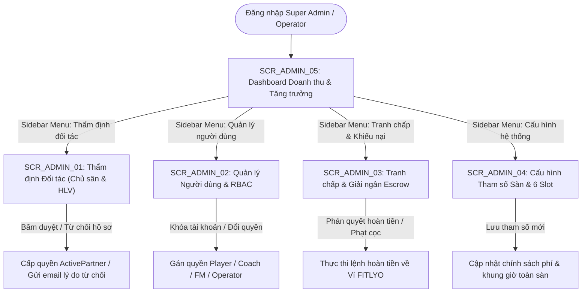

# TÀI LIỆU ĐẶC TẢ CHI TIẾT MÀN HÌNH - PHÂN HỆ QUẢN TRỊ TOÀN SÀN FITLYO (SCR_ADMIN_xx)
**Dự án:** Nền Tảng Thể Thao FITLYO Pickleball (EXE101 - FPT University)  
**Phiên bản:** 2.0  
**Tác giả:** Đội ngũ Phân tích & Thiết kế Giao diện FITLYO  
**Phân hệ:** System Administration & Platform Management (`SCR_ADMIN_xx`)  
**Ngày cập nhật:** 14/10/2026  
**Môi trường áp dụng:** Web App Desktop Admin Portal (Màn hình chuẩn 1440px / 1920px)

---

## MỤC LỤC TÀI LIỆU
1. [TỔNG QUAN KIẾN TRÚC & SƠ ĐỒ ĐIỀU HƯỚNG PHÂN HỆ ADMIN](#1-tổng-quan-kiến-trúc--sơ-đồ-điều-hướng-phân-hệ-admin)
   - 1.1. Vai trò & Mục tiêu quản trị của Phân hệ Admin
   - 1.2. Sơ đồ luồng điều hướng tổng thể (Admin Navigation Flow)
   - 1.3. Bảng danh mục màn hình nhóm SCR_ADMIN_xx
2. [ĐẶC TẢ CHI TIẾT TỪNG MÀN HÌNH](#2-đặc-tả-chi-tiết-từng-màn-hình)
   - 2.1. `SCR_ADMIN_01`: Thẩm định & Phê duyệt Hồ sơ Đối tác (Partner Onboarding & KYC Verification)
   - 2.2. `SCR_ADMIN_02`: Quản lý Người dùng, Phân quyền & Khóa tài khoản (User Management & RBAC Administration)
   - 2.3. `SCR_ADMIN_03`: Xử lý Tranh chấp, Khiếu nại Hủy kèo & Gian lận DUPR (Dispute Resolution & Escrow Settlement)
   - 2.4. `SCR_ADMIN_04`: Cấu hình Tham số Toàn sàn & Khung giờ 6 Slot (Global System Configuration & 6-Slot Policy)
   - 2.5. `SCR_ADMIN_05`: Dashboard Phân tích Doanh thu & Tăng trưởng Toàn sàn (Platform Analytics & Financial Dashboard)
3. [MA TRẬN PHÂN QUYỀN TRÊN GIAO DIỆN ADMIN (RBAC ON UI MATRIX)](#3-ma-trận-phân-quyền-trên-giao-diện-admin)
4. [QUY CHUẨN DESIGN TOKENS & TRẠNG THÁI MÀU SẮC DÀNH CHO ADMIN PORTAL](#4-quy-chuẩn-design-tokens--trạng-thái-màu-sắc)

---

## 1. TỔNG QUAN KIẾN TRÚC & SƠ ĐỒ ĐIỀU HƯỚNG PHÂN HỆ ADMIN

### 1.1. Vai trò & Mục tiêu quản trị của Phân hệ Admin
Phân hệ Quản trị Toàn sàn (`SCR_ADMIN_xx`) là "bộ não kiểm soát và vận hành" của nền tảng FITLYO tại TP. Thủ Đức, đảm bảo an toàn tài chính, pháp lý và tính công bằng thể thao:
1. **Kiểm soát & Thẩm định Đối tác (KYC & Trust):** Thẩm định hồ sơ giấy phép đăng ký kinh doanh của các cụm sân (Field Managers) và chứng chỉ giảng dạy quốc tế (IPTPA / PPR) của các Huấn luyện viên trước khi cho phép hoạt động và nhận tiền trên sàn.
2. **Trọng tài Xử lý Tranh chấp & Ký quỹ (Escrow Arbitration):** Can thiệp và giải quyết các khiếu nại về việc bùng cọc, hủy sân do thời tiết bất khả kháng (mưa ngập sân ngoài trời), hoặc nghi vấn gian lận điểm DUPR (Smurfing / Sandbagging).
3. **Cấu hình Quy chuẩn Tham số Toàn sàn:** Định nghĩa chính sách phí sàn, cấu hình 6 khung giờ 90 phút chuẩn, định mức tỷ lệ Giờ Vàng (Slot 5), và giám sát dòng tiền GMV toàn nền tảng.

---

### 1.2. Sơ đồ luồng điều hướng tổng thể (Admin Navigation Flow)



---

### 1.3. Bảng danh mục màn hình nhóm SCR_ADMIN_xx

| Mã màn hình | Tên màn hình chức năng | Loại giao diện | Điểm vào chính (Entry Point) | Điểm thoát chính (Exit Point) |
| :--- | :--- | :--- | :--- | :--- |
| **`SCR_ADMIN_01`** | Thẩm định & Phê duyệt Hồ sơ Đối tác | Data Table + Split Drawer | Menu `/admin/kyc`, Thông báo hồ sơ mới | Phê duyệt hồ sơ, Yêu cầu bổ sung |
| **`SCR_ADMIN_02`** | Quản lý Người dùng, Phân quyền & Khóa | Data Grid Search & Filter | Menu `/admin/users` | Drawer chi tiết user, Khóa tài khoản |
| **`SCR_ADMIN_03`** | Xử lý Tranh chấp, Hủy kèo & Escrow | Ticket Queue + Evidence Box | Menu `/admin/disputes`, Cảnh báo cọc | Lệnh hoàn cọc, Xử phạt gian lận |
| **`SCR_ADMIN_04`** | Cấu hình Tham số Toàn sàn & 6 Slot | Multi-tab Form / Settings | Menu `/admin/settings` | Lưu cấu hình, Nhật ký kiểm toán |
| **`SCR_ADMIN_05`** | Dashboard Phân tích Doanh thu Sàn | Full Analytics Dashboard | Trang chủ Admin `/admin/dashboard` | Xuất báo cáo tài chính Excel/PDF |

---

## 2. ĐẶC TẢ CHI TIẾT TỪNG MÀN HÌNH

---

### 2.1. `SCR_ADMIN_01`: Thẩm định & Phê duyệt Hồ sơ Đối tác (Partner Onboarding & KYC Verification)

#### 1. Thông tin chung (Overview)
- **Mã màn hình:** `SCR_ADMIN_01`
- **Tên màn hình:** Thẩm định & Phê duyệt Hồ sơ Đối tác (Chủ sân & HLV)
- **Phân hệ:** Quản trị Sàn (`SCR_ADMIN`)
- **Đối tượng sử dụng:** Quản trị viên (Super Admin), Chuyên viên thẩm định đối tác (KYC Specialist).
- **Mục tiêu cốt lõi:** Thẩm định tính pháp lý và năng lực chuyên môn của đơn vị đăng ký mới (Giấy phép kinh doanh, Hợp đồng thuê mặt bằng cụm sân, Bằng HLV IPTPA/PPR, CCCD) để phê duyệt hoặc yêu cầu bổ sung chứng từ.

#### 2. Wireframe Bố cục Giao diện (Layout Wireframe)
```text
+-----------------------------------------------------------------------------------+
| [FITLYO ADMIN PORTAL]   Dashboard   Thẩm định (5)   Người dùng   Tranh chấp (2)   |
+-----------------------------------------------------------------------------------+
| HỒ SƠ CHỜ THẨM ĐỊNH (KYC QUEUE):    [Tất cả loại ▼]  [Tìm tên, SĐT...           (Q)]|
|                                                                                   |
| Mã HS    | Loại đối tác | Tên Đơn vị / Cá nhân  | Ngày nộp   | Trạng thái | Thao tác |
| ---------+--------------+-----------------------+------------+------------+----------|
| #KYC-881 | [Chủ Sân]    | D-Pickleball Thảo Điền| 14/10 09:30| [CHỜ DUYỆT]| [Xem HS] |
| #KYC-882 | [Coach]      | Lê Hoàng Dũng (IPTPA) | 14/10 11:15| [CHỜ DUYỆT]| [Xem HS] |
| #KYC-879 | [Chủ Sân]    | Sân Rackets Hiệp Phú  | 13/10 16:00| [BỔ SUNG]  | [Xem HS] |
+-----------------------------------------------------------------------------------+
| KHUNG CHI TIẾT HỒ SƠ ĐƯỢC CHỌN (#KYC-881 - D-Pickleball Thảo Điền):               |
| - Người đại diện : Nguyễn Văn Đức (CCCD: 07909200xxxx - [Xem ảnh CCCD 2 mặt])      |
| - Giấy phép KD   : GPKD Số 0317892xxx cấp ngày 12/03/2023 [Xem file PDF]         |
| - Địa chỉ cụm sân: 12 Võ Trường Toản, Phường Thảo Điền, TP. Thủ Đức              |
| - Quy mô khai báo: 4 Sân trong nhà | Hệ thống đèn LED 400 Lux | PCCC Đạt chuẩn    |
| - Tài khoản nhận : 190345678888 - Techcombank Thảo Điền (Chủ TK: NGUYEN VAN DUC)   |
|                                                                                   |
| Ghi chú kiểm duyệt: [ Đã kiểm tra thực địa, sân mới sạch sẽ đạt tiêu chuẩn USAPA ]|
|                                                                                   |
| [ YÊU CẦU BỔ SUNG CHỨNG TỪ ]   [ TỪ CHỐI HỒ SƠ ]   [ PHÊ DUYỆT & KÍCH HOẠT SÀN ] |
+-----------------------------------------------------------------------------------+
```

---

### 2.2. `SCR_ADMIN_02`: Quản lý Người dùng, Phân quyền & Khóa tài khoản (User Management & RBAC Administration)

#### 1. Thông tin chung (Overview)
- **Mã màn hình:** `SCR_ADMIN_02`
- **Tên màn hình:** Quản lý Người dùng, Phân quyền & Khóa tài khoản
- **Phân hệ:** Quản trị Sàn (`SCR_ADMIN`)
- **Mục tiêu cốt lõi:** Quản lý toàn bộ danh sách tài khoản trong hệ sinh thái (Người chơi, VIP, Coach, Field Manager, Operator), theo dõi điểm DUPR, số dư ví, điểm uy tín thể thao, và thực thi các biện pháp kỷ luật (cảnh cáo, đóng băng ví, khóa vĩnh viễn tài khoản gian lận).

#### 2. Wireframe Bố cục Giao diện (Layout Wireframe)
```text
+-----------------------------------------------------------------------------------+
| [=] DANH SÁCH NGƯỜI DÙNG TOÀN SÀN: (Tổng cộng: 4,820 tài khoản)                    |
| [ Tìm theo Tên, Email, SĐT, User ID...                          (Q) ] [Xuất Excel]|
| Vai trò: [ Tất cả vai trò ▼ ]  Trạng thái: [ Đang hoạt động ▼ ] DUPR: [ 1.0 - 6.0 ]|
+-----------------------------------------------------------------------------------+
| ID     | Họ và Tên      | Vai trò    | DUPR | Điểm Uy tín | Số dư Ví     | Thao tác |
| -------+----------------+------------+------+-------------+--------------+----------|
| #U1021 | Nguyễn Văn An  | VIP Player | 3.42 | 98/100      | 1.200.000 VNĐ| [Chi tiết|
| #U1045 | Lê Hoàng Dũng  | Coach      | 4.85 | 100/100     | 9.600.000 VNĐ| [Chi tiết|
| #U0988 | Trần Đình Trọng| Player     | 2.10 | 45/100 [!]  | 0 VNĐ        | [KHÓA TK]|
|        | (Bị 3 báo cáo bùng cọc liên tiếp trong tuần qua)                         |
+-----------------------------------------------------------------------------------+
| THAO TÁC XỬ LÝ NHANH USER #U0988:                                                 |
| - Hành động: ( ) Cảnh cáo ( ) Đóng băng Ví Escrow (*) Khóa tài khoản 30 ngày      |
| - Lý do xử phạt: [ Gian lận cọc và bỏ kèo không báo trước 3 trận liên tiếp      ] |
|                                                                                   |
| [ HỦY BỎ ]                                            [ XÁC NHẬN THỰC THI KHÓA ]  |
+-----------------------------------------------------------------------------------+
```

---

### 2.3. `SCR_ADMIN_03`: Xử lý Tranh chấp, Khiếu nại Hủy kèo & Gian lận DUPR (Dispute Resolution & Escrow Settlement)

#### 1. Thông tin chung (Overview)
- **Mã màn hình:** `SCR_ADMIN_03`
- **Tên màn hình:** Xử lý Tranh chấp, Khiếu nại Hủy kèo & Gian lận DUPR
- **Phân hệ:** Quản trị Sàn (`SCR_ADMIN`)
- **Mục tiêu cốt lõi:** Phân xử công bằng các sự cố thực địa (ví dụ: sân bị mưa ướt không thể đấu, đối thủ khai gian DUPR để "bắt nạt" newbie, người chơi no-show bỏ về giữa chừng) và đưa ra quyết định giải ngân tiền ký quỹ Escrow.

#### 2. Wireframe Bố cục Giao diện (Layout Wireframe)
```text
+-----------------------------------------------------------------------------------+
| [=] HÀNG ĐỢI XỬ LÝ TRANH CHẤP KÝ QUỸ (ESCROW DISPUTE QUEUE):                       |
| Mã vụ   | Kèo đấu / Khóa học     | Nguyên đơn     | Bị đơn      | Số tiền | Mức độ |
| --------+------------------------+----------------+-------------+---------+--------|
| #DIS-12 | Kèo #FTL-M26-8891      | Minh Trí       | Văn Hùng    | 45.000đ | [CAO]  |
|         | Lý do: Bị đơn bỏ về giữa Set 1, không chịu cọc tiền sân               |
| #DIS-13 | Đặt sân Cụm An Khánh   | Nguyễn Tuấn    | Chủ Sân AK  | 180.000đ| [TRUNG]|
|         | Lý do: Mưa to sân ngoài trời ngập nước, chủ sân không chịu hoàn cọc    |
+-----------------------------------------------------------------------------------+
| CHI TIẾT VỤ TRANH CHẤP #DIS-13 (Mưa bão ngập sân ngoài trời):                     |
| - Bằng chứng đính kèm : 2 Ảnh chụp sân ngập nước lúc 18:35 + Video đối soát tiếp tân|
| - Quy chế sàn FITLYO  : Sự kiện thời tiết bất khả kháng -> Hoàn 100% tiền cho khách|
| - Đề xuất phán quyết  : Hoàn 180.000đ về Ví người chơi; Trợ giá bảo trì 50k cho sân|
|                                                                                   |
| [ RA PHÁN QUYẾT: HOÀN TIỀN 100% CHO USER ]      [ CHUYỂN BAN PHÁP LÝ XEM XÉT ]   |
+-----------------------------------------------------------------------------------+
```

---

### 2.4. `SCR_ADMIN_04`: Cấu hình Tham số Toàn sàn & Khung giờ 6 Slot (Global System Configuration & 6-Slot Policy)

#### 1. Thông tin chung (Overview)
- **Mã màn hình:** `SCR_ADMIN_04`
- **Tên màn hình:** Cấu hình Tham số Toàn sàn & Khung giờ 6 Slot
- **Phân hệ:** Quản trị Sàn (`SCR_ADMIN`)
- **Mục tiêu cốt lõi:** Cung cấp giao diện cấu hình tập trung các quy chuẩn vận hành cốt lõi của FITLYO: Định nghĩa giờ bắt đầu và kết thúc của 6 Slot 90 phút, thiết lập tỷ lệ chiết khấu hoa hồng sàn (Commission Fees), mức cọc tối thiểu cho từng thể thức, và ngưỡng cảnh báo DUPR.

#### 2. Wireframe Bố cục Giao diện (Layout Wireframe)
```text
+-----------------------------------------------------------------------------------+
| [=] CẤU HÌNH THAM SỐ VẬN HÀNH TOÀN SÀN                                            |
+-----------------------------------------------------------------------------------+
| 1. QUY CHUẨN 6 KHUNG GIỜ 90 PHÚT CHUẨN TOÀN BỘ CỤM SÂN:                           |
| - Slot 1: [ 06:00 ] đến [ 07:30 ]   - Slot 4: [ 15:30 ] đến [ 17:00 ]             |
| - Slot 2: [ 07:30 ] đến [ 09:00 ]   - Slot 5: [ 18:30 ] đến [ 20:00 ] [* GIỜ VÀNG]|
| - Slot 3: [ 09:00 ] đến [ 10:30 ]   - Slot 6: [ 20:00 ] đến [ 21:30 ]             |
| Thời gian dọn dẹp giữa các ca: [ 15 phút ] (17:00 - 17:15, v.v.)                  |
|                                                                                   |
| 2. CHÍNH SÁCH PHÍ HOA HỒNG SÀN (COMMISSION RATES):                                |
| - Phí sàn trên Kèo Social Ghép Trận : [ 5.0 ] % trên tổng tiền sân                |
| - Phí sàn trên Khóa học của Coach   : [ 10.0 ] % trên học phí khóa                |
| - Phí sàn trên Gói Hội viên VIP     : [ 0.0 ] % (Thu trọn gói 99k/tháng)          |
|                                                                                   |
| 3. QUY ĐỊNH BẢO VỆ KÝ QUỸ ESCROW:                                                 |
| - Mốc thời gian được phép hủy hoàn 100% cọc: [ 6.0 ] Tiếng trước giờ thi đấu      |
| - Tỷ lệ tiền phạt bùng cọc chia cho bạn chơi trên sân: [ 100.0 ] %                |
|                                                                                   |
| [ KHÔI PHỤC MẶC ĐỊNH ]                              [ LƯU CẤU HÌNH TOÀN SÀN ]     |
+-----------------------------------------------------------------------------------+
```

---

### 2.5. `SCR_ADMIN_05`: Dashboard Phân tích Doanh thu & Tăng trưởng Toàn sàn (Platform Analytics & Financial Dashboard)

#### 1. Thông tin chung (Overview)
- **Mã màn hình:** `SCR_ADMIN_05`
- **Tên màn hình:** Dashboard Phân tích Doanh thu & Tăng trưởng Toàn sàn
- **Phân hệ:** Quản trị Sàn (`SCR_ADMIN`)
- **Mục tiêu cốt lõi:** Theo dõi các chỉ số tài chính và tăng trưởng theo thời gian thực (Tổng khối lượng giao dịch GMV, Doanh thu hoa hồng sàn thực thu, Tỷ lệ lấp đầy sân bình quân toàn TP. Thủ Đức, Tỷ lệ người dùng nâng cấp VIP).

#### 2. Wireframe Bố cục Giao diện (Layout Wireframe)
```text
+-----------------------------------------------------------------------------------+
| [=] FITLYO EXECUTIVE DASHBOARD                         [ < Tháng 10/2026 > ]       |
+-----------------------------------------------------------------------------------+
| TỔNG GIÁ TRỊ GIAO DỊCH (GMV):   DOANH THU HOA HỒNG SÀN:   HỘI VIÊN VIP ĐANG ACTIVE:|
| 1.840.000.000 VNĐ (+18.4%)      142.500.000 VNĐ           412 Hội viên (36.8tr)    |
|                                                                                   |
| TỶ LỆ LẤP ĐẦY 6 SLOT TOÀN TP. THỦ ĐỨC:                                            |
| [ Slot 1: 52% ] [ Slot 2: 68% ] [ Slot 3: 41% ] [ Slot 4: 64% ] [ Slot 5 VÀNG: 98% ]|
|                                                                                   |
| BIỂU ĐỒ TĂNG TRƯỞNG KÈO ĐẤU DUPR & SỐ TRẬN THÀNH CÔNG THEO NGÀY:                  |
| (1,240 Trận hoàn tất tuần qua | Tỉ lệ tranh chấp bùng cọc: chỉ 0.42% nhờ Escrow)  |
|                                                                                   |
| [ XUẤT BÁO CÁO TÀI CHÍNH KIỂM TOÁN (EXCEL / PDF) ]                                |
+-----------------------------------------------------------------------------------+
```

---

## 3. MA TRẬN PHÂN QUYỀN TRÊN GIAO DIỆN ADMIN (RBAC ON UI MATRIX)

| Hành động trên Giao diện | Super Admin | Vận hành (Operator) | Hỗ trợ (Customer Support) |
| :--- | :---: | :---: | :---: |
| Phê duyệt hồ sơ Đối tác (`SCR_ADMIN_01`) | Toàn quyền | Xem & Đề xuất | Chỉ xem |
| Khóa tài khoản / Đổi quyền (`SCR_ADMIN_02`)| Toàn quyền | Khóa tạm thời 7 ngày | Chỉ xem |
| Phán quyết Tranh chấp Escrow (`SCR_ADMIN_03`)| Toàn quyền duyệt hoàn tiền | Phân loại & Tổng hợp bằng chứng | Tiếp nhận đơn |
| Sửa tham số sàn 6 Slot (`SCR_ADMIN_04`) | Toàn quyền cấu hình | Không thể sửa | Không thể sửa |
| Xem Dashboard Doanh thu (`SCR_ADMIN_05`) | Xem chi tiết số liệu | Xem KPI vận hành | Không truy cập |

---

## 4. QUY CHUẨN DESIGN TOKENS & TRẠNG THÁI MÀU SẮC DÀNH CHO ADMIN PORTAL

- **Admin Dark Slate Theme:** `#0F172A` (Slate-900) & `#1E293B` (Slate-800) - Giao diện chuyên nghiệp cho quản trị viên.
- **Escrow Settlement Emerald:** `#059669` (Emerald-600) - Lệnh hoàn tiền / giải ngân thành công.
- **Dispute Warning Rose:** `#E11D48` (Rose-600) - Vụ tranh chấp khẩn cấp, tài khoản bị báo cáo gian lận.
- **System Config Purple:** `#7C3AED` (Purple-600) - Các tham số hệ thống và phân quyền cốt lõi.
