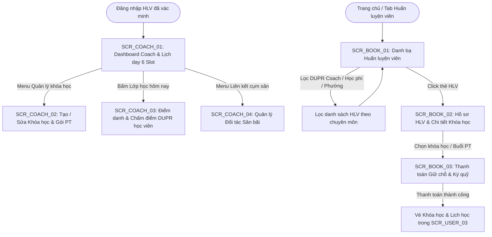
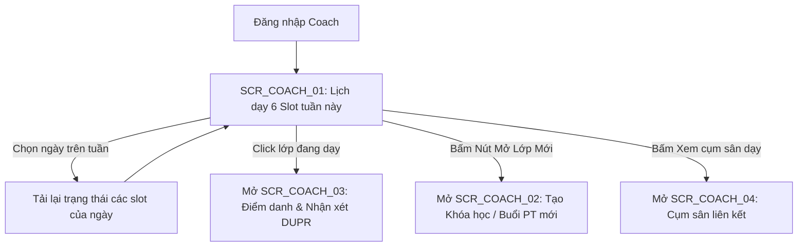

# TÀI LIỆU ĐẶC TẢ CHI TIẾT MÀN HÌNH - PHÂN HỆ HUẤN LUYỆN VIÊN & ĐẶT LỊCH HỌC (SCR_COACH_xx & SCR_BOOK_xx)
**Dự án:** Nền Tảng Thể Thao FITLYO Pickleball (EXE101 - FPT University)  
**Phiên bản:** 2.0  
**Tác giả:** Đội ngũ Phân tích & Thiết kế Giao diện FITLYO  
**Phân hệ:** Coach Portal & PT / Course Booking (`SCR_COACH_xx` & `SCR_BOOK_xx`)  
**Ngày cập nhật:** 14/10/2026  
**Môi trường áp dụng:** Web App Coach Dashboard (Desktop 1280px+) & Mobile Web Booking (Responsive 375px - 430px)

---

## MỤC LỤC TÀI LIỆU
1. [TỔNG QUAN KIẾN TRÚC & SƠ ĐỒ ĐIỀU HƯỚNG PHÂN HỆ COACH](#1-tổng-quan-kiến-trúc--sơ-đồ-điều-hướng-phân-hệ-coach)
   - 1.1. Vai trò & Mục tiêu kinh doanh của Phân hệ Huấn luyện viên
   - 1.2. Sơ đồ luồng điều hướng tổng thể (Coach & Booking Navigation Flow)
   - 1.3. Bảng danh mục màn hình nhóm SCR_COACH_xx & SCR_BOOK_xx
2. [ĐẶC TẢ CHI TIẾT NHÓM MÀN HÌNH COACH PORTAL (SCR_COACH_xx)](#2-đặc-tả-chi-tiết-nhóm-màn-hình-coach-portal)
   - 2.1. `SCR_COACH_01`: Dashboard Tổng quan Coach & Lịch dạy Cá nhân (Coach Portal Dashboard & Teaching Schedule)
   - 2.2. `SCR_COACH_02`: Quản lý & Thiết lập Khóa học / Buổi tập PT 1-1 (Course & PT Package Management)
   - 2.3. `SCR_COACH_03`: Điểm danh Học viên & Nhập Đánh giá DUPR Khóa học (Attendance & Student DUPR Assessment)
   - 2.4. `SCR_COACH_04`: Quản lý Yêu cầu Liên kết Cụm sân (Venue Affiliation Requests & Partnerships)
3. [ĐẶC TẢ CHI TIẾT NHÓM MÀN HÌNH ĐẶT LỊCH COACH (SCR_BOOK_xx)](#3-đặc-tả-chi-tiết-nhóm-màn-hình-đặt-lịch-coach)
   - 3.1. `SCR_BOOK_01`: Danh bạ Tìm kiếm Huấn luyện viên & Lọc Chuyên môn (Coach Marketplace & Discovery)
   - 3.2. `SCR_BOOK_02`: Hồ sơ Huấn luyện viên, Đánh giá & Danh mục Khóa học (Coach Public Profile & Course Catalog)
   - 3.3. `SCR_BOOK_03`: Đặt lịch Học & Thanh toán Giữ chỗ Khóa học (Coach Booking Checkout & Escrow Payment)
4. [MA TRẬN PHÂN QUYỀN TRÊN GIAO DIỆN PHÂN HỆ COACH & BOOK (RBAC ON UI MATRIX)](#4-ma-trận-phân-quyền-trên-giao-diện)
5. [QUY CHUẨN DESIGN TOKENS & TRẠNG THÁI MÀU SẮC](#5-quy-chuẩn-design-tokens--trạng-thái-màu-sắc)

---

## 1. TỔNG QUAN KIẾN TRÚC & SƠ ĐỒ ĐIỀU HƯỚNG PHÂN HỆ COACH

### 1.1. Vai trò & Mục tiêu kinh doanh của Phân hệ Huấn luyện viên
Phân hệ Huấn luyện viên (Coach Portal & Booking) kết nối trực tiếp nguồn nhân lực đào tạo chất lượng cao với cộng đồng người chơi phong trào đang có nhu cầu chuẩn hóa kỹ năng và nâng hạng DUPR:
1. **Chuẩn hóa Khóa học & Lộ trình DUPR:** Cung cấp công cụ cho Coach xây dựng các gói khóa học bài bản (Newbie 2.0 -> 3.0, Kỹ thuật Dinking nâng cao 3.5+, Chiến thuật Đôi nam nữ).
2. **Khớp nối Lịch dạy vào 6 Slot Chuẩn:** Lịch dạy của HLV được tự động lồng ghép vào 6 slot 90 phút tại các cụm sân đối tác đã được liên kết phê duyệt, tránh trùng lặp sân và tối ưu hóa chi phí thuê mặt bằng.
3. **Thanh toán Ký quỹ Học phí (Escrow Course Fees):** Học phí được bảo lãnh trên hệ thống FITLYO; HLV được đối soát nhận thanh toán theo tiến độ hoàn thành các buổi dạy và sau khi hoàn tất khảo thí DUPR kết khóa cho học viên.

---

### 1.2. Sơ đồ luồng điều hướng tổng thể (Coach & Booking Navigation Flow)



---

### 1.3. Bảng danh mục màn hình nhóm SCR_COACH_xx & SCR_BOOK_xx

| Mã màn hình | Tên màn hình chức năng | Loại giao diện | Điểm vào chính (Entry Point) | Điểm thoát chính (Exit Point) |
| :--- | :--- | :--- | :--- | :--- |
| **`SCR_COACH_01`** | Dashboard Coach & Lịch dạy Cá nhân | Full Page Desktop/Tablet | Đăng nhập Coach, Menu `/coach/schedule` | `SCR_COACH_02`, `SCR_COACH_03`, Báo cáo thu nhập |
| **`SCR_COACH_02`** | Quản lý & Thiết lập Khóa học / Buổi PT | Multi-tab Form / Modal | Menu `/coach/courses`, Nút "Tạo khóa mới" | Lưu khóa học, Đẩy lên Danh bạ `SCR_BOOK_01` |
| **`SCR_COACH_03`** | Điểm danh Học viên & Đánh giá DUPR | Interactive Sheet / Page | Click lớp học trên Lịch `SCR_COACH_01` | Xác nhận hoàn thành buổi học, Cập nhật DUPR |
| **`SCR_COACH_04`** | Quản lý Yêu cầu Liên kết Cụm sân | Data Grid / Split View | Menu `/coach/venues` | Gửi yêu cầu liên kết đến FM, Cấu hình chiết khấu |
| **`SCR_BOOK_01`** | Danh bạ HLV & Lọc Chuyên môn | Full Page Mobile First | Bottom Nav: Tab "HLV", Search Bar | `SCR_BOOK_02`, Bộ lọc DUPR & Học phí |
| **`SCR_BOOK_02`** | Hồ sơ Huấn luyện viên & Khóa học | Full Page Detail | Click thẻ Coach từ `SCR_BOOK_01` | `SCR_BOOK_03`, Video demo, Đánh giá học viên |
| **`SCR_BOOK_03`** | Đặt lịch Học & Thanh toán Giữ chỗ | Checkout Step Form | Bấm "Đăng ký học" trên `SCR_BOOK_02` | Vé lớp học, Lịch hoạt động `SCR_USER_03` |

---

## 2. ĐẶC TẢ CHI TIẾT NHÓM MÀN HÌNH COACH PORTAL (SCR_COACH_xx)

---

### 2.1. `SCR_COACH_01`: Dashboard Tổng quan Coach & Lịch dạy Cá nhân (Coach Portal Dashboard & Teaching Schedule)

#### 1. Thông tin chung (Overview)
- **Mã màn hình:** `SCR_COACH_01`
- **Tên màn hình:** Dashboard Tổng quan Coach & Lịch dạy Cá nhân
- **Phân hệ:** Huấn Luyện Viên (`SCR_COACH`)
- **Đối tượng sử dụng:** Huấn luyện viên đã được xác thực bằng cấp IPTPA / PPR / DUPR Certified (`ActiveCoach`).
- **Mục tiêu cốt lõi:** Cho phép HLV quản lý toàn bộ 6 khung giờ dạy học mỗi ngày, theo dõi sĩ số học viên từng lớp, trạng thái điểm danh và tổng doanh thu tạm giữ ký quỹ trong tháng.

#### 2. Sơ đồ luồng màn hình (Screen Flow)


#### 3. Wireframe Bố cục Giao diện (Layout Wireframe)
```text
+-----------------------------------------------------------------------------------+
| [FITLYO COACH]  Trang chủ   Lịch dạy   Khóa học   Học viên   Cụm sân   [@ HLV Dũng]  |
+-----------------------------------------------------------------------------------+
| DASHBOARD HUẤN LUYỆN VIÊN: LÊ HOÀNG DŨNG (DUPR: 4.85 - Chứng chỉ IPTPA Level 2)    |
| [ Thống kê nhanh tháng 10: 18 Buổi dạy | 24 Học viên | Tạm giữ Escrow: 14.200.000đ ]|
+-----------------------------------------------------------------------------------+
| LỊCH DẠY THEO TUẦN: [< Tuần 42: 12/10 - 18/10/2026 >]   [+ TẠO LỚP DẠY MỚI]        |
|                                                                                   |
| Khung Giờ 6 Slot       | Thứ 4 (14/10) - Hôm nay         | Thứ 5 (15/10) - Ngày mai |
| -----------------------+---------------------------------+--------------------------|
| Slot 1: 06:00 - 07:30  | [TRỐNG - Chưa có lịch]          | [LỚP CƠ BẢN NEWBIE 2.0]  |
|                        | (Bấm để mở buổi PT 1-1)         | Sân D-Thảo Điền (4/4 HV) |
| -----------------------+---------------------------------+--------------------------|
| Slot 2: 07:30 - 09:00  | [PT 1-1 NÂNG CAO DINKING]       | [TRỐNG - Nhận lịch PT]   |
|                        | Học viên: Trần Bảo (Sân 01)     |                          |
| -----------------------+---------------------------------+--------------------------|
| Slot 3: 09:00 - 10:30  | [NGHỈ NGƠI - Khóa lịch]         | [NGHỈ NGƠI - Khóa lịch]  |
| -----------------------+---------------------------------+--------------------------|
| Slot 4: 15:30 - 17:00  | [LỚP CHIẾN THUẬT ĐÔI 3.0+]      | [LỚP CHIẾN THUẬT ĐÔI]    |
|                        | Sân Saigon Rackets (4/4 HV)     | (2/4 Học viên đã cọc)    |
| -----------------------+---------------------------------+--------------------------|
| Slot 5: 18:30 - 20:00  | [GIỜ VÀNG - LỚP DUPR 3.5 BOOT]  | [GIỜ VÀNG - PT VIP]      |
| [KHUNG GIỜ VÀNG]       | Sân D-Thảo Điền - Đang diễn ra  | Đã đặt cọc 100%          |
|                        | [ > BẤM VÀO ĐIỂM DANH & CHẤM ]  |                          |
| -----------------------+---------------------------------+--------------------------|
| Slot 6: 20:00 - 21:30  | [TRỐNG - Nhận ghép lịch]        | [TRỐNG]                  |
+-----------------------------------------------------------------------------------+
```

#### 4. Bảng Đặc tả Thành phần Giao diện (Component & Field Specs)

| Mã Thành phần | Tên Thành phần | Loại Control | Dữ liệu / Định dạng | Ràng buộc Nghiệp vụ & Tương tác |
| :--- | :--- | :--- | :--- | :--- |
| `C01_STATS_BAR` | Thanh chỉ số tháng | KPI Metrics Row | Doanh thu, số giờ dạy | Đồng bộ dữ liệu Escrow theo thời gian thực. |
| `C01_WEEK_NAV` | Bộ chọn tuần dạy | Navigation Buttons | Chuỗi tuần: `Tuần xx` | Cho phép xem lịch dạy trước 4 tuần và quá khứ. |
| `C01_SLOT_CELL` | Ô khung giờ dạy học | Matrix Calendar Cell | Trạng thái: Empty, Busy, Active | Click ô bận mở chi tiết lớp; Click ô trống mở modal set lịch. |
| `C01_GOLD_BADGE` | Nhãn Slot 5 Giờ Vàng | Highlight Tag | Amber Badge | Giúp HLV ưu tiên xếp các gói huấn luyện VIP hoặc lớp đông. |
| `C01_ROLLCALL_BTN`| Nút điểm danh nhanh | Secondary Action | Direct Link | Kích hoạt khi khung giờ slot bắt đầu trong vòng 30 phút. |

#### 5. Ma trận 5 Trạng thái Giao diện (5 UI States Matrix)
1. **Normal (Bình thường):** Hiển thị lịch tuần đầy đủ với các ô màu tương ứng: Xanh lá (Lớp đông đủ học viên), Xanh dương (PT 1-1), Vàng (Slot 5 Giờ Vàng), Xám (Trống).
2. **Empty Week (Tuần trống):** HLV chưa xếp lịch dạy. Hiển thị thông báo: *"Tuần này bạn chưa có buổi dạy nào. Hãy công bố lịch để học viên đăng ký!"*.
3. **Loading:** Skeleton Grid hiển thị mờ trong lúc tải dữ liệu lịch.
4. **Error:** Báo lỗi nếu cụm sân liên kết bị ngắt kết nối hoặc mất mạng.
5. **Conflict Alert:** Nếu HLV nhận 2 lịch trùng trong 1 slot: Hệ thống nhấp nháy đỏ ô slot và hiện nút giải quyết xung đột.

---

### 2.2. `SCR_COACH_02`: Quản lý & Thiết lập Khóa học / Buổi tập PT 1-1 (Course & PT Package Management)

#### 1. Thông tin chung (Overview)
- **Mã màn hình:** `SCR_COACH_02`
- **Tên màn hình:** Quản lý & Thiết lập Khóa học / Buổi tập PT 1-1
- **Phân hệ:** Huấn Luyện Viên (`SCR_COACH`)
- **Mục tiêu cốt lõi:** Cho phép HLV cấu hình tên khóa học, mô tả kỹ năng đạt được, mức DUPR đầu vào và cam kết đầu ra (ví dụ: Tăng tối thiểu +0.50 DUPR), số lượng học viên tối đa (1-1 hoặc Nhóm 4 người), và học phí khóa học.

#### 2. Wireframe Bố cục Giao diện (Layout Wireframe)
```text
+-------------------------------------------------------------------+
| [< Quay lại Dashboard]       THIẾT LẬP KHÓA HỌC MỚI                |
+-------------------------------------------------------------------+
| 1. THÔNG TIN KHÓA HỌC:                                            |
| Tên khóa học (*): [ Khóa Boot Camp Pickleball - Bứt Phá DUPR 3.5 ] |
| Loại hình đào tạo: ( ) PT Cá nhân 1-1   (*) Lớp Nhóm (Tối đa 4 HV)|
|                                                                   |
| 2. MỤC TIÊU DUPR & ĐỐI TƯỢNG:                                     |
| DUPR Đầu vào yêu cầu : [ 2.50 - 3.00 ▼ ]                           |
| DUPR Cam kết đầu ra  : [ 3.50+ ▼ ]                                 |
| Số lượng buổi học    : [ 8 buổi ] (Mỗi buổi chuẩn 90 phút theo Slot)|
|                                                                   |
| 3. ĐỊA ĐIỂM SÂN DẠY LIÊN KẾT:                                     |
| Chọn Cụm Sân (*): [ Cụm D-Pickleball Thảo Điền (Đã liên kết) ▼ ]  |
| Khung giờ cố định: [*] Slot 4 (15:30)  [*] Slot 5 (18:30 Giờ Vàng)|
|                                                                   |
| 4. HỌC PHÍ & CHÍNH SÁCH ESCROW:                                   |
| Học phí trọn khóa / học viên: [ 2.400.000 ] VNĐ                   |
| (Đã bao gồm: Tiền thuê sân 8 buổi + Bóng tập + Giáo trình)         |
| Thu nhập dự kiến sau khi trừ phí sàn 10%: 2.160.000 VNĐ / học viên|
|                                                                   |
| [ HỦY BỎ ]                          [ CÔNG BỐ KHÓA HỌC LÊN SÀN ]  |
+-------------------------------------------------------------------+
```

#### 3. Bảng Đặc tả Thành phần Giao diện (Component & Field Specs)

| Mã Thành phần | Tên Thành phần | Loại Control | Dữ liệu / Định dạng | Ràng buộc Nghiệp vụ & Tương tác |
| :--- | :--- | :--- | :--- | :--- |
| `C02_TITLE_INPUT` | Tên khóa học | Text Input | Chuỗi 10 - 100 ký tự | Bắt buộc nhập. Nêu rõ kỹ năng trọng tâm. |
| `C02_TYPE_RADIO` | Loại hình đào tạo | Radio Group | `PT_1ON1`, `GROUP_4` | Lớp nhóm cố định 4 học viên để khớp mô hình 1 sân. |
| `C02_DUPR_IN` | DUPR đầu vào | Select Dropdown | 2.0, 2.5, 3.0, 3.5 | Lọc học viên đăng ký trên `SCR_BOOK_03`. |
| `C02_DUPR_OUT` | DUPR cam kết ra | Select Dropdown | DUPR cao hơn đầu vào | Cam kết tiến bộ để học viên tin cậy ký quỹ. |
| `C02_VENUE_SELECT`| Chọn cụm sân dạy | Dropdown Select | Danh sách sân đã duyệt | Chỉ chọn các sân đã duyệt liên kết tại `SCR_COACH_04`. |
| `C02_FEE_INPUT` | Học phí khóa học | Currency Input | Số nguyên VNĐ | Tự động tính tiền thực nhận sau phí sàn 10%. |
| `C02_SUBMIT_BTN` | Nút công bố khóa | Primary Button | Action Trigger | Kiểm tra hợp lệ -> Đẩy khóa học lên `SCR_BOOK_01`. |

---

### 2.3. `SCR_COACH_03`: Điểm danh Học viên & Nhập Đánh giá DUPR Khóa học (Attendance & Student DUPR Assessment)

#### 1. Thông tin chung (Overview)
- **Mã màn hình:** `SCR_COACH_03`
- **Tên màn hình:** Điểm danh Học viên & Nhập Đánh giá DUPR Khóa học
- **Phân hệ:** Huấn Luyện Viên (`SCR_COACH`)
- **Mục tiêu cốt lõi:** Cho phép HLV thực hiện điểm danh từng buổi dạy (Check-in), chấm điểm kỹ thuật từng bài tập (Serve, Third Shot Drop, Dinking Rally), và nhập đánh giá khảo thí DUPR chính thức khi kết thúc khóa học để cấp chứng chỉ hoàn thành trên hồ sơ học viên.

#### 2. Wireframe Bố cục Giao diện (Layout Wireframe)
```text
+-------------------------------------------------------------------+
| [< Danh sách buổi dạy]     ĐIỂM DANH & ĐÁNH GIÁ HỌC VIÊN          |
+-------------------------------------------------------------------+
| LỚP: Bứt Phá DUPR 3.5 | Buổi 8/8 (Khảo thí tốt nghiệp & Chấm DUPR) |
| Sân: Sân 02 - D-Pickleball Thảo Điền | Slot 5 (18:30 - 20:00)      |
+-------------------------------------------------------------------+
| DANH SÁCH 4 HỌC VIÊN:                                             |
|                                                                   |
| 1. Học viên: Trần Bảo (DUPR khởi điểm: 2.75)                      |
|    - Điểm danh: [*] Có mặt   [ ] Vắng mặt                         |
|    - Đánh giá kỹ thuật: Giao bóng: 8/10 | Drop shot: 8.5/10       |
|    - DUPR Tốt nghiệp cấp mới: [ 3.45 ] [x] Đạt cam kết đầu ra     |
|    - Nhận xét: "Bộ chân di chuyển thanh thoát, kiểm soát bóng tốt"|
|                                                                   |
| 2. Học viên: Nguyễn Hoàng Nam (DUPR khởi điểm: 2.80)              |
|    - Điểm danh: [*] Có mặt   [ ] Vắng mặt                         |
|    - Đánh giá kỹ thuật: Giao bóng: 7.5/10 | Drop shot: 8.0/10     |
|    - DUPR Tốt nghiệp cấp mới: [ 3.35 ] [x] Đạt cam kết đầu ra     |
|    - Nhận xét: "Cần cải thiện tốc độ phản xạ trên lưới"          |
|                                                                   |
| 3. Học viên: Lê Thu Trang (DUPR: 2.65) -> Điểm danh: Có mặt (3.20)|
| 4. Học viên: Phạm Quốc Huy (DUPR: 2.90) -> Điểm danh: Có mặt (3.50)|
+-------------------------------------------------------------------+
| [XÁC NHẬN KẾT THÚC KHÓA HỌC & GIẢI NGÂN HỌC PHÍ ESCROW (9.600.000đ)]|
+-------------------------------------------------------------------+
```

#### 3. Bảng Đặc tả Thành phần Giao diện (Component & Field Specs)

| Mã Thành phần | Tên Thành phần | Loại Control | Dữ liệu / Định dạng | Ràng buộc Nghiệp vụ & Tương tác |
| :--- | :--- | :--- | :--- | :--- |
| `C03_ATTEND_TOGGLE`| Công tắc điểm danh | Checkbox / Switch | Boolean: Present/Absent | Phải điểm danh trước khi mở ô chấm điểm DUPR. |
| `C03_DUPR_SCORE` | Ô nhập DUPR cấp mới | Number Input | Float: 1.00 - 6.00 | Giới hạn theo dải thẩm quyền chứng chỉ của Coach. |
| `C03_FEEDBACK` | Nhận xét chi tiết | Textarea | Tối đa 250 ký tự | Lời phê của Coach hiển thị trực tiếp trên Profile học viên. |
| `C03_DISBURSE_BTN`| Nút giải ngân học phí | Primary Green Button | Action Trigger | Kích hoạt hệ thống Escrow chuyển tiền về ví Coach. |

---

### 2.4. `SCR_COACH_04`: Quản lý Yêu cầu Liên kết Cụm sân (Venue Affiliation Requests & Partnerships)

#### 1. Thông tin chung (Overview)
- **Mã màn hình:** `SCR_COACH_04`
- **Tên màn hình:** Quản lý Yêu cầu Liên kết Cụm sân
- **Phân hệ:** Huấn Luyện Viên (`SCR_COACH`)
- **Mục tiêu cốt lõi:** Cho phép HLV gửi hồ sơ chứng chỉ và đề xuất liên kết giảng dạy đến các cụm sân đối tác tại TP. Thủ Đức, thỏa thuận mức chiết khấu tiền sân (ví dụ sân chiết khấu 15% cho HLV mở lớp), và theo dõi trạng thái phê duyệt từ Field Manager.

#### 2. Wireframe Bố cục Giao diện (Layout Wireframe)
```text
+-------------------------------------------------------------------+
| [=] FITLYO COACH            QUẢN LÝ LIÊN KẾT CỤM SÂN               |
+-------------------------------------------------------------------+
| DANH SÁCH CỤM SÂN ĐÃ LIÊN KẾT:                                    |
| +---------------------------------------------------------------+ |
| | Cụm Sân: D-Pickleball Thảo Điền (12 Võ Trường Toản, Q.2 cũ)   | |
| | Trạng thái: [ ĐÃ PHÊ DUYỆT - ĐANG HOẠT ĐỘNG ]                 | |
| | Chính sách ưu đãi sân: Giảm 15% giờ thường | Giảm 10% Giờ Vàng| |
| | Số lớp đang mở tại sân: 3 Lớp nhóm & 2 Buổi PT 1-1            | |
| | [ Xem chi tiết thỏa thuận ]              [ Đóng liên kết ]    | |
| +---------------------------------------------------------------+ |
|                                                                   |
| TÌM CỤM SÂN MỚI & GỬI YÊU CẦU LIÊN KẾT:                           |
| [ Tìm theo tên sân hoặc phường: Hiệp Phú, An Khánh...         (Q) ]|
|                                                                   |
| +---------------------------------------------------------------+ |
| | Cụm Sân: Saigon Rackets Hiệp Phú (Khu Công Nghệ Cao)          | |
| | Quy mô: 6 Sân thi đấu chuẩn quốc tế                           | |
| | [ GỬI HỒ SƠ YÊU CẦU LIÊN KẾT DẠY HỌC (KÈM BẰNG IPTPA) ]      | |
| +---------------------------------------------------------------+ |
+-------------------------------------------------------------------+
```

---

## 3. ĐẶC TẢ CHI TIẾT NHÓM MÀN HÌNH ĐẶT LỊCH COACH (SCR_BOOK_xx)

---

### 3.1. `SCR_BOOK_01`: Danh bạ Tìm kiếm Huấn luyện viên & Lọc Chuyên môn (Coach Marketplace & Discovery)

#### 1. Thông tin chung (Overview)
- **Mã màn hình:** `SCR_BOOK_01`
- **Tên màn hình:** Danh bạ Tìm kiếm Huấn luyện viên & Lọc Chuyên môn
- **Phân hệ:** Đặt lịch Học Huấn Luyện Viên (`SCR_BOOK`)
- **Đối tượng sử dụng:** Tất cả người chơi Pickleball tìm kiếm HLV cá nhân hoặc lớp học nhóm.
- **Mục tiêu cốt lõi:** Cung cấp thị trường HLV minh bạch với điểm DUPR thực, chứng chỉ quốc tế được kiểm duyệt, đánh giá từ học viên cũ, và học phí theo buổi hoặc trọn gói.

#### 2. Wireframe Bố cục Giao diện (Layout Wireframe)
```text
+-------------------------------------------------------------+
| [=] FITLYO COACHES                  (Q) Tìm tên HLV         |
+-------------------------------------------------------------+
| BỘ LỌC CHUYÊN MÔN:                                          |
| Trình độ HLV: [ DUPR 4.0+ ▼ ]   Chứng chỉ: [ IPTPA / PPR ▼ ]|
| Khu vực     : [ Thảo Điền, An Phú ▼ ]   Học phí: [ Dưới 500k/buổi ▼]|
| Hình thức   : [*] PT 1-1       [*] Lớp Nhóm (Tối đa 4 người)|
+-------------------------------------------------------------+
| TÌM THẤY 12 HUẤN LUYỆN VIÊN ĐẠT CHUẨN:                      |
|                                                             |
| +---------------------------------------------------------+ |
| | (Avatar) HLV LÊ HOÀNG DŨNG             [DUPR 4.85] [VIP]| |
| | Chứng chỉ: IPTPA Level 2 | 6 năm kinh nghiệm            | |
| | Đánh giá : ★★★★★ (4.9/5 - 86 học viên)                  | |
| | Cụm sân  : D-Pickleball Thảo Điền & Rackets Hiệp Phú    | |
| | Học phí  : Từ 350.000đ / buổi (PT 1-1)                  | |
| | Khóa hot : Boot Camp Nâng Hạng DUPR 3.5 (8 buổi)        | |
| | [Xem hồ sơ & Lịch dạy]             [ ĐẶT LỊCH HỌC NGAY ]| |
| +---------------------------------------------------------+ |
|                                                             |
| +---------------------------------------------------------+ |
| | (Avatar) HLV NGUYỄN MINH ANH           [DUPR 4.30]      | |
| | Chứng chỉ: PPR Certified Coach                          | |
| | Chuyên   : Kỹ thuật căn bản Newbie & Kiểm soát Dinking  | |
| | Đánh giá : ★★★★★ (4.8/5 - 42 học viên)                  | |
| | Học phí  : Từ 280.000đ / buổi                            | |
| | [Xem hồ sơ & Lịch dạy]             [ ĐẶT LỊCH HỌC NGAY ]| |
| +---------------------------------------------------------+ |
+-------------------------------------------------------------+
```

---

### 3.2. `SCR_BOOK_02`: Hồ sơ Huấn luyện viên, Đánh giá & Danh mục Khóa học (Coach Public Profile & Course Catalog)

#### 1. Thông tin chung (Overview)
- **Mã màn hình:** `SCR_BOOK_02`
- **Tên màn hình:** Hồ sơ Huấn luyện viên, Đánh giá & Danh mục Khóa học
- **Phân hệ:** Đặt lịch Học Huấn Luyện Viên (`SCR_BOOK`)
- **Điểm vào:** Click vào bất kỳ Coach card nào từ `SCR_BOOK_01`.
- **Mục tiêu cốt lõi:** Trưng bày uy tín của HLV (bằng cấp, video bài giảng mẫu, đánh giá của học viên đã tăng DUPR) và danh mục các khóa học đang mở đăng ký.

#### 2. Wireframe Bố cục Giao diện (Layout Wireframe)
```text
+-------------------------------------------------------------+
| [< Quay lại]            HỒ SƠ HUẤN LUYỆN VIÊN       [Chia sẻ] |
+-------------------------------------------------------------+
| (AVATAR HD) LÊ HOÀNG DŨNG                  [TÍCH XANH IPTPA] |
| Điểm DUPR thi đấu: 4.85 | Huấn luyện viên chuyên nghiệp     |
| Đánh giá tổng quan: ★★★★★ 4.9 (86 lượt đánh giá từ học viên)|
| Khu vực dạy chính : Thảo Điền, An Phú (TP. Thủ Đức)         |
+-------------------------------------------------------------+
| [ Giới thiệu ]  [ Khóa học (3) ]  [ Lịch rảnh ]  [ Đánh giá ]|
|                                                             |
| BẰNG CẤP & CHỨNG CHỈ QUỐC TẾ:                               |
| - IPTPA Level 2 Certified Instructor (2022)                 |
| - Huân chương Bạc Giải Vô Địch Pickleball Mở Rộng 2024       |
|                                                             |
| CÁC KHÓA HỌC ĐANG TUYỂN SINH:                              |
| +---------------------------------------------------------+ |
| | [BOOT CAMP] NÂNG HẠNG DUPR 3.5 TRONG 8 BUỔI             | |
| | Thời lượng: 8 buổi x 90 phút (Khung 18:30 Giờ Vàng)     | |
| | Sĩ số     : Nhóm 4 học viên (Đã có 3/4 đăng ký)         | |
| | Sân tập   : D-Pickleball Thảo Điền (Sân 02)             | |
| | Học phí   : 2.400.000đ / trọn khóa (Bao gồm tiền sân)   | |
| | [ Chi tiết lộ trình ]             [ ĐĂNG KÝ KHÓA NÀY ]  | |
| +---------------------------------------------------------+ |
|                                                             |
| +---------------------------------------------------------+ |
| | [PT CÁ NHÂN 1-1] CHUYÊN SÂU DROP SHOT & DINKS (90 Phút) | |
| | Thời gian : Chọn slot rảnh theo yêu cầu của bạn         | |
| | Học phí   : 450.000đ / buổi                             | |
| | [ ĐẶT LỊCH BUỔI TẬP ]                                   | |
| +---------------------------------------------------------+ |
+-------------------------------------------------------------+
```

---

### 3.3. `SCR_BOOK_03`: Đặt lịch Học & Thanh toán Giữ chỗ Khóa học (Coach Booking Checkout & Escrow Payment)

#### 1. Thông tin chung (Overview)
- **Mã màn hình:** `SCR_BOOK_03`
- **Tên màn hình:** Đặt lịch Học & Thanh toán Giữ chỗ Khóa học
- **Phân hệ:** Đặt lịch Học Huấn Luyện Viên (`SCR_BOOK`)
- **Điểm vào:** Bấm "Đăng ký khóa này" hoặc "Đặt lịch buổi tập" trên `SCR_BOOK_02`.
- **Mục tiêu cốt lõi:** Xác nhận thông tin đăng ký (Họ tên, SĐT, DUPR hiện tại), chọn khung giờ học (6 slot), chọn phương thức thanh toán và thực hiện **Ký quỹ bảo lãnh Escrow 100% học phí**.

#### 2. Wireframe Bố cục Giao diện (Layout Wireframe)
```text
+-------------------------------------------------------------+
| [< Quay lại]              THANH TOÁN ĐĂNG KÝ HỌC            |
+-------------------------------------------------------------+
| TÓM TẮT ĐƠN ĐĂNG KÝ:                                        |
| Khóa học  : Boot Camp Nâng Hạng DUPR 3.5 (8 buổi)           |
| HLV       : Lê Hoàng Dũng (IPTPA Certified)                 |
| Địa điểm  : Cụm D-Pickleball Thảo Điền                      |
| Khung giờ : Slot 5 (18:30 - 20:00) Thứ 2 & Thứ 4 hàng tuần  |
| Khai giảng: Thứ Hai, 19/10/2026                             |
+-------------------------------------------------------------+
| THÔNG TIN HỌC VIÊN:                                         |
| Họ và tên : [ Nguyễn Quốc Trung                         ]   |
| Số ĐT     : [ 0912 345 678                              ]   |
| DUPR Hiện : [ 2.75 ] -> Mục tiêu sau khóa: [ 3.50 ]         |
+-------------------------------------------------------------+
| CHI TIẾT THANH TOÁN KÝ QUỸ:                                 |
| Học phí trọn gói (8 buổi)          : 2.400.000 VNĐ          |
| Tiền sân 90p x 8 buổi (Đã gồm)     : 0 VNĐ                  |
| Ưu đãi VIP Member FITLYO (-5%)     : -120.000 VNĐ           |
| TỔNG THANH TOÁN (ESCROW BẢO LÃNH)  : 2.280.000 VNĐ          |
+-------------------------------------------------------------+
| CHÍNH SÁCH BẢO LÃNH ESCROW:                                 |
| Tiền học phí được hệ thống FITLYO giữ trung gian. HLV chỉ   |
| được giải ngân sau khi bạn hoàn thành các buổi học và được  |
| chấm điểm DUPR kết khóa. Hoàn tiền 100% nếu HLV bỏ lớp.     |
+-------------------------------------------------------------+
| PHƯƠNG THỨC THANH TOÁN:                                     |
| (•) Ví FITLYO Pay (Số dư: 3.500.000đ)                       |
| ( ) Quét mã VietQR Chuyển khoản ngân hàng 24/7              |
| ( ) Thẻ ATM / Visa / Mastercard nội địa                     |
|                                                             |
| [  XÁC NHẬN KÝ QUỸ & HOÀN TẤT ĐĂNG KÝ (2.280.000đ)  ]       |
+-------------------------------------------------------------+
```

---

## 4. MA TRẬN PHÂN QUYỀN TRÊN GIAO DIỆN (RBAC ON UI MATRIX)

| Hành động trên Giao diện | Người chơi / Học viên | Huấn luyện viên (Coach) | Chủ sân (FM) | Quản trị viên (Admin) |
| :--- | :---: | :---: | :---: | :---: |
| Xem Danh bạ HLV (`SCR_BOOK_01`) | Toàn quyền | Xem vị thế của mình | Xem tìm kiếm đối tác | Xem & Quản lý |
| Xem Hồ sơ HLV (`SCR_BOOK_02`) | Toàn quyền | Xem trang công khai | Xem hồ sơ liên kết | Toàn quyền |
| Đặt lịch & Ký quỹ (`SCR_BOOK_03`) | Toàn quyền | Không tự đặt | Không áp dụng | Xem dòng tiền Escrow |
| Xem Dashboard Lịch dạy (`SCR_COACH_01`) | Không thể truy cập | Toàn quyền lịch của mình | Xem lịch tại sân mình | Toàn quyền kiểm tra |
| Tạo / Sửa Khóa học (`SCR_COACH_02`) | Không thể truy cập | Toàn quyền tạo khóa | Duyệt mức phí sân | Quản lý kiểm duyệt |
| Điểm danh & Chấm DUPR (`SCR_COACH_03`)| Nhận kết quả đánh giá | Toàn quyền chấm học viên | Không can thiệp điểm | Xem lịch sử khảo thí |
| Quản lý Liên kết Sân (`SCR_COACH_04`)| Không áp dụng | Gửi yêu cầu tới sân | Phê duyệt / Từ chối | Trọng tài khiếu nại |

---

## 5. QUY CHUẨN DESIGN TOKENS & TRẠNG THÁI MÀU SẮC

- **Coach Primary Blue:** `#2563EB` (Blue-600) - Tượng trưng cho chuyên nghiệp, đào tạo bài bản và học thuật thể thao.
- **IPTPA Gold Certification:** `#D97706` (Amber-600) - Dành riêng cho huy hiệu chứng chỉ quốc tế và Giờ Vàng (Slot 5).
- **Escrow Guarantee Teal:** `#0D9488` (Teal-600) - Biểu tượng quỹ bảo lãnh an toàn học phí cho học viên.
- **Success Attendance Green:** `#16A34A` (Green-600) - Điểm danh có mặt, đạt chỉ tiêu DUPR cam kết.
- **Attendance Absent Red:** `#DC2626` (Red-600) - Vắng mặt không lý do.
