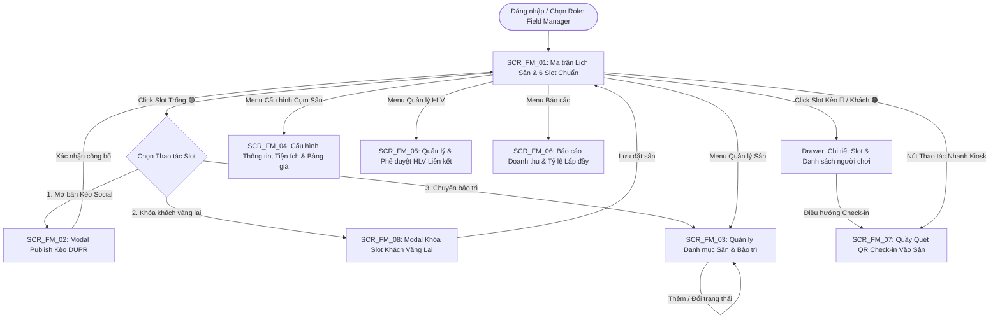
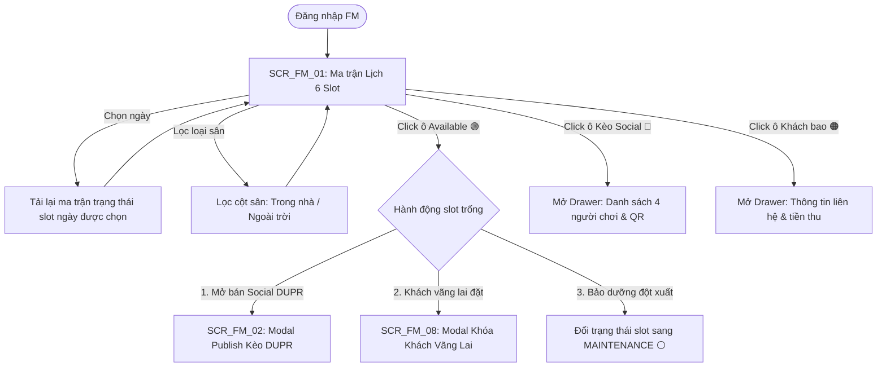
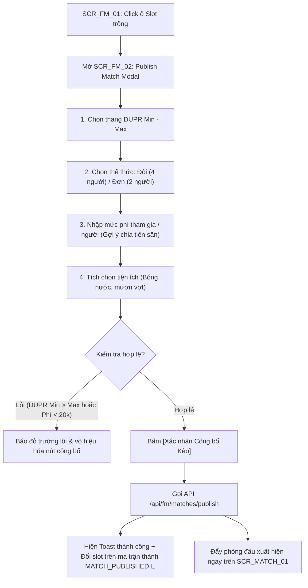
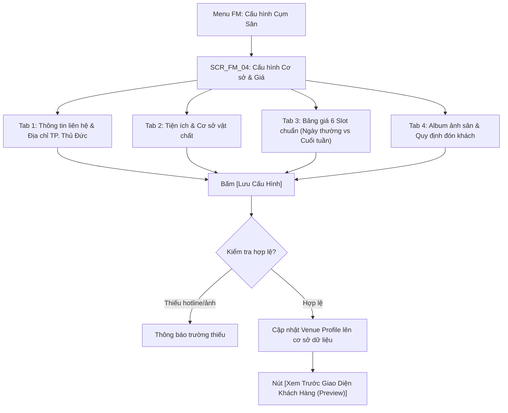
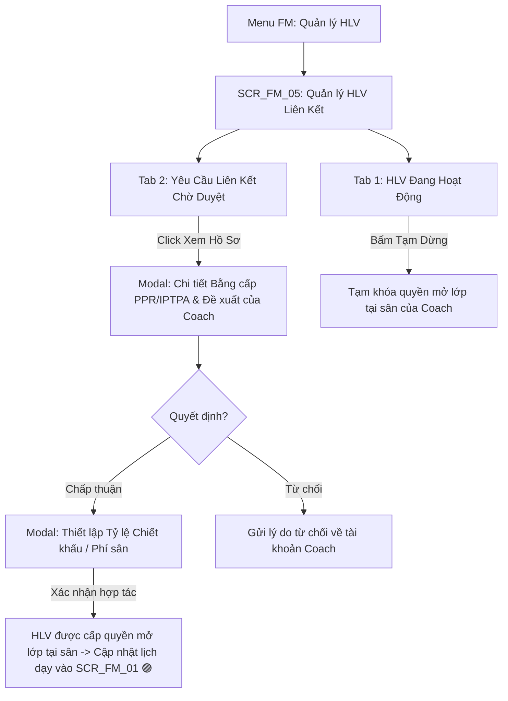
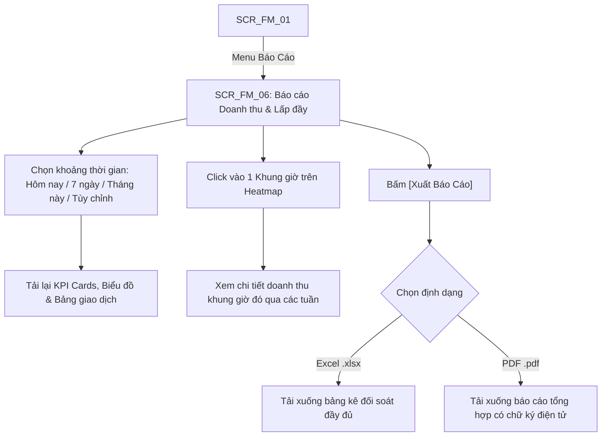
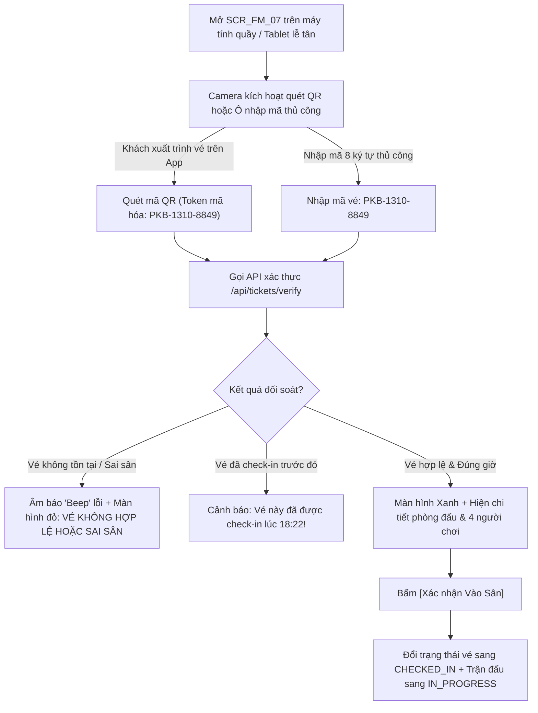
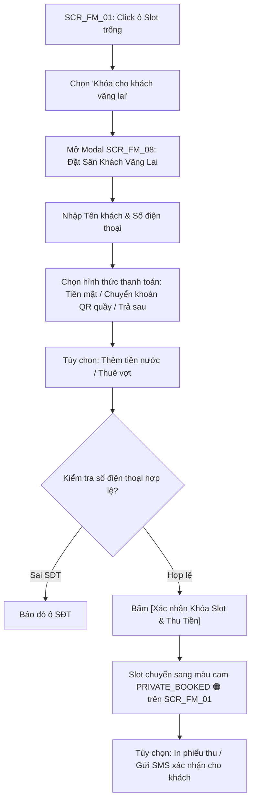

# TÀI LIỆU ĐẶC TẢ CHI TIẾT MÀN HÌNH & GIAO DIỆN (UI/UX SPECIFICATION)
# PHÂN HỆ: FIELD MANAGER - CHỦ SÂN & QUẢN LÝ CỤM SÂN (NHÓM SCR_FM_xx)
### *Dự án: FITLYO - Nền tảng Quản lý Sân Pickleball, Social Matchmaking & PT Booking*
### *Môn học: EXE101 - Khởi nghiệp Đổi mới Sáng tạo (FPT University)*
### *Chuẩn hóa theo Screen Analysis & UI Design Specification Framework*

---

| Thông Tin Tài Liệu | Chi Tiết |
| :--- | :--- |
| **Dự án** | **FITLYO (Pickleball Platform - Khu vực TP. Thủ Đức)** |
| **Phân hệ đặc tả** | **Field Manager (Chủ sân / Ban quản lý cụm sân thể thao)** |
| **Mã nhóm màn hình** | **SCR_FM_xx (Đầy đủ 08 màn hình chức năng)** |
| **Phiên bản** | 1.0.0 (Bản đặc tả kỹ thuật chuyên sâu) |
| **Tài liệu căn cứ** | [FITLYO_PRD_Yeu_Cau_Phan_Mem.md](file:///D:/FPTU/Term%207/EXE101/FITLYO/Documents/FITLYO_PRD_Yeu_Cau_Phan_Mem.md)<br>[FITLYO_Tai_Lieu_Luong_Nghiep_Vu.md](file:///D:/FPTU/Term%207/EXE101/FITLYO/Documents/FITLYO_Tai_Lieu_Luong_Nghiep_Vu.md)<br>[FITLYO_Dac_Ta_Man_Hinh_Screen_Spec.md](file:///D:/FPTU/Term%207/EXE101/FITLYO/Documents/FITLYO_Dac_Ta_Man_Hinh_Screen_Spec.md) |
| **Đối tượng áp dụng** | Product Owner (PO), Business Analyst (BA), UI/UX Designer, Frontend Developer, QA/QC |

---

## MỤC LỤC TỔNG THỂ

1. [TỔNG QUAN KIẾN TRÚC & SƠ ĐỒ ĐIỀU HƯỚNG PHÂN HỆ FIELD MANAGER](#1-tổng-quan-kiến-trúc--sơ-đồ-điều-hướng-phân-hệ-field-manager)
   - 1.1. Vai trò & Mục tiêu vận hành của Field Manager (FM)
   - 1.2. Sơ đồ luồng điều hướng tổng thể (FM Screen Navigation Flow)
   - 1.3. Bảng danh mục toàn bộ mã màn hình nhóm SCR_FM_xx
2. [ĐẶC TẢ CHI TIẾT TỪNG MÀN HÌNH TRONG NHÓM SCR_FM_xx](#2-đặc-tả-chi-tiết-từng-màn-hình-trong-nhóm-scr_fm_xx)
   - 2.1. `SCR_FM_01`: Ma trận Lịch Sân & Điều hành Slot Thời Gian Thực (Master Court Calendar & 6-Slot Grid)
   - 2.2. `SCR_FM_02`: Modal Khởi tạo & Mở bán Kèo Ghép trận Social Matchmaking (Publish Social Match Modal)
   - 2.3. `SCR_FM_03`: Quản lý Danh mục Sân con & Lịch bảo trì (Court Inventory & Maintenance Management)
   - 2.4. `SCR_FM_04`: Cấu hình Thông tin Cụm sân, Tiện ích & Bảng giá (Venue Profile, Amenities & Pricing Setup)
   - 2.5. `SCR_FM_05`: Quản lý & Phê duyệt HLV Liên kết Hoạt động (Affiliated Coaches & Partnership Management)
   - 2.6. `SCR_FM_06`: Báo cáo Doanh thu, Đối soát & Tỷ lệ Lấp đầy Slot (Revenue, Occupancy Analytics & Settlement Report)
   - 2.7. `SCR_FM_07`: Quầy Tiếp đón, Quét Mã QR Check-in & Kiểm soát Vào Sân (Front-desk QR Scanner & Access Terminal)
   - 2.8. `SCR_FM_08`: Khóa Slot & Đặt Sân Trực tiếp Cho Khách Vãng Lai (Walk-in Booking & Direct Slot Reservation Modal)
3. [MA TRẬN PHÂN QUYỀN TRÊN GIAO DIỆN PHÂN HỆ FM (RBAC ON UI MATRIX)](#3-ma-trận-phân-quyền-trên-giao-diện-phân-hệ-fm)
4. [QUY CHUẨN DESIGN TOKENS & TRẠNG THÁI MÀU SẮC DÀNH CHO FIELD MANAGER](#4-quy-chuẩn-design-tokens--trạng-thái-màu-sắc)

---

## 1. TỔNG QUAN KIẾN TRÚC & SƠ ĐỒ ĐIỀU HƯỚNG PHÂN HỆ FIELD MANAGER

### 1.1. Vai trò & Mục tiêu vận hành của Field Manager (FM)
Field Manager là chủ sở hữu hoặc quản lý vận hành cụm sân Pickleball trên địa bàn TP. Thủ Đức. Phân hệ `SCR_FM_xx` được thiết kế nhằm giải quyết 3 bài toán sống còn:
1. **Tối đa hóa công suất lấp đầy (Maximize Occupancy):** Xóa bỏ các khung giờ "chết" (sáng sớm, đầu giờ chiều) bằng cách chuyển đổi slot trống thành các phòng đấu **Social Matchmaking DUPR** hoặc đón lớp học của Coach liên kết.
2. **Quy chuẩn hóa vận hành 6 Slot 90 phút:** Mọi hoạt động đặt sân, giao lưu, dạy học đều khớp hoàn hảo vào khung giờ chuẩn (06:00 - 21:30), nhận diện tự động **Giờ Vàng (Slot 5: 18:30 - 20:00)** để tối ưu chính sách giá.
3. **Chống thất thoát & Đối soát Check-in 1 chạm:** Tự động hóa việc thu cọc trực tuyến, phát sinh vé điện tử QR Code và quét xác thực tại quầy tiếp đón trong dưới 3 giây.

---

### 1.2. Sơ đồ luồng điều hướng tổng thể (FM Screen Navigation Flow)



---

### 1.3. Bảng danh mục toàn bộ mã màn hình nhóm SCR_FM_xx

| Mã màn hình | Tên màn hình chức năng | Loại giao diện | Điểm vào chính (Entry Point) | Điểm thoát chính (Exit Point) |
| :--- | :--- | :--- | :--- | :--- |
| **`SCR_FM_01`** | Ma trận Lịch Sân & Điều hành Slot Thời Gian Thực | Full Page (Desktop/Tablet) | Menu `/fm/calendar`, Dashboard chính | `SCR_FM_02`, `SCR_FM_08`, Drawer chi tiết |
| **`SCR_FM_02`** | Modal Khởi tạo & Mở bán Kèo Ghép trận Social Match | Interactive Modal / Dialog | Click ô slot trống trên `SCR_FM_01` | Đẩy kèo lên Feed `SCR_MATCH_01`, đóng modal |
| **`SCR_FM_03`** | Quản lý Danh mục Sân con & Lịch bảo trì | Full Page / Data Grid | Menu `/fm/courts` | Modal thêm sân con, chuyển trạng thái sân |
| **`SCR_FM_04`** | Cấu hình Thông tin Cụm sân, Tiện ích & Bảng giá | Full Page / Multi-tab Form | Menu `/fm/settings` | Lưu cấu hình, xem trước hồ sơ trên mobile |
| **`SCR_FM_05`** | Quản lý & Phê duyệt HLV Liên kết tại Cụm sân | Full Page / Split List | Menu `/fm/coaches` | Modal duyệt liên kết, cấu hình chiết khấu |
| **`SCR_FM_06`** | Báo cáo Doanh thu, Đối soát & Tỷ lệ Lấp đầy Slot | Full Page / Analytics Dash | Menu `/fm/reports` | Xuất file Excel / PDF, chi tiết giao dịch |
| **`SCR_FM_07`** | Quầy Tiếp đón & Quét Mã QR Check-in Điện tử | Kiosk Mode / Fullscreen Web | Menu `/fm/checkin`, Header Action | Xác nhận vào sân, in phiếu / mở cửa |
| **`SCR_FM_08`** | Khóa Slot & Đặt Sân Trực tiếp Cho Khách Vãng Lai | Quick Action Modal | Click slot trống chọn "Khóa khách vãng lai" | Lưu đặt sân, chuyển slot thành Private |

---

## 2. ĐẶC TẢ CHI TIẾT TỪNG MÀN HÌNH TRONG NHÓM SCR_FM_xx

---

### 2.1. `SCR_FM_01`: Ma trận Lịch Sân & Điều hành Slot Thời Gian Thực (Master Court Calendar & 6-Slot Grid)

#### 1. Thông tin chung (Overview)
- **Mã màn hình:** `SCR_FM_01`
- **Tên màn hình:** Ma trận Lịch Sân & Điều hành Slot Thời Gian Thực
- **Phân hệ:** Field Manager (Chủ sân)
- **Đối tượng sử dụng (Actors):** Field Manager (Chủ sân), Quản lý ca / Nhân viên quầy tiếp đón
- **Điều kiện tiên quyết:** Tài khoản FM đã được Admin phê duyệt giấy phép kinh doanh (`ActiveFM`). Cụm sân đã khai báo ít nhất 1 sân con hoạt động.
- **Mục tiêu cốt lõi:** Cung cấp "tháp điều hành" trực quan 100% tình trạng sân theo 6 khung giờ chuẩn 90 phút/ngày; hỗ trợ thao tác 1 chạm để mở bán kèo Social, khóa khách vãng lai, hoặc kiểm tra đối soát người chơi.

#### 2. Sơ đồ luồng màn hình (Screen Flow)


#### 3. Phác thảo bố cục giao diện (Wireframe Mockup)
```text
+----------------------------------------------------------------------------------------------------+
| [LOGO FITLYO]  Cụm sân: [ D-Sports Pickleball Thủ Đức ▾ ]       [🔔 (3)] [Kiosk QR 📷] [Avatar FM] |
+----------------------------------------------------------------------------------------------------+
| [🗓️ LỊCH ĐIỀU HÀNH NGÀY]: [< Hôm nay, 13/10/2026 >]  [Hôm nay] [Chọn lịch tuần]      [ + Thêm sân ]|
| BỘ LỌC CỘT: (• Tất cả 4 sân)   ( ) Sân trong nhà   ( ) Sân ngoài trời   ( ) Sân có mái che         |
+----------------------------------------------------------------------------------------------------+
| CHÚ GIẢI TRẠNG THÁI:                                                                               |
| [🟢 Trống (Available)]  [🔵 Kèo Social DUPR]  [🟣 Giờ dạy Coach]  [🟠 Khách bao riêng]  [⚪ Bảo trì]|
+----------------------------------------------------------------------------------------------------+
| KHUNG GIỜ (SLOT) | SÂN 1 (Trong nhà)     | SÂN 2 (Trong nhà)     | SÂN 3 (Ngoài trời)    | SÂN 4...|
+------------------+-----------------------+-----------------------+-----------------------+---------+
| Slot 1           | 🟢 TRỐNG              | 🟢 TRỐNG              | ⚪ BẢO TRÌ LƯỚI       | 🟢 TRỐNG|
| 06:00 - 07:30    | 150.000đ              | 150.000đ              | (Tạm khóa slot)       | 150.000đ|
|                  | [ + Mở Kèo Social ]   | [ + Mở Kèo Social ]   |                       |         |
+------------------+-----------------------+-----------------------+-----------------------+---------+
| Slot 2           | 🟣 LỚP HỌC COACH      | 🟢 TRỐNG              | 🟢 TRỐNG              | 🟢 TRỐNG|
| 07:30 - 09:00    | HLV Tuấn Kiệt (4 HV)  | 180.000đ              | 140.000đ              | 160.000đ|
|                  | Lớp: DUPR 2.0 Căn bản | [ + Mở Kèo Social ]   | [ + Mở Kèo Social ]   |         |
+------------------+-----------------------+-----------------------+-----------------------+---------+
| Slot 3           | 🔵 KÈO SOCIAL (3/4)   | 🟢 TRỐNG              | 🟢 TRỐNG              | 🟢 TRỐNG|
| 15:30 - 17:00    | DUPR: 2.0 - 2.5       | 180.000đ              | 140.000đ              | 160.000đ|
|                  | Thu: 135.000đ [Xem]   | [ + Mở Kèo Social ]   | [ + Mở Kèo Social ]   |         |
+------------------+-----------------------+-----------------------+-----------------------+---------+
| Slot 4           | 🟠 KHÁCH BAO RIÊNG    | 🔵 KÈO SOCIAL (FULL)  | 🟢 TRỐNG              | 🟢 TRỐNG|
| 17:00 - 18:30    | Anh Thành (0918.xxx)  | DUPR: 3.0 - 3.5 [4/4] | 160.000đ              | 180.000đ|
|                  | Thu tại quầy: 200.000đ| Đã thanh toán 100%    | [ + Mở Kèo Social ]   |         |
+------------------+-----------------------+-----------------------+-----------------------+---------+
| Slot 5 (GIỜ VÀNG)| 🔵 KÈO SOCIAL (FULL)  | 🔵 KÈO SOCIAL (FULL)  | 🟠 KHÁCH BAO RIÊNG    | 🔵 KÈO..|
| 18:30 - 20:00 🔥 | DUPR: 3.5 - 4.0 [4/4] | DUPR: 2.5 - 3.0 [4/4] | Đặt cọc App (Chị Lan) | [4/4]   |
|                  | Check-in: 4/4 vé QR   | Check-in: 3/4 vé QR   | Thu: 180.000đ         |         |
+------------------+-----------------------+-----------------------+-----------------------+---------+
| Slot 6           | 🟢 TRỐNG              | 🟢 TRỐNG              | 🟢 TRỐNG              | 🟢 TRỐNG|
| 20:00 - 21:30    | 160.000đ              | 160.000đ              | 140.000đ              | 160.000đ|
|                  | [ + Mở Kèo Social ]   | [ + Mở Kèo Social ]   | [ + Mở Kèo Social ]   |         |
+----------------------------------------------------------------------------------------------------+
| 📊 TỔNG KẾT HÔM NAY:                                                                               |
| Công suất lấp đầy: [========================......] 72% (17/24 slot)  | Doanh thu ngày: 4.850.000đ |
| Slot Giờ Vàng (Slot 5): Lấp đầy 100% (4/4 sân)                        | Vé QR Check-in: 15/16 người|
+----------------------------------------------------------------------------------------------------+
```

#### 4. Bảng đặc tả chi tiết trường & thành phần (Field Spec)

| Mã UI | Tên thành phần | Loại Control | Bắt buộc | Ràng buộc & Validation | Logic nghiệp vụ & Hành vi |
| :--- | :--- | :--- | :---: | :--- | :--- |
| `SEL_VENUE_CURRENT` | Bộ chọn cụm sân | Dropdown Select | Có | Danh sách cụm sân thuộc quyền sở hữu của FM | Mặc định chọn cụm sân đầu tiên. Đổi sân tải lại toàn bộ ma trận lịch. |
| `PICK_DATE_NAV` | Thanh điều hướng ngày | Date Strip Navigation | Có | Chọn lùi tối đa 30 ngày (lịch sử) hoặc tiến 60 ngày tới | Gồm 2 nút [<], [>] và nút [Hôm nay] để quay lại tức thì. Trigger fetch API slot grid. |
| `FLT_COURT_TYPE` | Bộ lọc loại sân | Radio Chips | Không | Tất cả / Trong nhà / Ngoài trời / Mái che | Lọc ẩn/hiện các cột sân tương ứng trên ma trận (Client-side filtering). |
| `CELL_SLOT_AVAILABLE` | Ô slot trống | Interactive Card | Có | Trạng thái: `AVAILABLE` (Màu xanh lục `#22C55E`) | Hover: Border sáng + hiện tooltip giá. Click: Mở Action Sheet chọn (1) Mở Social, (2) Khóa khách vãng lai, (3) Bảo trì. |
| `CELL_SLOT_MATCH` | Ô slot kèo Social | Interactive Card | Có | Trạng thái: `MATCH_PUBLISHED` (Màu xanh dương `#3B82F6`) | Hiển thị: Tiêu đề kèo, khoảng DUPR, số lượng người `X/Y`, badge `FULL`. Click mở Drawer danh sách người tham gia & đối soát vé QR. |
| `CELL_SLOT_COACH` | Ô slot lớp Coach | Interactive Card | Có | Trạng thái: `COACHING` (Màu tím `#A855F7`) | Hiển thị: Tên HLV liên kết, tên khóa học, sĩ số học viên. Click mở Drawer xem thông tin buổi dạy và liên hệ HLV. |
| `CELL_SLOT_PRIVATE` | Ô slot khách bao | Interactive Card | Có | Trạng thái: `PRIVATE_BOOKED` (Màu cam `#F97316`) | Hiển thị: Tên khách đặt, số điện thoại, trạng thái thanh toán (Tại quầy / Đã chuyển khoản). Click mở popup cập nhật thu tiền. |
| `CELL_SLOT_MAINT` | Ô slot bảo trì | Interactive Card | Có | Trạng thái: `MAINTENANCE` (Màu xám `#64748B`) | Vô hiệu hóa đặt sân, nền xám mờ. Click cho phép mở lại thành `AVAILABLE` nếu bảo dưỡng xong sớm. |
| `BADGE_PEAK_FLAME` | Huy hiệu Slot Giờ Vàng | Status Badge | - | Tự động kích hoạt tại Slot 5 (18:30 - 20:00) | Kèm icon ngọn lửa `Flame` nhấp nháy, cảnh báo khung giờ cao điểm để áp giá giờ vàng. |
| `BAR_OCCUPANCY` | Thanh tỷ lệ lấp đầy | Progress Bar | - | Tỷ lệ = $(\text{Slot Booked} / \text{Tổng Slot Active}) \times 100\%$ | Dưới 50%: Màu cam cảnh báo ế khách; 50-75%: Màu vàng; Trên 75%: Màu xanh lá cây tối ưu. |

#### 5. Ma trận 5 trạng thái giao diện (Screen State Matrix)
* **1. Ideal State:** Ma trận tải đầy đủ các cột sân con và 6 hàng slot, hiển thị chính xác màu sắc phân định theo 5 trạng thái.
* **2. Loading State:** Hiển thị khung Skeleton Shimmer của bảng lưới (Header cột nhấp nháy, các ô slot mờ) trong lúc tải dữ liệu ma trận qua API.
* **3. Empty State:** Trường hợp FM mới tạo tài khoản, chưa có sân con nào $\rightarrow$ Hiển thị minh họa sân trống + Thông báo: *"Chưa có sân con nào trong cụm sân"* + Nút bấm **[+ Thêm Sân Con Đầu Tiên]** điều hướng sang `SCR_FM_03`.
* **4. Error State:** Lỗi máy chủ 500 hoặc mất kết nối mạng $\rightarrow$ Banner đỏ giữa màn hình: *"Không thể tải ma trận lịch sân. Vui lòng kiểm tra kết nối mạng"* + Nút **[Thử lại]**.
* **5. Edge / Concurrency State:** Khi FM đang xem ma trận, một người chơi trên mobile vừa bấm cọc slot cuối cùng của kèo $\rightarrow$ Hệ thống nhận WebSocket event, tức thì cập nhật ô slot từ `3/4` sang `FULL` kèm hiệu ứng pulse viền xanh nhẹ trong 1.5 giây.

#### 6. Phân quyền trên UI (RBAC on UI)
* **Field Manager (Chủ sân / Quản lý):** Toàn quyền xem, click slot để mở bán Social, khóa sân vãng lai, chuyển bảo trì.
* **Staff / Nhân viên quầy:** Chỉ được xem ma trận, check-in QR và nhập khách vãng lai; không được xóa sân hoặc đổi biểu phí gốc.
* **Admin hệ thống:** Chế độ xem giám sát (Auditor mode), có thêm nút *"Tạm khóa cụm sân"* nếu vi phạm.

---

### 2.2. `SCR_FM_02`: Modal Khởi tạo & Mở bán Kèo Ghép trận Social Match (Publish Social Match Modal)

#### 1. Thông tin chung (Overview)
- **Mã màn hình:** `SCR_FM_02`
- **Tên màn hình:** Modal Khởi tạo & Mở bán Kèo Ghép trận Social Matchmaking
- **Phân hệ:** Field Manager
- **Đối tượng sử dụng (Actors):** Field Manager
- **Điều kiện tiên quyết:** Bấm vào một ô slot có trạng thái `AVAILABLE` trên ma trận `SCR_FM_01`.
- **Mục tiêu cốt lõi:** Thiết lập nhanh các tham số trận đấu (thang điểm DUPR, thể thức, chi phí cọc chia đều) và công bố lên Bảng tin Ghép trận `SCR_MATCH_01` trong dưới 30 giây để thu hút người chơi lấp đầy slot.

#### 2. Sơ đồ luồng màn hình (Screen Flow)


#### 3. Phác thảo bố cục giao diện (Wireframe Mockup)
```text
+-----------------------------------------------------------------------------------+
| [X]                   CÔNG BỐ PHÒNG GHÉP TRẬN SOCIAL MATCH                        |
+-----------------------------------------------------------------------------------+
| THÔNG TIN KHUNG GIỜ & ĐỊA ĐIỂM ĐÃ CHỌN:                                           |
| 🏢 Cụm sân D-Sports Pickleball Thủ Đức • Sân số 2 (Trong nhà)                     |
| ⏰ Slot 5: 18:30 - 20:00 (Khung Giờ Vàng 🔥) | Hôm nay: 13/10/2026                |
+-----------------------------------------------------------------------------------+
| 1. Trình độ yêu cầu (Thang điểm DUPR):                                            |
|    DUPR Tối thiểu: [ 2.5 ▾ ]            DUPR Tối đa: [ 3.0 ▾ ]                    |
|    💡 Khuyến nghị: Chênh lệch Min - Max <= 0.5 để đảm bảo trận đấu cân sức        |
|                                                                                   |
| 2. Thể thức & Quy mô phòng đấu:                                                  |
|    (•) Đánh Đôi (Doubles) - 4 người chơi    ( ) Đánh Đơn (Singles) - 2 người chơi |
|                                                                                   |
| 3. Mức phí cọc slot mỗi người chơi:                                               |
|    [ 50.000 ] VNĐ / người                                                         |
|    💡 Cơ sở tính: Giá sân 180.000đ/90p chia 4 người = 45.000đ + 5.000đ phí bóng tiêu |
|       chuẩn. Tổng tiền sân thu về dự kiến: 200.000 VNĐ.                           |
|                                                                                   |
| 4. Tiện ích & Cơ sở vật chất cung cấp kèm theo:                                  |
|    [x] 2 quả bóng thi đấu tiêu chuẩn (Franklin X-40)  [x] Nước uống miễn phí      |
|    [ ] Có người nhặt bóng chuyên nghiệp               [x] Hỗ trợ mượn vợt test    |
|    [x] Đèn LED cao cấp chống chói sân thi đấu                                     |
|                                                                                   |
| 5. Ghi chú thêm cho người tham gia (Tùy chọn):                                    |
|    [ Giao lưu vui vẻ, đề nghị đến đúng giờ trước 10 phút để khởi động và test... ]|
+-----------------------------------------------------------------------------------+
| [ HỦY BỎ ]                                           [ ✔️ XÁC NHẬN CÔNG BỐ KÈO -> ]|
+-----------------------------------------------------------------------------------+
```

#### 4. Bảng đặc tả chi tiết trường & thành phần (Field Spec)

| Mã UI | Tên thành phần | Loại Control | Bắt buộc | Ràng buộc & Validation | Logic nghiệp vụ & Hành vi |
| :--- | :--- | :--- | :---: | :--- | :--- |
| `TXT_MODAL_CONTEXT` | Khung ngữ cảnh sân & giờ | Read-only Banner | Có | Kế thừa chính xác sân và slot đã click từ `SCR_FM_01` | Hiển thị rõ tên sân con, slot giờ và ngày thi đấu để tránh FM cấu hình nhầm slot. |
| `SEL_DUPR_MIN` | DUPR Tối thiểu | Select Dropdown | Có | Thang từ 1.0 đến 5.5 (bước nhảy 0.25). Phải $\le$ `SEL_DUPR_MAX`. | Mức sàn phân hạng. Người chơi có DUPR thấp hơn mức này sẽ bị cảnh báo hoặc chặn giữ chỗ. |
| `SEL_DUPR_MAX` | DUPR Tối đa | Select Dropdown | Có | Thang từ 1.5 đến 6.0. Phải $\ge$ `SEL_DUPR_MIN`. | Khuyến nghị tự động: Khi chọn Min = 2.5, hệ thống tự gợi ý Max = 3.0. |
| `RAD_FORMAT` | Thể thức thi đấu | Radio Group | Có | 2 giá trị: `doubles` (4 người) hoặc `singles` (2 người) | Mặc định: `doubles`. Khi chọn đôi, hệ thống gán `max_players = 4`; khi chọn đơn gán `max_players = 2`. |
| `INP_ENTRY_FEE` | Mức phí / người | Input (Currency) | Có | Tối thiểu: 20.000đ. Tối đa: 300.000đ. Bước nhảy: 5.000đ. | Tự động tính toán tổng doanh thu và so sánh với giá gốc của slot. |
| `CHK_AMENITIES` | Danh mục tiện ích | Checkbox Group | Không | Các tiện ích đã khai báo tại `SCR_FM_04` | Cho phép tích chọn các dịch vụ đi kèm slot ghép trận để kích cầu người chơi. |
| `INP_NOTE` | Ghi chú thêm | Textarea | Không | Tối đa 250 ký tự | Hiển thị trên thẻ card trận đấu tại `SCR_MATCH_01` và `SCR_MATCH_02`. |
| `BTN_CONFIRM_PUBLISH` | Nút Xác nhận công bố | Button (Primary) | Có | Kích hoạt khi toàn bộ trường bắt buộc hợp lệ | Nhấn gọi API, đổi trạng thái slot sang `MATCH_PUBLISHED`, đẩy notification đến người chơi quanh TP. Thủ Đức. |

#### 5. Ma trận 5 trạng thái giao diện (Screen State Matrix)
* **1. Ideal State:** Dữ liệu sân con và giờ slot được điền tự động; các trường mặc định sẵn giá trị tối ưu (DUPR 2.5 - 3.0, 50.000đ/người).
* **2. Loading State:** Khi bấm nút công bố, nút chuyển sang trạng thái Loading xoay spinner, vô hiệu hóa form chống click kép.
* **3. Empty State:** Không áp dụng vì modal luôn mở kèm ngữ cảnh một slot cụ thể.
* **4. Error State:** Nếu DUPR Min > DUPR Max $\rightarrow$ Viền đỏ input + câu cảnh báo: *"Điểm DUPR tối thiểu không được lớn hơn điểm tối đa"*; nếu máy chủ báo lỗi $\rightarrow$ Hiện Toast đỏ: *"Không thể tạo phòng đấu, vui lòng thử lại"*.
* **5. Edge / Concurrency State:** Nếu trong lúc FM mở modal này mà tại quầy có nhân viên khác vừa khóa sân vãng lai cho slot đó $\rightarrow$ Modal hiện cảnh báo xung đột: *"Slot này vừa được đặt tại quầy cách đây vài giây"* và tự động đóng.

---

### 2.3. `SCR_FM_03`: Quản lý Danh mục Sân con & Lịch bảo trì (Court Inventory & Maintenance Management)

#### 1. Thông tin chung (Overview)
- **Mã màn hình:** `SCR_FM_03`
- **Tên màn hình:** Quản lý Danh mục Sân con & Lịch bảo trì (Court Inventory)
- **Phân hệ:** Field Manager
- **Đối tượng sử dụng (Actors):** Field Manager
- **Điều kiện tiên quyết:** Đã đăng nhập vai trò Field Manager.
- **Mục tiêu cốt lõi:** Quản lý số lượng và thông số kỹ thuật của từng sân con trong cơ sở; thêm sân con mới, cấu hình trạng thái hoạt động (Active / Tạm đóng) và lên lịch bảo trì mặt sân/thay lưới định kỳ.

#### 2. Sơ đồ luồng màn hình (Screen Flow)
```mermaid
flowchart TD
    Dashboard["SCR_FM_01"] -->|Menu Quản lý Sân| SCR_FM_03["SCR_FM_03: Danh mục Court Inventory"]
    SCR_FM_03 -->|Bấm [+ Thêm Sân Con]| ModalAddCourt["Modal: Khai báo sân mới (Tên, Phân loại, Mặt sân)"]
    ModalAddCourt -->|Lưu thành công| SCR_FM_03
    SCR_FM_03 -->|Bật/Tắt Toggle Active| ToggleConfirm{"Xác nhận tạm dừng sân?"}
    ToggleConfirm -- Có slot đang đặt --> WarnBlock["Cảnh báo: Sân đang có khách đặt, không thể tắt!"]
    ToggleConfirm -- Sân trống --> UpdateState["Đổi trạng thái sân sang Inactive"]
    SCR_FM_03 -->|Bấm [Lên lịch bảo trì]| ModalMaint["Modal: Chọn khoảng ngày bảo trì & Lý do"]
    ModalMaint -->|Xác nhận| LockSlots["Tự động khóa toàn bộ 6 slot trong khoảng ngày bảo trì"]
```

#### 3. Phác thảo bố cục giao diện (Wireframe Mockup)
```text
+-----------------------------------------------------------------------------------+
| FITLYO FM | Quản lý Sân Con (Court Inventory) - Cụm sân D-Sports    [ + Thêm Sân ]|
+-----------------------------------------------------------------------------------+
| TỔNG QUY MÔ: 4 Sân Tiêu Chuẩn  |  🟢 Đang hoạt động: 3 Sân  |  ⚪ Đang bảo trì: 1 Sân|
+-----------------------------------------------------------------------------------+
| [ BỘ LỌC ]: [ Tất cả (4) ]   [ Đang hoạt động (3) ]   [ Đang bảo trì (1) ]        |
+-----------------------------------------------------------------------------------+
| [ DANH SÁCH THẺ SÂN CON ]:                                                        |
| +-------------------------------------------------------------------------------+ |
| | [SÂN 1] SÂN TRONG NHÀ MÁY LẠNH                        [ ĐANG HOẠT ĐỘNG (ON) ] | |
| | Loại sân: Trong nhà tiêu chuẩn  | Mặt sân: Acrylic giảm chấn 8 lớp            | |
| | Hệ thống đèn: LED 500 Lux thi đấu | Lưới: Tiêu chuẩn USAPA                      | |
| | Biểu phí gốc: 150.000đ - 220.000đ/slot 90p | Khai thác hôm nay: 5/6 slot      | |
| |                               [ Lịch bảo trì ]  [ Cấu hình giá ]  [ Chỉnh sửa ]| |
| +-------------------------------------------------------------------------------+ |
| +-------------------------------------------------------------------------------+ |
| | [SÂN 2] SÂN TRONG NHÀ TIÊU CHUẨN                      [ ĐANG HOẠT ĐỘNG (ON) ] | |
| | Loại sân: Trong nhà             | Mặt sân: Cushion Court chuyên dụng           | |
| | Hệ thống đèn: LED 450 Lux       | Biểu phí gốc: 150.000đ - 200.000đ/slot 90p  | |
| | Khai thác hôm nay: 4/6 slot                                                   | |
| |                               [ Lịch bảo trì ]  [ Cấu hình giá ]  [ Chỉnh sửa ]| |
| +-------------------------------------------------------------------------------+ |
| +-------------------------------------------------------------------------------+ |
| | [SÂN 3] SÂN NGOÀI TRỜI KHÔNG MÁI CHE                  [ ĐANG BẢO TRÌ (OFF) ]  | |
| | Loại sân: Ngoài trời            | Mặt sân: Sơn thể thao kháng nước             | |
| | Tình trạng: Bảo trì thay cáp lưới & vệ sinh mặt sân (Từ 13/10 đến 14/10)      | |
| |                               [ Kết thúc bảo trì sớm ]  [ Xem chi tiết bảo trì]| |
| +-------------------------------------------------------------------------------+ |
+-----------------------------------------------------------------------------------+
```

#### 4. Bảng đặc tả chi tiết trường & thành phần (Field Spec)

| Mã UI | Tên thành phần | Loại Control | Bắt buộc | Ràng buộc & Validation | Logic nghiệp vụ & Hành vi |
| :--- | :--- | :--- | :---: | :--- | :--- |
| `BTN_ADD_COURT` | Nút Thêm Sân Con | Button Primary | - | Không vượt quá số sân khai báo trong giấy phép kinh doanh | Mở modal nhập tên sân, chọn phân loại (Trong nhà/Ngoài trời), vật liệu mặt sân. |
| `SW_COURT_ACTIVE` | Công tắc Active/Inactive | Switch Toggle | Có | Chỉ tắt được nếu không có booking trong tương lai | Tắt sẽ đổi toàn bộ 6 slot của sân sang `MAINTENANCE` trên `SCR_FM_01`. |
| `CARD_COURT_ITEM` | Thẻ chi tiết sân con | Composite Card | Có | Hiển thị đầy đủ thông số kỹ thuật | Gồm tên sân, loại sân, công nghệ mặt sân, độ rọi đèn Lux, hiệu suất khai thác. |
| `BTN_SCHEDULE_MAINT`| Nút Lên lịch bảo trì | Button Outline | - | Ngày bắt đầu $\le$ Ngày kết thúc | Mở modal chọn dải ngày bảo trì, tự động giải phóng hoặc hoàn cọc cho slot bị ảnh hưởng. |
| `BTN_EARLY_RESUME` | Nút Kết thúc bảo trì sớm | Button Success | - | Chỉ hiển thị khi sân đang ở trạng thái `MAINTENANCE` | Nhấn xác nhận sẽ chuyển sân về `Active`, mở lại các slot trống thành `AVAILABLE`. |
| `INP_COURT_NAME` | Tên sân con (Trong modal) | Input Text | Có | Max 50 ký tự, không được trùng tên trong cụm sân | Ví dụ: "Sân 1 (Trong nhà)", "Sân VIP Máy Lạnh". |
| `SEL_SURFACE_MATERIAL`| Loại vật liệu mặt sân | Select Dropdown | Có | Acrylic / Cushion / Thảm PVC / Sơn bê tông | Hiển thị làm thông số tham khảo cho người chơi khi xem chi tiết kèo. |

#### 5. Ma trận 5 trạng thái giao diện (Screen State Matrix)
* **1. Ideal State:** Hiển thị danh sách đầy đủ 4-8 thẻ sân với toggle trạng thái bật/tắt xanh mượt.
* **2. Loading State:** Hiển thị 3 Skeleton card lớn với hiệu ứng shimmer mô phỏng khung thông số sân.
* **3. Empty State:** Chưa có sân nào $\rightarrow$ Hiển thị hình vẽ mặt sân + Text: *"Cơ sở chưa có sân con nào"* + Nút **[+ Thêm Sân Con]**.
* **4. Error State:** Không lấy được danh mục sân từ máy chủ $\rightarrow$ Banner lỗi đỏ + Nút **[Tải lại danh sách]**.
* **5. Edge / Concurrency State:** FM bấm tắt Active của Sân 1 nhưng sân đó đang có 2 trận Social đã có người cọc $\rightarrow$ Modal cảnh báo ngăn chặn: *"Không thể tạm dừng sân vì đang có 2 trận đấu đã nhận cọc. Vui lòng hủy trận hoặc dời sang sân khác trước!"*.

#### 6. Phân quyền trên UI (RBAC on UI)
* **Field Manager:** Toàn quyền thêm, sửa, đổi trạng thái và xóa sân (chỉ xóa được sân chưa từng có lịch sử giao dịch).
* **Staff / Nhân viên quầy:** Chỉ được xem và bật nút "Báo hỏng lưới / Cần bảo trì đột xuất".

---

### 2.4. `SCR_FM_04`: Cấu hình Thông tin Cụm sân, Tiện ích & Bảng giá (Venue Profile, Amenities & Pricing Setup)

#### 1. Thông tin chung (Overview)
- **Mã màn hình:** `SCR_FM_04`
- **Tên màn hình:** Cấu hình Thông tin Cụm sân, Tiện ích & Bảng giá
- **Phân hệ:** Field Manager
- **Đối tượng sử dụng (Actors):** Field Manager
- **Mục tiêu cốt lõi:** Thiết lập hồ sơ công khai của cơ sở hiển thị trên nền tảng (`SCR_VENUE_01` cho người chơi); cấu hình tiện ích cơ sở vật chất và bảng giá chuẩn cho 6 slot theo ngày thường vs cuối tuần.

#### 2. Sơ đồ luồng màn hình (Screen Flow)


#### 3. Phác thảo bố cục giao diện (Wireframe Mockup)
```text
+-----------------------------------------------------------------------------------+
| FITLYO FM | CẤU HÌNH CỤM SÂN & BẢNG GIÁ VẬN HÀNH                  [ Lưu thay đổi ]|
+-----------------------------------------------------------------------------------+
| TABS: [ 🏢 Thông tin chung ] [ ☕ Tiện ích ] [ 💰 Bảng giá 6 Slot ] [ 🖼️ Hình ảnh ]|
+-----------------------------------------------------------------------------------+
| [TAB 3: BẢNG GIÁ 6 SLOT CHUẨN ĐANG CHỌN]:                                         |
| Cấu hình giá thuê sân gốc theo khung giờ 90 phút (Đơn vị: VNĐ):                   |
|                                                                                   |
| KHUNG GIỜ (SLOT)       | GIÁ NGÀY THƯỜNG (T2 - T6)     | GIÁ CUỐI TUẦN (T7 - CN)  |
| -----------------------+-------------------------------+------------------------- |
| Slot 1 (06:00 - 07:30) | [ 150.000 ] đ                 | [ 170.000 ] đ            |
| Slot 2 (07:30 - 09:00) | [ 180.000 ] đ                 | [ 200.000 ] đ            |
| Slot 3 (15:30 - 17:00) | [ 180.000 ] đ                 | [ 200.000 ] đ            |
| Slot 4 (17:00 - 18:30) | [ 200.000 ] đ                 | [ 220.000 ] đ            |
| Slot 5 (18:30 - 20:00)🔥| [ 220.000 ] đ (Giờ Vàng)      | [ 250.000 ] đ (Giờ Vàng) |
| Slot 6 (20:00 - 21:30) | [ 160.000 ] đ                 | [ 180.000 ] đ            |
|                                                                                   |
| ⚙️ THIẾT LẬP CHÍNH SÁCH CHIA TIỀN KÈO SOCIAL:                                    |
| [x] Tự động cộng phụ phí bóng tiêu chuẩn 5.000đ/người vào giá cọc slot Social     |
| [x] Cho phép người chơi hủy hoàn cọc 100% nếu báo trước 12 tiếng                  |
+-----------------------------------------------------------------------------------+
| [ HỦY BỎ ]                                            [ ✔️ LƯU TOÀN BỘ CẤU HÌNH ]  |
+-----------------------------------------------------------------------------------+
```

#### 4. Bảng đặc tả chi tiết trường & thành phần (Field Spec)

| Mã UI | Tên thành phần | Loại Control | Bắt buộc | Ràng buộc & Validation | Logic nghiệp vụ & Hành vi |
| :--- | :--- | :--- | :---: | :--- | :--- |
| `INP_VENUE_NAME` | Tên cụm sân | Input Text | Có | Tối đa 100 ký tự | Tên thương hiệu hiển thị công khai trên ứng dụng. |
| `INP_HOTLINE` | Số điện thoại hotline | Input Phone | Có | Định dạng 10 chữ số chuẩn VN (09x, 08x, 03x, 07x) | Dùng để khách liên hệ khẩn cấp hoặc gửi thông báo SMS. |
| `INP_ADDRESS` | Địa chỉ chi tiết | Input Text | Có | Phải thuộc địa bàn TP. Thủ Đức (Linh Chiểu, Thảo Điền, An Phú...) | Tích hợp Google Maps Auto-complete để lấy tọa độ Lat/Long chính xác. |
| `CHK_FACILITIES` | Danh sách tiện ích | Checkbox Group | Có | Chọn ít nhất 1 tiện ích | Danh mục: Bãi đỗ ô tô, Phòng tắm nóng lạnh, Căng tin, Đèn LED, Pro Shop, Wifi... |
| `GRID_PRICE_WEEKDAY`| Giá slot ngày thường | Input Matrix (Number) | Có | Từ 100.000đ đến 500.000đ/slot 90p | Áp dụng cho Thứ 2 đến Thứ 6. Tự động cập nhật vào ô slot trên ma trận `SCR_FM_01`. |
| `GRID_PRICE_WEEKEND`| Giá slot cuối tuần | Input Matrix (Number) | Có | Thường cao hơn giá ngày thường | Áp dụng cho Thứ 7 và Chủ Nhật. |
| `UPL_BANNER_IMG` | Ảnh bìa & Gallery | File Upload | Có | Định dạng JPG/PNG, tối đa 5MB/ảnh, tối thiểu 3 ảnh | Hiển thị trên màn hình xem chi tiết cụm sân của khách hàng. |
| `BTN_SAVE_VENUE` | Nút Lưu cấu hình | Button Primary | Có | Tất cả các trường bắt buộc hợp lệ | Ghi đè cấu hình mới, cập nhật thời gian thực vào hệ thống tính giá. |

#### 5. Ma trận 5 trạng thái giao diện (Screen State Matrix)
* **1. Ideal State:** Dữ liệu cấu hình hiện tại được nạp đầy đủ vào form, phân loại theo 4 tab rành mạch.
* **2. Loading State:** Shimmer form loader trong lúc kéo thông tin cụm sân từ máy chủ về.
* **3. Empty State:** Áp dụng khi FM mới khởi tạo cụm sân lần đầu $\rightarrow$ Hiển thị wizard hướng dẫn 4 bước cấu hình ban đầu.
* **4. Error State:** Lưu thất bại do mất mạng hoặc giá slot nhập nhỏ hơn 50.000đ $\rightarrow$ Hiện lỗi inline màu đỏ tại ô nhập giá.
* **5. Edge / Concurrency State:** FM đang đổi giá Slot 5 từ 220k lên 250k $\rightarrow$ Các kèo Social đã publish trước đó vẫn giữ nguyên giá cũ đã cọc; chỉ các kèo/slot tạo mới sau thời điểm lưu mới áp dụng giá mới.

#### 6. Phân quyền trên UI (RBAC on UI)
* **Field Manager:** Toàn quyền chỉnh sửa thông tin cụm sân và bảng giá 6 slot.
* **Staff / Nhân viên quầy:** Chỉ được xem biểu giá để báo giá cho khách vãng lai, không có quyền sửa đổi.

---

### 2.5. `SCR_FM_05`: Quản lý & Phê duyệt HLV Liên kết tại Cụm sân (Affiliated Coaches & Partnership Management)

#### 1. Thông tin chung (Overview)
- **Mã màn hình:** `SCR_FM_05`
- **Tên màn hình:** Quản lý & Phê duyệt HLV Liên kết tại Cụm sân
- **Phân hệ:** Field Manager
- **Đối tượng sử dụng (Actors):** Field Manager
- **Mục tiêu cốt lõi:** Quản lý danh sách các HLV độc lập hoạt động giảng dạy tại cơ sở; phê duyệt yêu cầu liên kết mới từ Coach; thiết lập tỷ lệ chia sẻ doanh thu và kiểm soát giờ dạy để tránh xung đột với khách vãng lai.

#### 2. Sơ đồ luồng màn hình (Screen Flow)


#### 3. Phác thảo bố cục giao diện (Wireframe Mockup)
```text
+-----------------------------------------------------------------------------------+
| FITLYO FM | Quản lý Huấn Luyện Viên Liên Kết (Cụm sân D-Sports)                   |
+-----------------------------------------------------------------------------------+
| TABS: [ 👨‍🏫 ĐANG LIÊN KẾT (3) ]             |          [ ⏳ YÊU CẦU CHỜ DUYỆT (2) ]     |
+-----------------------------------------------------------------------------------+
| DANH SÁCH YÊU CẦU CHỜ DUYỆT:                                                      |
| +-------------------------------------------------------------------------------+ |
| | [Avatar] HLV NGUYỄN HOÀNG LONG                    [ ✔️ ĐÃ XÁC THỰC BỞI ADMIN ] | |
| | Chứng chỉ: PPR Certified Coach Level 2  | Kinh nghiệm: 6 năm thi đấu          | |
| | Khung giờ đề xuất dạy: Thứ 3 & Thứ 5 (Slot 2: 07:30 - 09:00 tại Sân 1)        | |
| | Hình thức đề xuất: Thuê mặt sân cố định theo slot (Ưu đãi HLV: 140.000đ/slot) | |
| | Hồ sơ năng lực: [ 📄 ChungChi_PPR.pdf ]   [ 📄 ThongTinLopHoc.pdf ]           | |
| |                                     [ ❌ TỪ CHỐI ]   [ ✔️ CHẤP THUẬN LIÊN KẾT ]| |
| +-------------------------------------------------------------------------------+ |
| +-------------------------------------------------------------------------------+ |
| | [Avatar] HLV TRẦN MINH ANH                        [ ✔️ ĐÃ XÁC THỰC BỞI ADMIN ] | |
| | Chứng chỉ: PPR Certified Coach Level 1  | Kinh nghiệm: 3 năm                  | |
| | Đề xuất: Mở lớp Nhập môn buổi tối Thứ 7                                       | |
| |                                     [ ❌ TỪ CHỐI ]   [ ✔️ CHẤP THUẬN LIÊN KẾT ]| |
| +-------------------------------------------------------------------------------+ |
+-----------------------------------------------------------------------------------+
```

#### 4. Bảng đặc tả chi tiết trường & thành phần (Field Spec)

| Mã UI | Tên thành phần | Loại Control | Bắt buộc | Ràng buộc & Validation | Logic nghiệp vụ & Hành vi |
| :--- | :--- | :--- | :---: | :--- | :--- |
| `TAB_COACH_STATUS` | Tab danh sách HLV | Segmented Control | Có | Đang liên kết / Chờ duyệt / Đã tạm dừng | Lọc danh sách tương ứng. Hiện badge số lượng yêu cầu chờ duyệt màu đỏ. |
| `BADGE_ADMIN_VERIFIED`| Huy hiệu Admin Verified | Verified Badge | - | Chỉ hiển thị nếu HLV đã được Admin duyệt chứng chỉ tại `SCR_ADMIN_01` | Tạo sự tin cậy tuyệt đối cho chủ sân trước khi hợp tác. |
| `BTN_APPROVE_COACH`| Nút Chấp thuận liên kết | Button Primary | Có | Phải chọn chính sách giá sân trước khi duyệt | Mở modal cấu hình mức phí sân dành riêng cho Coach (cố định hoặc chiết khấu %). |
| `BTN_REJECT_COACH` | Nút Từ chối liên kết | Button Danger Outline | Có | Tối thiểu 10 ký tự lý do | Gửi thông báo đến Coach kèm lý do (ví dụ: sân đã kín lịch giờ đề xuất). |
| `SEL_FEE_MODEL` | Hình thức hợp tác | Select Dropdown | Có | (1) Thuê slot cố định ưu đãi, (2) Chiết khấu hoa hồng % học phí | Mặc định: Thuê slot cố định. |
| `BTN_SUSPEND_COACH`| Nút Tạm dừng liên kết | Button Warning | - | Chỉ áp dụng cho HLV đang active | Tạm thời ẩn các lớp học của Coach này tại cụm sân nếu có khiếu nại từ học viên. |

#### 5. Ma trận 5 trạng thái giao diện (Screen State Matrix)
* **1. Ideal State:** Hiển thị thẻ HLV đầy đủ thông tin chuyên môn, chứng chỉ tích xanh và đề xuất khung giờ.
* **2. Loading State:** Shimmer card mô phỏng avatar tròn và các dòng text chứng chỉ.
* **3. Empty State (Tab Chờ duyệt):** Minh họa bắt tay + Câu thông báo: *"Hiện không có yêu cầu liên kết mới nào từ Huấn luyện viên"*.
* **4. Error State:** Lỗi máy chủ không tải được danh sách $\rightarrow$ Banner lỗi đỏ + Nút **[Tải lại]**.
* **5. Edge / Concurrency State:** Khi FM bấm chấp thuận HLV Tuấn Kiệt vào Slot 2 Sân 1, nhưng slot đó vừa bị khách vãng lai đặt trước $\rightarrow$ Hệ thống cảnh báo xung đột lịch và yêu cầu chọn lại sân con khác.

#### 6. Phân quyền trên UI (RBAC on UI)
* **Field Manager:** Toàn quyền duyệt, từ chối, tạm dừng hợp tác với HLV.
* **Staff / Nhân viên quầy:** Chỉ được xem danh sách HLV đang có lớp dạy để chỉ dẫn học viên vào đúng sân.

---

### 2.6. `SCR_FM_06`: Báo cáo Doanh thu, Đối soát & Tỷ lệ Lấp đầy Slot (Revenue, Occupancy Analytics & Settlement Report)

#### 1. Thông tin chung (Overview)
- **Mã màn hình:** `SCR_FM_06`
- **Tên màn hình:** Báo cáo Doanh thu, Đối soát & Tỷ lệ Lấp đầy Slot
- **Phân hệ:** Field Manager
- **Đối tượng sử dụng (Actors):** Field Manager, Kế toán sân
- **Mục tiêu cốt lõi:** Theo dõi chỉ số kinh doanh theo thời gian thực (Doanh thu, tỷ lệ lấp đầy, số giờ khai thác); đối soát dòng tiền thu qua cổng thanh toán FITLYO vs thu tiền mặt tại quầy; xuất file báo cáo phục vụ kế toán.

#### 2. Sơ đồ luồng màn hình (Screen Flow)


#### 3. Phác thảo bố cục giao diện (Wireframe Mockup)
```text
+-----------------------------------------------------------------------------------+
| FITLYO FM | BÁO CÁO DOANH THU & HIỆU SUẤT VẬN HÀNH         [ 📥 Xuất file Excel ] |
+-----------------------------------------------------------------------------------+
| KHOẢNG THỜI GIAN: [ (•) Hôm nay ]  [ ( ) 7 ngày qua ]  [ ( ) Tháng này ]  [ Tuần ▾]|
+-----------------------------------------------------------------------------------+
| [ CÁC CHỈ SỐ KPI TỔNG HỢP HÔM NAY - 13/10/2026 ]:                                 |
| +---------------------+ +---------------------+ +-------------------------------+ |
| | TỔNG DOANH THU NGÀY | | CÔNG SUẤT LẤP ĐẦY   | | CƠ CẤU NGUỒN THU              | |
| | 4.850.000 VNĐ       | | 72% (17 / 24 Slot)  | | 🔵 Social: 52% (2.520.000đ)   | |
| | ↗️ +18% so với T3 trc| | ↗️ Đạt mục tiêu >70%| | 🟠 Vãng lai: 32% (1.550.000đ) | |
| |                     | |                     | | 🟣 Lớp Coach: 16% (780.000đ)  | |
| +---------------------+ +---------------------+ +-------------------------------+ |
+-----------------------------------------------------------------------------------+
| [ BIỂU ĐỒ NHIỆT LẤP ĐẦY THEO 6 SLOT CHUẨN (SLOT OCCUPANCY HEATMAP) ]:             |
| Slot 1 (06:00-07:30): [████░░░░░░] 40% (Cần khuyến mãi giảm 20k)                  |
| Slot 2 (07:30-09:00): [████████░░] 75% (Tận dụng tốt cho lớp học Coach)          |
| Slot 3 (15:30-17:00): [██████░░░░] 60%                                            |
| Slot 4 (17:00-18:30): [█████████░] 90% (Khách công sở tan làm)                    |
| Slot 5 (18:30-20:00): [██████████] 100% 🔥 GIỜ VÀNG LẤP ĐẦY TUYỆT ĐỐI             |
| Slot 6 (20:00-21:30): [███████░░░] 70%                                            |
+-----------------------------------------------------------------------------------+
| [ BẢNG KÊ ĐỐI SOÁT GIAO DỊCH CHI TIẾT ]:                                          |
| MÃ G/D    | KHUNG GIỜ | SÂN   | LOẠI HÌNH | SỐ TIỀN    | HÌNH THỨC   | TRẠNG THÁI |
| ----------+-----------+-------+-----------+------------+-------------+----------- |
| TX-9023-1 | Slot 5    | Sân 3 | Kèo Social| 180.000đ   | Cổng FITLYO | Đã giữ cọc |
| TX-8812-4 | Slot 4    | Sân 1 | Khách bao | 200.000đ   | Tiền mặt quầy| Đã thu     |
| TX-7731-2 | Slot 2    | Sân 1 | Lớp Coach | 140.000đ   | Cổng FITLYO | Đã quyết toán|
+-----------------------------------------------------------------------------------+
```

#### 4. Bảng đặc tả chi tiết trường & thành phần (Field Spec)

| Mã UI | Tên thành phần | Loại Control | Bắt buộc | Ràng buộc & Validation | Logic nghiệp vụ & Hành vi |
| :--- | :--- | :--- | :---: | :--- | :--- |
| `DATE_RANGE_PRESETS`| Chọn mốc thời gian | Button Group | Có | Hôm nay / 7 ngày / Tháng này / Tùy chỉnh | Lọc toàn bộ tập dữ liệu biểu đồ và bảng đối soát theo dải thời gian được chọn. |
| `CARD_TOTAL_REV` | Thẻ tổng doanh thu | Metric Card | - | Đơn vị: VNĐ. Định dạng phân cách hàng nghìn. | Tổng hợp dòng tiền thu được từ cọc app + thu tiền mặt tại quầy. Kèm tỷ lệ tăng trưởng. |
| `CARD_OCCUPANCY_RATE`| Thẻ tỷ lệ lấp đầy | Metric Card | - | Phần trăm (%) $\le 100\%$ | Tỷ lệ số slot có phát sinh doanh thu so với tổng số slot khả dụng trong giai đoạn. |
| `HEATMAP_SLOTS` | Biểu đồ nhiệt theo slot | Heatmap Visualizer | - | Thể hiện 6 slot chuẩn | Giúp FM nhìn rõ khung giờ vắng khách (Slot 1, Slot 3) để chủ động mở kèo Social giảm giá. |
| `TABLE_TRANSACTIONS`| Bảng kê đối soát | Data Table | Có | Phân trang 10/25/50 dòng | Liệt kê chi tiết từng giao dịch, loại hình đặt sân, kênh thanh toán và mã booking. |
| `BTN_EXPORT_EXCEL` | Nút Xuất Excel | Button Secondary | - | Tự động sinh file `.xlsx` | Xuất toàn bộ bảng kê giao dịch phục vụ nộp kế toán và đối soát với sàn FITLYO. |

#### 5. Ma trận 5 trạng thái giao diện (Screen State Matrix)
* **1. Ideal State:** Biểu đồ vẽ mượt mà, KPI nổi bật, bảng kê có dữ liệu đối soát chuẩn xác đến từng đồng.
* **2. Loading State:** Skeleton pulse cho 3 Card KPI và biểu đồ mờ dạng placeholder.
* **3. Empty State:** Chọn khoảng ngày chưa khai trương $\rightarrow$ Thông báo: *"Không có dữ liệu giao dịch trong khoảng thời gian này"*.
* **4. Error State:** Lỗi API tổng hợp báo cáo $\rightarrow$ Thông báo: *"Không thể tải báo cáo tài chính. [Thử lại]"*.
* **5. Edge / Concurrency State:** Khi có khách vừa quét mã QR check-in tại quầy $\rightarrow$ Doanh thu và tỷ lệ lấp đầy trên báo cáo tự động nhảy số theo thời gian thực (Real-time socket update).

#### 6. Phân quyền trên UI (RBAC on UI)
* **Field Manager (Chủ sân):** Xem toàn bộ doanh thu, lịch sử đối soát và tài khoản ngân hàng thụ hưởng.
* **Staff / Nhân viên quầy:** Chỉ được xem số tiền mặt thực thu trong ca trực của mình, không được xem tổng doanh thu tháng.

---

### 2.7. `SCR_FM_07`: Quầy Tiếp đón & Quét Mã QR Check-in Điện tử (Front-desk QR Scanner & Access Terminal)

#### 1. Thông tin chung (Overview)
- **Mã màn hình:** `SCR_FM_07`
- **Tên màn hình:** Quầy Tiếp đón & Quét Mã QR Check-in Điện tử (Front-desk Terminal)
- **Phân hệ:** Field Manager
- **Đối tượng sử dụng (Actors):** Field Manager, Nhân viên lễ tân quầy cụm sân
- **Mục tiêu cốt lõi:** Xác thực vé điện tử QR Code của người chơi trong vòng 3 giây; đối soát danh tính người chơi trong phòng đấu Social Match; tự động ghi nhận check-in và hỗ trợ mở cửa sân/bật đèn tự động.

#### 2. Sơ đồ luồng màn hình (Screen Flow)


#### 3. Phác thảo bố cục giao diện (Wireframe Mockup)
```text
+-----------------------------------------------------------------------------------+
| FITLYO KIOSK | QUẦY TIẾP ĐÓN & XÁC THỰC CHECK-IN SÂN   [Âm thanh: BẬT 🔊] [Thu nhỏ]|
+-----------------------------------------------------------------------------------+
| [ KHU VỰC QUÉT MÃ QR CODE ]:                                                      |
| +-------------------------------------+  +--------------------------------------+ |
| |                                     |  | KẾT QUẢ ĐỐI SOÁT VÉ ĐIỆN TỬ:         | |
| |            [ CAMERA LIVE ]          |  | Mã vé: PKB-1310-8849                 | |
| |        ┌───────────────────┐        |  | Trạng thái: [ ✔️ HỢP LỆ - ĐỦ TIÊU CHUẨN] | |
| |        │   ██████ ██████   │        |  | ------------------------------------ | |
| |        │   ██  ██ ██  ██   │        |  | 🏢 Cụm sân: D-Sports Thủ Đức - SÂN 3 | |
| |        │   ██████ ██████   │        |  | ⏰ Slot 5: 18:30 - 20:00 (Hôm nay)   | |
| |        └───────────────────┘        |  | Thể thức: Đôi nam nữ (DUPR 2.5 - 3.0)| |
| |     (Đưa mã QR vào khung quét)      |  |                                      | |
| +-------------------------------------+  | DANH SÁCH NGƯỜI CHƠI TRONG VÉ (4):   | |
| HOẶC NHẬP MÃ THỦ CÔNG:                   |  | 1. [Avatar] Trần Văn Hùng (Host) [✔️]| |
| [ PKB-1310-8849               ] [TÌM] |  | 2. [Avatar] Lê Thị Mai           [✔️]| |
|                                       |  | 3. [Avatar] Nguyễn An (Đang quét)[✔️]| |
|                                       |  | 4. [Avatar] Vũ Thảo Vy           [⏳]| |
|                                       |  | ------------------------------------ | |
|                                       |  | [ MỞ CỬA SÂN 3 ]  [ XÁC NHẬN VÀO SÂN]| |
| +-------------------------------------+  +--------------------------------------+ |
+-----------------------------------------------------------------------------------+
| NHẬT KÝ VÀO SÂN VỪA QUA:                                                          |
| 18:25 - Sân 1 - Kèo DUPR 3.5 - 4/4 người đã check-in                              |
| 18:20 - Sân 2 - Khách bao riêng: Anh Thành (0918.xxx) - Đã vào sân                |
+-----------------------------------------------------------------------------------+
```

#### 4. Bảng đặc tả chi tiết trường & thành phần (Field Spec)

| Mã UI | Tên thành phần | Loại Control | Bắt buộc | Ràng buộc & Validation | Logic nghiệp vụ & Hành vi |
| :--- | :--- | :--- | :---: | :--- | :--- |
| `VIEW_CAMERA_SCAN` | Khung quét Camera | Live Video Viewfinder | Có | Nhận diện chuẩn QR Code (chuỗi token bảo mật 64-bit) | Tự động bắt mã QR khi người chơi đưa màn hình điện thoại vào khung, phát âm thanh "Beep" tích cực. |
| `INP_TICKET_MANUAL`| Ô nhập mã vé thủ công | Input Text | Không | Định dạng `PKB-XXXX-XXXX` (8-12 ký tự) | Dự phòng trường hợp màn hình điện thoại khách bị nứt/vỡ camera không quét được. |
| `TXT_VERIFY_STATUS`| Huy hiệu kết quả đối soát| Status Banner | Có | `VALID`, `INVALID`, `ALREADY_CHECKED_IN`, `WRONG_VENUE`, `WRONG_TIME` | Hiển thị màu xanh lá cây đậm (Hợp lệ) hoặc đỏ cảnh báo (Không hợp lệ). |
| `LIST_CHECKIN_USER`| Danh sách 4 người chơi | List Component | Có | Hiển thị avatar, tên, trạng thái check-in từng người | Đánh dấu tích xanh cạnh tên người vừa xuất trình mã vé. Cho phép nhân viên thấy ai chưa đến. |
| `BTN_CONFIRM_ENTRY`| Nút Xác nhận vào sân | Button Success | Có | Chỉ bấm được khi vé hợp lệ | Đổi trạng thái vé, trừ số người chưa check-in, cập nhật trạng thái trận đấu trên màn hình điều hành. |
| `SW_AUDIO_BEEP` | Công tắc âm thanh quầy | Toggle Button | - | Mặc định: Bật (On) | Phát âm thanh phản hồi xúc giác cho nhân viên quầy khi quét thành công mà không cần nhìn liên tục vào màn hình. |

#### 5. Ma trận 5 trạng thái giao diện (Screen State Matrix)
* **1. Ideal State:** Camera quét nhạy bén, nhận diện mã QR trong 0.5 giây, hiển thị đầy đủ thông tin phòng và người chơi.
* **2. Loading State:** Xoay vòng tròn "Đang đối soát mã vé..." trong khoảng thời gian gọi API xác thực (dưới 1 giây).
* **3. Empty State:** Chưa có mã quét $\rightarrow$ Khung quét nhấp nháy đèn laser đỏ ảo, sẵn sàng nhận mã.
* **4. Error State (Sai thông tin):** Quét phải mã vé của sân khác $\rightarrow$ Màn hình đỏ rực + Âm thanh cảnh báo "Error" + Thông báo: *"Mã vé này thuộc Cụm sân Thủ Thiêm Sports Hub, không thể check-in tại D-Sports!"*.
* **5. Edge / Concurrency State:** Quét mã vé khi khách đến sớm trước giờ thi đấu hơn 45 phút $\rightarrow$ Popup cảnh báo nhẹ: *"Vé hợp lệ cho Slot 5 (18:30). Khách đến sớm 50 phút, vui lòng mời khách ngồi tại khu vực chờ"*.

#### 6. Phân quyền trên UI (RBAC on UI)
* **Staff / Nhân viên quầy:** Toàn quyền thao tác check-in hàng ngày.
* **Field Manager:** Toàn quyền thao tác và kiểm tra nhật ký đối soát vé.

---

### 2.8. `SCR_FM_08`: Khóa Slot & Đặt Sân Trực tiếp Cho Khách Vãng Lai (Walk-in Booking & Direct Slot Reservation Modal)

#### 1. Thông tin chung (Overview)
- **Mã màn hình:** `SCR_FM_08`
- **Tên màn hình:** Khóa Slot & Đặt Sân Trực tiếp Cho Khách Vãng Lai
- **Phân hệ:** Field Manager
- **Đối tượng sử dụng (Actors):** Field Manager, Nhân viên lễ tân quầy
- **Mục tiêu cốt lõi:** Xử lý nhanh chóng nghiệp vụ khóa slot cho khách vãng lai đến đặt trực tiếp tại quầy hoặc gọi hotline trong dưới 15 giây; đồng bộ tức thì lên ma trận lịch để tránh overbooking.

#### 2. Sơ đồ luồng màn hình (Screen Flow)


#### 3. Phác thảo bố cục giao diện (Wireframe Mockup)
```text
+-----------------------------------------------------------------------------------+
| [X]                ĐẶT SÂN & KHÓA SLOT CHO KHÁCH VÃNG LAI                        |
+-----------------------------------------------------------------------------------+
| CỤM SÂN: D-Sports Thủ Đức • SÂN 1 (Trong nhà)                                     |
| THỜI GIAN: Slot 4 (17:00 - 18:30) | Hôm nay, 13/10/2026                           |
+-----------------------------------------------------------------------------------+
| 1. Thông tin khách đặt sân:                                                       |
|    Họ và tên khách: [ Anh Nguyễn Thành Trung                          ]           |
|    Số điện thoại:   [ 0918.334.455                                    ]           |
|                                                                                   |
| 2. Nguồn đặt sân & Hình thức thanh toán:                                          |
|    Nguồn đặt:   (•) Khách đến quầy trực tiếp    ( ) Khách gọi điện thoại Hotline  |
|    Thanh toán:  (•) Tiền mặt tại quầy           ( ) Chuyển khoản VietQR           |
|                 ( ) Khách quen ghi nợ / Trả sau                                   |
|                                                                                   |
| 3. Chi phí thuê sân & Dịch vụ đi kèm:                                            |
|    Tiền thuê sân gốc (Slot 4):              200.000 VNĐ                           |
|    Nước uống / Dịch vụ thêm:               [ 30.000 ] VNĐ (3 chai Revive)         |
|    ----------------------------------------------------                           |
|    TỔNG TIỀN PHẢI THU:                      230.000 VNĐ                           |
|    Số tiền khách đã trả:                   [ 230.000 ] VNĐ (Đã thu đủ 100%)       |
|                                                                                   |
| 4. Ghi chú nội bộ cho ca trực (Tùy chọn):                                         |
|    [ Khách quen công ty FPT, yêu cầu chuẩn bị thêm 2 vợt test...                ] |
+-----------------------------------------------------------------------------------+
| [ HỦY BỎ ]                                [ 🖨️ IN PHIẾU ]  [ ✔️ XÁC NHẬN KHÓA SÂN ]|
+-----------------------------------------------------------------------------------+
```

#### 4. Bảng đặc tả chi tiết trường & thành phần (Field Spec)

| Mã UI | Tên thành phần | Loại Control | Bắt buộc | Ràng buộc & Validation | Logic nghiệp vụ & Hành vi |
| :--- | :--- | :--- | :---: | :--- | :--- |
| `INP_WALK_NAME` | Tên khách đặt | Input Text | Có | Tối thiểu 2 ký tự, tối đa 50 ký tự | Tên người đại diện nhận sân. |
| `INP_WALK_PHONE` | Số điện thoại khách | Input Phone | Có | Định dạng 10 số hợp lệ VN | Dùng để tra cứu lịch sử và gửi tin nhắn xác nhận nhận sân. |
| `RAD_SOURCE` | Nguồn đặt sân | Radio Group | Có | `AT_COUNTER` (Tại quầy) hoặc `PHONE_CALL` (Điện thoại) | Thống kê cơ cấu nguồn khách vãng lai trên báo cáo `SCR_FM_06`. |
| `RAD_PAY_METHOD` | Hình thức thanh toán | Radio Group | Có | Tiền mặt / Chuyển khoản VietQR / Ghi nợ | Mặc định: Tiền mặt. Nếu chọn VietQR sẽ tự động hiện popup mã QR động của cụm sân. |
| `INP_EXTRA_FEE` | Phụ phí nước / bóng | Input Number | Không | $\ge 0$ VNĐ | Cộng dồn vào tổng tiền thu tại quầy. |
| `INP_PAID_AMOUNT` | Tiền thực thu | Input Number | Có | Phải $\ge 0$. Nếu $<$ Tổng tiền $\rightarrow$ Hệ thống ghi nhận còn nợ. | Giúp quản lý đối soát quỹ tiền mặt cuối ngày của nhân viên thu ngân. |
| `BTN_PRINT_TICKET` | Nút In phiếu vào sân | Button Outline | Không | Kết nối máy in nhiệt khổ K80 hoặc A5 | Tùy chọn in phiếu xác nhận đưa cho khách vào sân. |
| `BTN_LOCK_CONFIRM` | Nút Xác nhận khóa sân | Button Primary | Có | Tên và SĐT hợp lệ | Đổi trạng thái slot trên ma trận `SCR_FM_01` thành `PRIVATE_BOOKED` (Màu cam). |

#### 5. Ma trận 5 trạng thái giao diện (Screen State Matrix)
* **1. Ideal State:** Form mở nhanh dưới 200ms, tự động điền sẵn giá gốc của slot (ví dụ 200.000đ), focus sẵn vào ô nhập Tên khách.
* **2. Loading State:** Khi bấm xác nhận, nút chuyển trạng thái xử lý lưu giao dịch và in phiếu.
* **3. Empty State:** Không áp dụng vì modal mở kèm ngữ cảnh slot đã chọn.
* **4. Error State:** Bỏ trống số điện thoại $\rightarrow$ Báo đỏ: *"Vui lòng nhập số điện thoại để lưu thông tin đối soát"*.
* **5. Edge / Concurrency State:** Khi nhân viên quầy đang nhập thông tin thì khách trên app vừa đặt slot đó $\rightarrow$ Hệ thống lập tức hiện thông báo xung đột và ngăn chặn ghi đè dữ liệu.

#### 6. Phân quyền trên UI (RBAC on UI)
* **Field Manager & Staff quầy:** Toàn quyền thực hiện khóa slot vãng lai.

---

## 3. MA TRẬN PHÂN QUYỀN TRÊN GIAO DIỆN PHÂN HỆ FM (RBAC ON UI MATRIX)

Nhằm đảm bảo an toàn tài chính và dữ liệu vận hành, phân hệ `SCR_FM_xx` áp dụng ma trận kiểm soát truy cập trên giao diện như sau:

| Chức năng trên giao diện | Mã màn hình | Field Manager (Chủ sân) | Staff / Lễ tân quầy | Coach liên kết | Admin sàn FITLYO |
| :--- | :---: | :---: | :---: | :---: | :---: |
| **Xem ma trận lịch 6 slot thời gian thực** | `SCR_FM_01` | **Enabled** (Toàn quyền) | **Enabled** (Toàn quyền) | **Enabled** (Chỉ xem lịch sân mình dạy) | **Enabled** (Giám sát) |
| **Mở bán kèo Social Match DUPR** | `SCR_FM_02` | **Enabled** | **Disabled** *(Tooltip: Cần quyền Chủ sân)* | **Hidden** | **Enabled** |
| **Thêm sân con / Thay đổi cấu trúc cơ sở** | `SCR_FM_03` | **Enabled** | **Hidden** | **Hidden** | **Enabled** (Xét duyệt) |
| **Bật / Tắt trạng thái bảo trì sân con** | `SCR_FM_03` | **Enabled** | **Enabled** (Báo cáo sự cố) | **Hidden** | **Enabled** |
| **Thay đổi biểu phí 6 slot & Thông tin sân**| `SCR_FM_04` | **Enabled** | **Hidden** | **Hidden** | **Enabled** (Giám sát) |
| **Duyệt / Từ chối yêu cầu liên kết của Coach**| `SCR_FM_05` | **Enabled** | **Hidden** | **Hidden** | **Enabled** |
| **Xem báo cáo doanh thu & Rút tiền đối soát** | `SCR_FM_06` | **Enabled** (Bảo mật 2FA) | **Hidden** | **Hidden** | **Enabled** (Đối soát sàn) |
| **Quét mã QR Check-in khách vào sân** | `SCR_FM_07` | **Enabled** | **Enabled** (Thao tác chính) | **Hidden** | **Hidden** |
| **Khóa slot cho khách vãng lai tại quầy** | `SCR_FM_08` | **Enabled** | **Enabled** (Thao tác chính) | **Hidden** | **Hidden** |

---

## 4. QUY CHUẨN DESIGN TOKENS & TRẠNG THÁI MÀU SẮC DÀNH CHO FIELD MANAGER

Để đảm bảo nhân viên và chủ sân không bị nhầm lẫn khi vận hành trên màn hình lớn (Desktop / POS Terminal):

### 4.1. Bảng mã màu chuẩn nhận diện trạng thái Slot (Tokens)
```css
/* Trạng thái Slot Sân - SportTech Pickleball Standards */
--color-slot-available:   #22C55E; /* 🟢 Trống: Sẵn sàng nhận khách / Mở Social */
--color-slot-match:       #3B82F6; /* 🔵 Kèo Social DUPR: Đã công bố trên Feed */
--color-slot-coaching:    #A855F7; /* 🟣 Giờ dạy Coach: Đã gán lớp học cố định */
--color-slot-private:     #F97316; /* 🟠 Khách bao riêng: Thu tiền tại quầy / Đặt riêng */
--color-slot-maintenance: #64748B; /* ⚪ Bảo trì: Khóa slot, không nhận khách */
--color-slot-peak:        #EA580C; /* 🔥 Giờ Vàng (Slot 5): Viền lửa cảnh báo */
```

### 4.2. Quy chuẩn công thái học thao tác (Ergonomics & Touch Target)
1. **Thiết bị màn hình cảm ứng tại quầy (Touch POS):** Mọi ô slot trên ma trận `SCR_FM_01` có kích thước chiều cao tối thiểu **$80\text{px}$** và chiều rộng tối thiểu **$160\text{px}$** để nhân viên chạm ngón tay chính xác mà không bị bấm nhầm.
2. **Phản hồi âm thanh (Audio Feedback):** Tại màn hình Kiosk `SCR_FM_07`, thành công phát âm thanh "Beep" tần số cao (1200Hz); lỗi phát âm thanh trầm (400Hz) giúp tăng tốc độ check-in vào giờ cao điểm.
3. **Phím tắt điều hành nhanh (Desktop Shortcuts):**
   * Phím `Space`: Kích hoạt camera quét QR check-in tức thì.
   * Phím `Esc`: Đóng nhanh mọi modal/drawer đang mở.
   * Phím `F5`: Làm mới trạng thái ma trận lịch sân.

---

### TỔNG KẾT BÀN GIAO KỸ THUẬT
Tài liệu đặc tả này bao quát **100% phạm vi 08 màn hình của nhóm `SCR_FM_xx`**, tuân thủ nghiêm ngặt **Screen Analysis & UI Design Specification Framework**, đóng vai trò là kim chỉ nam trực tiếp cho đội ngũ UI Designer thiết kế Figma component và Frontend Engineer lập trình mã nguồn trong dự án FITLYO.
