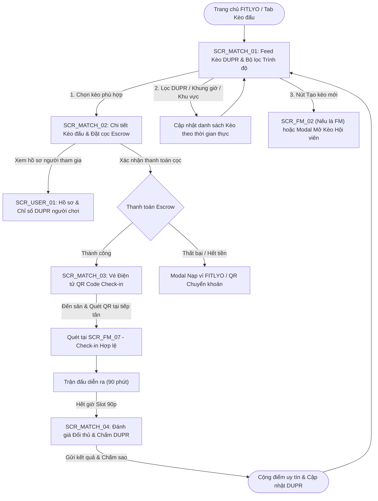
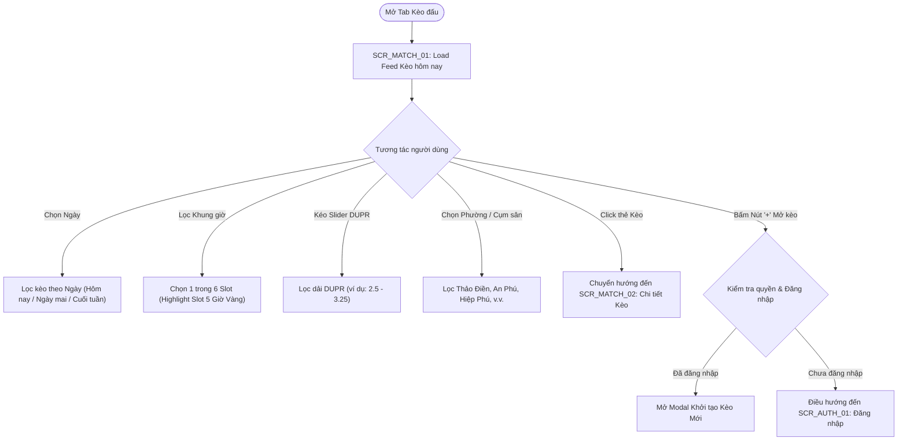
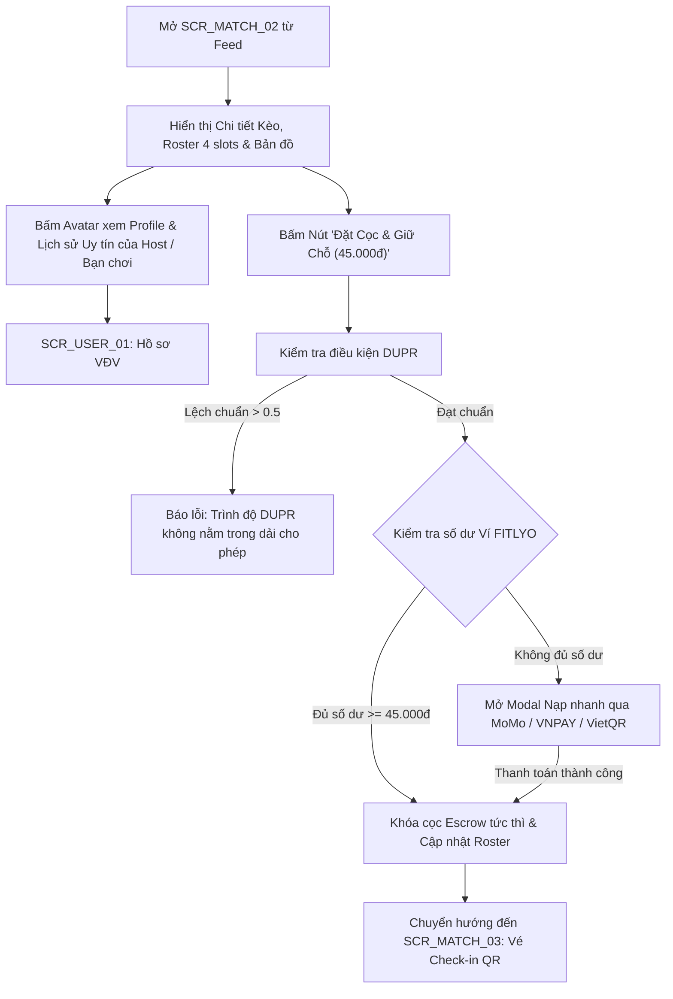
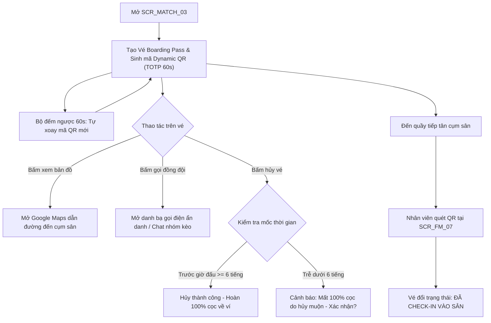
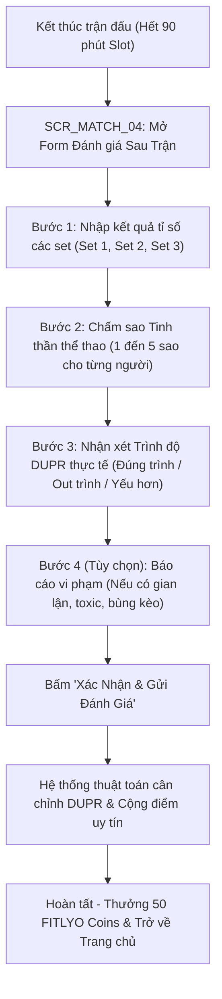

# TÀI LIỆU ĐẶC TẢ CHI TIẾT MÀN HÌNH - PHÂN HỆ KÈO ĐẤU PICKLEBALL & GHÉP TRẬN DUPR (SCR_MATCH_xx)
**Dự án:** Nền Tảng Thể Thao FITLYO Pickleball (EXE101 - FPT University)  
**Phiên bản:** 2.0  
**Tác giả:** Đội ngũ Phân tích & Thiết kế Giao diện FITLYO  
**Phân hệ:** Social Matchmaking & DUPR Matches (`SCR_MATCH_xx`)  
**Ngày cập nhật:** 14/10/2026  
**Môi trường áp dụng:** Mobile Web (PWA / Responsive Mobile First: 375px - 430px) & Web App Desktop (1280px+)

---

## MỤC LỤC TÀI LIỆU
1. [TỔNG QUAN KIẾN TRÚC & SƠ ĐỒ ĐIỀU HƯỚNG PHÂN HỆ MATCH](#1-tổng-quan-kiến-trúc--sơ-đồ-điều-hướng-phân-hệ-match)
   - 1.1. Vai trò & Mục tiêu kinh doanh của Phân hệ Kèo Đấu
   - 1.2. Sơ đồ luồng điều hướng tổng thể (Match Navigation Flow)
   - 1.3. Bảng danh mục màn hình nhóm SCR_MATCH_xx
2. [ĐẶC TẢ CHI TIẾT TỪNG MÀN HÌNH](#2-đặc-tả-chi-tiết-từng-màn-hình)
   - 2.1. `SCR_MATCH_01`: Feed Danh sách Kèo DUPR & Bộ lọc Trình độ (Social Matchmaking Feed & Level Filter)
   - 2.2. `SCR_MATCH_02`: Chi tiết Kèo đấu, Danh sách Vận động viên & Đặt cọc Giữ chỗ (Match Details, Roster & Escrow Deposit)
   - 2.3. `SCR_MATCH_03`: Vé Điện tử QR Code Check-in & Hướng dẫn Đến sân (Digital Match Pass & Dynamic QR Code Check-in)
   - 2.4. `SCR_MATCH_04`: Đánh giá Đối thủ & Chấm điểm DUPR Sau trận (Post-match Peer Review & DUPR Rating Submission)
3. [MA TRẬN PHÂN QUYỀN TRÊN GIAO DIỆN PHÂN HỆ MATCH (RBAC ON UI MATRIX)](#3-ma-trận-phân-quyền-trên-giao-diện-phân-hệ-match-rbac-on-ui-matrix)
4. [QUY CHUẨN DESIGN TOKENS & TRẠNG THÁI MÀU SẮC DÀNH CHO MATCHMAKING](#4-quy-chuẩn-design-tokens--trạng-thái-màu-sắc)

---

## 1. TỔNG QUAN KIẾN TRÚC & SƠ ĐỒ ĐIỀU HƯỚNG PHÂN HỆ MATCH

### 1.1. Vai trò & Mục tiêu kinh doanh của Phân hệ Kèo Đấu
Phân hệ Kèo đấu (`SCR_MATCH_xx`) là "trái tim cộng đồng" của nền tảng FITLYO, trực tiếp giải quyết 3 nỗi đau lớn nhất của người chơi phong trào và chủ sân tại TP. Thủ Đức:
1. **Thiếu bạn chơi ngang trình độ (No Fair Match):** Người chơi tự phát thường gặp tình trạng "lệch trình", dẫn đến trải nghiệm thể thao kém hào hứng. Hệ thống áp dụng thuật toán lọc chặn DUPR linh hoạt (sai số ±0.25 đến ±0.50), đảm bảo các trận đấu 4 người có trình độ cân bằng nhất.
2. **Nạn "Bỏ kèo / Bùng cọc" (No-show & Flaking):** FITLYO áp dụng cơ chế **Ký quỹ Giữ chỗ (Escrow Deposit)**. Khi đăng ký tham gia, hệ thống tạm giữ 100% tiền chia sân (ví dụ 45.000đ - 65.000đ/90 phút). Nếu thành viên tự ý vắng mặt không báo trước 6 tiếng, tiền cọc sẽ tự động phạt và bù đắp cho 3 người chơi còn lại trên sân.
3. **Quy chuẩn hóa 6 Khung Giờ 90 Phút:** Mọi kèo đấu được đồng bộ với 6 khung giờ chuẩn của các cụm sân đối tác (06:00 - 21:30), nhận diện tự động **Khung Giờ Vàng (Slot 5: 18:30 - 20:00)** để phân bổ số lượng người ghép hợp lý.

---

### 1.2. Sơ đồ luồng điều hướng tổng thể (Match Navigation Flow)



---

### 1.3. Bảng danh mục màn hình nhóm SCR_MATCH_xx

| Mã màn hình | Tên màn hình chức năng | Loại giao diện | Điểm vào chính (Entry Point) | Điểm thoát chính (Exit Point) |
| :--- | :--- | :--- | :--- | :--- |
| **`SCR_MATCH_01`** | Feed Danh sách Kèo DUPR & Bộ lọc Trình độ | Full Page (Mobile First) | Bottom Nav: Tab "Kèo đấu", Banner Trang chủ | `SCR_MATCH_02`, Bộ lọc nâng cao, Modal Mở kèo |
| **`SCR_MATCH_02`** | Chi tiết Kèo đấu, Danh sách VĐV & Đặt cọc | Full Page / Sticky Bottom Bar | Click thẻ Kèo trên `SCR_MATCH_01` | `SCR_MATCH_03`, Back `SCR_MATCH_01`, `SCR_USER_01` |
| **`SCR_MATCH_03`** | Vé Điện tử QR Code Check-in & Hướng dẫn | Full Page / Kiosk Ticket | Sau khi thanh toán cọc, Tab "Lịch của tôi" | Map Google Chỉ đường, `SCR_MATCH_04`, Hủy cọc |
| **`SCR_MATCH_04`** | Đánh giá Đối thủ & Chấm điểm DUPR Sau trận | Modal / Full Screen Wizard | Notification sau trận, Nút đánh giá ở Vé | Trở về Feed `SCR_MATCH_01`, Cập nhật `SCR_USER_01` |

---

## 2. ĐẶC TẢ CHI TIẾT TỪNG MÀN HÌNH

---

### 2.1. `SCR_MATCH_01`: Feed Danh sách Kèo DUPR & Bộ lọc Trình độ (Social Matchmaking Feed & Level Filter)

#### 1. Thông tin chung (Overview)
- **Mã màn hình:** `SCR_MATCH_01`
- **Tên màn hình:** Feed Danh sách Kèo DUPR & Bộ lọc Trình độ
- **Phân hệ:** Kèo Đấu & Ghép Trận (`SCR_MATCH`)
- **Đối tượng sử dụng:** Tất cả thành viên có tài khoản FITLYO (Người chơi vãng lai, Hội viên VIP, Huấn luyện viên, Chủ sân). Khách chưa đăng nhập được xem ở chế độ Read-only.
- **Mục tiêu cốt lõi:** Cho phép người chơi tìm thấy trận đấu phù hợp trong vòng dưới 30 giây bằng bộ lọc 3 trục: **Khung giờ (6 slot)**, **Trình độ DUPR (±0.25)**, và **Khu vực địa lý (TP. Thủ Đức)**; hiển thị minh bạch số lượng chỗ trống và chi phí cọc chia đều.

#### 2. Sơ đồ luồng màn hình (Screen Flow)


#### 3. Wireframe Bố cục Giao diện (Layout Wireframe)
```text
+-------------------------------------------------------------+
| [=] FITLYO PICKLEBALL                (Q) Tìm kiếm   [@] Avatar |
+-------------------------------------------------------------+
| [Hôm nay, 14/10]  [Ngày mai, 15/10]  [Thứ 7, 18/10]  [Chọn ngày]  |
|                                                             |
| BỘ LỌC 6 SLOT CHUẨN:                                         |
| ( ) Slot 1 ( ) Slot 2 ( ) Slot 3 ( ) Slot 4 (*) Slot 5 [VÀNG] ( ) Slot 6 |
|  06:00-07:30 07:30-09:00 09:00-10:30 15:30-17:00 18:30-20:00 20:00-21:30 |
|                                                             |
| TRÌNH ĐỘ DUPR: [ o===●===================o ] 2.75 - 3.25     |
| KHU VỰC: [ Tất cả phường (Thủ Đức) ▼ ]   THỂ THỨC: [ Đôi nam nữ ▼ ] |
+-------------------------------------------------------------+
| ĐANG CÓ 14 KÈO ĐẤU SẴN SÀNG GHÉP (Sắp xếp: Giờ gần nhất)     |
|                                                             |
| +---------------------------------------------------------+ |
| | [HOT-KÈO VÀNG] [DUPR 3.0 - 3.5]         Cọc: 45.000đ/người | |
| | Cụm Sân: D-Pickleball Thảo Điền - Sân 02                 | |
| | Thời gian: Slot 5 (18:30 - 20:00) | Tối nay (14/10)     | |
| | Thể thức: Giao lưu Đôi Nam Nữ - Tính điểm DUPR nội bộ   | |
| |                                                         | |
| | Vận động viên (3/4 Chỗ):                                 | |
| | (Avatar 1: Host 3.25) (Avatar 2: 3.10) (Avatar 3: 3.40) | |
| | [ ? CÒN TRỐNG 1 CHỖ - DUPR 3.0+]                        | |
| |                                                         | |
| | [Chi tiết kèo]                   [ THAM GIA & CỌC NGAY ]| |
| +---------------------------------------------------------+ |
|                                                             |
| +---------------------------------------------------------+ |
| | [GIAO LƯU NEWBIE] [DUPR 2.0 - 2.5]      Cọc: 35.000đ/người | |
| | Cụm Sân: Saigon Rackets Hiệp Phú - Sân 01                | |
| | Thời gian: Slot 1 (06:00 - 07:30) | Sáng mai (15/10)    | |
| | Thể thức: Rèn luyện kỹ thuật Dinking cơ bản             | |
| | Vận động viên: (Avatar 1: Host 2.25) (Avatar 2: 2.10)   | |
| | [ ? CÒN TRỐNG 2 CHỖ ]                                   | |
| | [Chi tiết kèo]                   [ THAM GIA & CỌC NGAY ]| |
| +---------------------------------------------------------+ |
|                                                             |
| [+] NÚT NỔI: TẠO KÈO GHÉP MỚI                               |
+-------------------------------------------------------------+
| [Trang chủ]    [* Kèo Đấu *]    [Đặt Sân]    [HLV]    [Tôi] |
+-------------------------------------------------------------+
```

#### 4. Bảng Đặc tả Thành phần Giao diện (Component & Field Specs)

| Mã Thành phần | Tên Thành phần | Loại Control | Dữ liệu / Định dạng | Ràng buộc Nghiệp vụ & Tương tác |
| :--- | :--- | :--- | :--- | :--- |
| `M01_DATE_TABS` | Thanh chọn ngày nhanh | Horizontal Scroll Tab | String: `YYYY-MM-DD` | Mặc định chọn "Hôm nay". Cho phép xem tối đa 14 ngày tới. |
| `M01_SLOT_FILTER` | Pills lọc 6 Slot 90p | Chip Group (Single/Multi) | Enum: `SLOT_1`..`SLOT_6` | Slot 5 (18:30 - 20:00) gắn badge nổi bật màu Amber "GIỜ VÀNG". |
| `M01_DUPR_SLIDER` | Thanh trượt dải DUPR | Range Slider kép | Float: `1.0` đến `6.0`, step `0.25` | Giới hạn tìm kiếm trong khoảng phù hợp với DUPR của user (±0.50). |
| `M01_LOC_DROPDOWN` | Chọn khu vực / phường | Dropdown Select | Enum phường TP. Thủ Đức | Lọc theo vị trí địa lý thuận tiện di chuyển. |
| `M01_MATCH_CARD` | Thẻ thông tin Kèo | Container Card | Object Match | Click vùng thẻ mở `SCR_MATCH_02`. Hiển thị badge trạng thái rõ ràng. |
| `M01_DUPR_BADGE` | Huy hiệu dải DUPR | Tag Badge | String (vd: "DUPR 3.0 - 3.5") | Xanh lục (Newbie 2.0-2.9), Xanh dương (3.0-3.9), Đỏ cam (4.0+). |
| `M01_PRICE_TEXT` | Tiền cọc chia đều | Typography | Currency: `xx.000đ/người` | Tính theo: Giá thuê sân 90p / 4 người chơi. |
| `M01_ROSTER_AVATARS` | Danh sách avatar VĐV | Avatar Group | 4 slots tối đa | Hiển thị avatar kèm điểm DUPR nhỏ ở góc. Chỗ trống hiển thị dấu "+". |
| `M01_JOIN_BTN` | Nút Tham gia & Cọc | Primary Button | Action Trigger | Nếu kèo đủ 4/4: disable ghi "HẾT CHỖ"; nếu còn chỗ: mở thẳng cọc. |
| `M01_FAB_CREATE` | Nút nổi tạo kèo mới | Floating Action Button | Action Trigger | Ghim góc dưới phải. Bấm mở modal tạo kèo ghép mới. |

#### 5. Ma trận 5 Trạng thái Giao diện (5 UI States Matrix)
1. **Normal (Bình thường):** Hiển thị danh sách 8-15 kèo khả dụng theo ngày và bộ lọc hiện tại. Có phân trang vô hạn (Infinite Scroll).
2. **Empty (Trống dữ liệu):** Không có kèo nào phù hợp tiêu chí lọc. Hiển thị hình minh họa quả bóng Pickleball buồn + nút CTA: *"Chưa có kèo nào trong khung giờ này. Hãy là người đầu tiên tạo kèo!"*.
3. **Loading (Đang tải):** Hiển thị 3 khung Skeleton Card lấp lánh (Shimmer Effect) mô phỏng cấu trúc thẻ kèo.
4. **Error (Lỗi kết nối):** Mất kết nối internet hoặc API lỗi. Hiển thị thông báo *"Không thể làm mới danh sách kèo đấu. Vui lòng thử lại."* kèm nút *"Tải lại"*.
5. **Success / Real-time Update:** Khi có người khác vừa tham gia hoặc vừa tạo kèo mới, thanh SnackBar nhỏ ở đỉnh báo: *"Có 2 kèo mới vừa mở trong khu vực của bạn! Bấm để cập nhật"*.

#### 6. Phân quyền & Điều kiện hiển thị (RBAC on UI)
- **Guest (Chưa đăng nhập):** Xem được feed kèo công khai. Khi bấm nút "Tham gia & Cọc ngay" hoặc FAB "Tạo kèo mới", hệ thống hiển thị Sheet Đăng nhập (`SCR_AUTH_01`).
- **Player (Đã đăng nhập, DUPR Unrated / Đã xác thực):** Được tham gia kèo phù hợp DUPR. Nếu kèo yêu cầu DUPR 3.5+ mà người chơi chỉ đạt 2.5, nút Tham gia hiển thị trạng thái Disabled kèm Tooltip: *"Yêu cầu DUPR tối thiểu 3.50 (Hiện tại của bạn: 2.50)"*.
- **VIP Member:** Ưu tiên hiển thị huy hiệu vương miện vàng trên Avatar, miễn phí giao dịch nạp cọc.

---

### 2.2. `SCR_MATCH_02`: Chi tiết Kèo đấu, Danh sách Vận động viên & Đặt cọc Giữ chỗ (Match Details, Roster & Escrow Deposit)

#### 1. Thông tin chung (Overview)
- **Mã màn hình:** `SCR_MATCH_02`
- **Tên màn hình:** Chi tiết Kèo đấu, Danh sách Vận động viên & Đặt cọc Giữ chỗ
- **Phân hệ:** Kèo Đấu & Ghép Trận (`SCR_MATCH`)
- **Điểm vào:** Bấm vào bất kỳ thẻ kèo nào từ `SCR_MATCH_01` hoặc bấm link chia sẻ trực tiếp (Deep-link).
- **Mục tiêu cốt lõi:** Minh bạch hóa thông tin trận đấu (Ai là Host, trình độ người đã tham gia, chất lượng mặt sân, khung giờ) và thu khoản **Ký quỹ Escrow (45.000đ - 65.000đ)** một cách tức thì qua Ví FITLYO hoặc MoMo/VNPAY.

#### 2. Sơ đồ luồng màn hình (Screen Flow)


#### 3. Wireframe Bố cục Giao diện (Layout Wireframe)
```text
+-------------------------------------------------------------+
| [< Quay lại]            CHI TIẾT KÈO ĐẤU           [Chia sẻ] |
+-------------------------------------------------------------+
| [ẢNH BÌA CỤM SÂN: D-Pickleball Thảo Điền - Sân 02 (Trong nhà)]|
|                                                             |
| [HOT - GIỜ VÀNG]  [DUPR Mục tiêu: 3.00 - 3.50]  [Giao lưu Đôi]|
|                                                             |
| Thời gian: 18:30 - 20:00 (Slot 5 Chuẩn - 90 Phút)           |
| Ngày đấu : Thứ Tư, 14/10/2026                               |
| Địa điểm : 12 Võ Trường Toản, Phường Thảo Điền, TP. Thủ Đức |
|             [Xem bản đồ chỉ đường & Hotline cụm sân >]       |
+-------------------------------------------------------------+
| DANH SÁCH VẬN ĐỘNG VIÊN THAM GIA (3/4 VĐV ĐÃ CỌC):          |
|                                                             |
| [Slot 1 - Host]  (Avatar) Nguyễn Văn An  [DUPR 3.25] [Uy tín 100%] |
|                  Đã đặt cọc 45.000đ - Sẵn sàng              |
|                                                             |
| [Slot 2]         (Avatar) Lê Quốc Bảo   [DUPR 3.10] [Uy tín 98%]  |
|                  Đã đặt cọc 45.000đ - Sẵn sàng              |
|                                                             |
| [Slot 3]         (Avatar) Trần Minh Trí [DUPR 3.40] [Uy tín 95%]  |
|                  Đã đặt cọc 45.000đ - Sẵn sàng              |
|                                                             |
| [Slot 4 - Trống] ( + ) BẠN CÓ THỂ THAM GIA VỊ TRÍ NÀY       |
|                  Yêu cầu: DUPR từ 2.75 đến 3.50             |
+-------------------------------------------------------------+
| CHÍNH SÁCH KÝ QUỸ & HOÀN HUỶ (ESCROW POLICY):               |
| - Tiền sân chia đều: 45.000đ / người cho 90 phút thi đấu.   |
| - Hoàn 100% tiền cọc nếu hủy trước giờ thi đấu >= 6 tiếng.  |
| - Nếu hủy trễ < 6 tiếng hoặc Bỏ kèo (No-show): MẤT 100% CỌC |
|   (Tiền phạt được chia đều bù đắp cho 3 thành viên còn lại).|
+-------------------------------------------------------------+
| THANH TOÁN KÝ QUỸ:                                          |
| Số dư ví hiện tại: 120.000đ (Đủ thanh toán)                 |
|                                                             |
| [  ĐẶT CỌC & GIỮ CHỖ NGAY (45.000đ) - KHÓA CHỖ TỨC THÌ    ] |
+-------------------------------------------------------------+
```

#### 4. Bảng Đặc tả Thành phần Giao diện (Component & Field Specs)

| Mã Thành phần | Tên Thành phần | Loại Control | Dữ liệu / Định dạng | Ràng buộc Nghiệp vụ & Tương tác |
| :--- | :--- | :--- | :--- | :--- |
| `M02_BANNER_IMG` | Ảnh bìa cụm sân | Image Carousel | URL Ảnh WebP HD | Vuốt xem cơ sở vật chất (mặt sân, đèn chiếu sáng, phòng tắm). |
| `M02_MATCH_HEADER`| Tiêu đề & Tag kèo | Typography + Badges | Text + Enums | Hiển thị rõ tên kèo, dải DUPR và nhãn Slot 5 Vàng (nếu có). |
| `M02_MAP_LINK` | Link xem chỉ đường | Text Link / Icon | Google Maps Lat/Lng | Bấm mở bản đồ ngoài hoặc modal dẫn đường GPS trực tiếp. |
| `M02_ROSTER_LIST` | Danh sách 4 vị trí | List Group | Danh sách VĐV | Hiển thị thông tin từng người: Tên, DUPR, Tỉ lệ Uy tín (Fair-play score). |
| `M02_SLOT_EMPTY` | Ô vị trí còn trống | Card Action | State Display | Nếu user đủ điều kiện DUPR -> hiển thị khung xanh viền nét đứt. |
| `M02_ESCROW_INFO` | Hộp chính sách cọc | Info Box Callout | Static Text + Alert | Nền màu xám trung tính, biểu tượng khiên bảo mật xanh lá. |
| `M02_WALLET_INFO` | Số dư ví thanh toán | Key-Value Row | Currency (VND) | Tự động tính xem số dư ví có đủ trừ 45.000đ hay không. |
| `M02_SUBMIT_BTN` | Nút Ký quỹ giữ chỗ | Big Sticky Button | Primary Green Button | Khóa tương tác trong lúc gọi API Escrow chống double-click. |

#### 5. Ma trận 5 Trạng thái Giao diện (5 UI States Matrix)
1. **Normal (Bình thường):** Kèo còn chỗ trống (ví dụ 3/4), người xem có DUPR hợp lệ, nút cọc màu xanh kích hoạt sẵn.
2. **Kèo Đã Đầy (Full Roster):** Đủ 4/4 thành viên. Nút cọc chuyển xám vô hiệu hóa: *"Kèo đã đủ người tham gia - Đang diễn ra trận đấu"*.
3. **Lệch DUPR (Out of Range):** DUPR người chơi không nằm trong dải yêu cầu. Nút cọc disabled kèm thông báo: *"Kèo yêu cầu DUPR 3.0 - 3.5 (Điểm của bạn là 2.20)"*.
4. **Processing (Đang giao dịch cọc):** Spinner quay trên nút, văn bản đổi thành: *"Đang khóa cọc giữ chỗ qua Ví FITLYO..."*.
5. **Success (Đặt cọc thành công):** Hiệu ứng Confetti chúc mừng xuất hiện 1 giây, tự động chuyển tiếp sang Màn hình Vé Check-in `SCR_MATCH_03`.

#### 6. Phân quyền & Điều kiện hiển thị (RBAC on UI)
- **Host (Người tạo kèo):** Thấy nút "Hủy kèo & Giải tán phòng" (chỉ khả dụng nếu hủy trước >= 6 tiếng; tiền hoàn 100% cho các thành viên đã cọc).
- **Thành viên đã cọc:** Thấy trạng thái "Đã giữ chỗ thành công" + nút "Xem vé QR".
- **Thành viên chưa cọc:** Thấy nút "Đặt cọc & Giữ chỗ ngay".

---

### 2.3. `SCR_MATCH_03`: Vé Điện tử QR Code Check-in & Hướng dẫn Đến sân (Digital Match Pass & Dynamic QR Code Check-in)

#### 1. Thông tin chung (Overview)
- **Mã màn hình:** `SCR_MATCH_03`
- **Tên màn hình:** Vé Điện tử QR Code Check-in & Hướng dẫn Đến sân
- **Phân hệ:** Kèo Đấu & Ghép Trận (`SCR_MATCH`)
- **Điểm vào:** Sau khi thanh toán cọc thành công tại `SCR_MATCH_02` hoặc vào từ Menu "Lịch của tôi" (`SCR_USER_03`).
- **Mục tiêu cốt lõi:** Cung cấp vé vào sân điện tử định dạng Boarding Pass với mã **Dynamic QR Code** chống gian lận (tự làm mới mỗi 60 giây), thông tin chỉ dẫn sân bãi, và số điện thoại ẩn danh liên lạc với bạn cùng chơi.

#### 2. Sơ đồ luồng màn hình (Screen Flow)


#### 3. Wireframe Bố cục Giao diện (Layout Wireframe)
```text
+-------------------------------------------------------------+
| [< Lịch thi đấu]           VÉ ĐIỆN TỬ VÀO SÂN       [Lưu ảnh] |
+-------------------------------------------------------------+
| . - - - - - - - - - - - - - - - - - - - - - - - - - - - - . |
| '               FITLYO MATCH PASS - KÈO SOCIAL            ' |
| '  Mã vé: #FTL-M26-8891                Trạng thái: ĐÃ CỌC ' |
| '                                                         ' |
| '  CỤM SÂN: D-Pickleball Thảo Điền                         ' |
| '  SÂN THI ĐẤU: SÂN 02 (Trong nhà - Máy lạnh)             ' |
| '  THỜI GIAN  : 18:30 - 20:00 (Slot 5 Giờ Vàng)           ' |
| '  NGÀY ĐẤU   : Thứ Tư, 14/10/2026                        ' |
| ' - - - - - - - - - - - - - - - - - - - - - - - - - - - - ' |
| '                   [ MÃ DYNAMIC QR CODE ]                ' |
| '                     +---------------+                   ' |
| '                     |  █▀▀█ █▀█ █▀▀█|                   ' |
| '                     |  █▄▄█ █▀▀ █▄▄█|                   ' |
| '                     |  █  █ █▄█ █  █|                   ' |
| '                     +---------------+                   ' |
| '             Mã làm mới sau: 42s (Chống chụp màn hình)   ' |
| '           Đưa mã này cho tiếp tân để quét khi vào sân   ' |
| ' - - - - - - - - - - - - - - - - - - - - - - - - - - - - ' |
| '  VỊ TRÍ GHẾ / TỦ ĐỒ: Tủ đồ Locker #14 (Miễn phí)        ' |
| '  ĐỒNG ĐỘI CÙNG TRẬN:                                    ' |
| '  - Nguyễn Văn An (Host - 0987.xxx.231) [Chat]           ' |
| '  - Lê Quốc Bảo          (0912.xxx.445) [Chat]           ' |
| '  - Trần Minh Trí        (0933.xxx.889) [Chat]           ' |
| . - - - - - - - - - - - - - - - - - - - - - - - - - - - - . |
|                                                             |
| [  CHỈ ĐƯỜNG ĐẾN CỤM SÂN (GOOGLE MAPS)  ]                  |
| [  CHAT VỚI NHÓM TRẬN ĐẤU (4 NGƯỜI)     ]                  |
|                                                             |
| [x] Hủy vé & Rút cọc (Chính sách: Hoàn 100% trước 12:30 hôm nay) |
+-------------------------------------------------------------+
```

#### 4. Bảng Đặc tả Thành phần Giao diện (Component & Field Specs)

| Mã Thành phần | Tên Thành phần | Loại Control | Dữ liệu / Định dạng | Ràng buộc Nghiệp vụ & Tương tác |
| :--- | :--- | :--- | :--- | :--- |
| `M03_TICKET_CARD`| Khung vé Boarding Pass | Card Container | Custom Styling | Họa tiết đục lỗ vé hai bên sườn (notch design), nền trắng sang trọng. |
| `M03_BOOKING_CODE`| Mã định danh vé | Typography (Mono) | Text: `#FTL-Mxx-xxxx` | Mã duy nhất dùng để đối soát thủ công nếu camera quét hỏng. |
| `M03_DYNAMIC_QR` | Mã QR động bảo mật | QR Canvas Renderer | TOTP Key + BookingID | Tự động đổi chuỗi băm mã hóa mỗi 60 giây. Chống chụp màn hình gửi người khác. |
| `M03_TIMER_BAR` | Thanh đếm ngược QR | Progress Bar / Text | Số nguyên: 60s -> 0s | Màu xanh khi > 20s, chuyển vàng cam khi < 10s. |
| `M03_ROSTER_CONTACT`| Danh sách liên lạc nhóm| List Group + Button | SĐT che 3 số giữa | Có nút Chat nhanh hoặc Gọi điện ẩn danh bảo vệ quyền riêng tư. |
| `M03_MAP_BTN` | Nút chỉ đường GPS | Secondary Button | Intent trigger | Khởi chạy ứng dụng bản đồ điều hướng chỉ đường tới cụm sân. |
| `M03_CANCEL_LINK` | Link Hủy tham gia | Destructive Text | Action Trigger | Kiểm tra quy tắc 6 tiếng để cảnh báo phạt cọc trước khi xác nhận. |

#### 5. Ma trận 5 Trạng thái Giao diện (5 UI States Matrix)
1. **Normal (Chưa Check-in):** Vé hợp lệ, QR xoay đều đặn mỗi 60 giây, nền trắng viền xanh lá.
2. **Checked-in (Đã vào sân):** Tiếp tân quét thành công tại quầy. Vé chuyển sang nền xanh nhạt, QR bị mờ đi và đóng dấu Stamp tròn màu đỏ: *"ĐÃ CHECK-IN VÀO SÂN LÚC 18:22"*.
3. **In-Progress (Đang thi đấu):** Hiển thị đồng hồ đếm ngược thời gian còn lại của Slot 90 phút (ví dụ: *"Còn 35 phút thi đấu"*).
4. **Expired / No-show (Quá hạn / Vắng mặt):** Người chơi không xuất hiện sau 30 phút tính từ giờ bắt đầu slot. Đóng dấu: *"VẮNG MẶT (BỎ KÈO) - PHẠT 100% CỌC"*.
5. **Cancelled (Đã hủy hợp lệ):** Hiển thị dấu *"ĐÃ HỦY - ĐÃ HOÀN 45.000đ VỀ VÍ"*.

#### 6. Phân quyền & Điều kiện hiển thị (RBAC on UI)
- Chỉ chủ sở hữu vé (User ID trùng khớp) mới mở được mã Dynamic QR này.
- Chủ sân và nhân viên tiếp tân dùng giao diện quét riêng (`SCR_FM_07`) để giải mã và xác nhận.

---

### 2.4. `SCR_MATCH_04`: Đánh giá Đối thủ & Chấm điểm DUPR Sau trận (Post-match Peer Review & DUPR Rating Submission)

#### 1. Thông tin chung (Overview)
- **Mã màn hình:** `SCR_MATCH_04`
- **Tên màn hình:** Đánh giá Đối thủ & Chấm điểm DUPR Sau trận
- **Phân hệ:** Kèo Đấu & Ghép Trận (`SCR_MATCH`)
- **Điểm vào:** Tự động kích hoạt bằng Push Notification khi Slot 90 phút kết thúc hoặc bấm nút "Đánh giá trận đấu" từ Vé `SCR_MATCH_03`.
- **Mục tiêu cốt lõi:** Thu thập kết quả tỉ số trận đấu, chấm điểm phong cách thể thao (Fair-play), và xác nhận trình độ DUPR thực tế của 3 người chơi còn lại. Đảm bảo dữ liệu DUPR nội bộ của FITLYO luôn trung thực và phản ánh đúng thực tế.

#### 2. Sơ đồ luồng màn hình (Screen Flow)


#### 3. Wireframe Bố cục Giao diện (Layout Wireframe)
```text
+-------------------------------------------------------------+
| [X Đóng]            ĐÁNH GIÁ TRẬN ĐẤU SAU GIỜ CHƠI           |
+-------------------------------------------------------------+
| Trận: Slot 5 (18:30 - 20:00) | Cụm sân D-Pickleball Thảo Điền|
|                                                             |
| 1. KẾT QUẢ TỈ SỐ TRẬN ĐẤU:                                  |
| [ Đôi bạn & Minh Trí ]        vs       [ Văn An & Quốc Bảo ] |
|  Set 1:  [ 11 ]                           [  9 ]            |
|  Set 2:  [  7 ]                           [ 11 ]            |
|  Set 3:  [ 11 ]                           [  8 ]            |
| -> Kết quả: Đội bạn thắng 2 - 1                             |
+-------------------------------------------------------------+
| 2. ĐÁNH GIÁ ĐỒNG ĐỘI & ĐỐI THỦ:                             |
|                                                             |
| * Người chơi 1: Nguyễn Văn An (Host - Khai báo DUPR: 3.25)   |
|   - Tinh thần thể thao:  [ ★ ] [ ★ ] [ ★ ] [ ★ ] [ ★ ] (5/5) |
|   - Trình độ thực tế  :  ( ) Đúng dải 3.25                   |
|                          (*) Đánh hay hơn (Nên tăng DUPR)   |
|                          ( ) Đánh yếu hơn khai báo          |
|                                                             |
| * Người chơi 2: Lê Quốc Bảo (Khai báo DUPR: 3.10)            |
|   - Tinh thần thể thao:  [ ★ ] [ ★ ] [ ★ ] [ ★ ] [ ☆ ] (4/5) |
|   - Trình độ thực tế  :  (*) Đúng dải trình độ 3.0 - 3.25    |
|                                                             |
| * Người chơi 3: Trần Minh Trí (Partner của bạn - DUPR: 3.40) |
|   - Tinh thần thể thao:  [ ★ ] [ ★ ] [ ★ ] [ ★ ] [ ★ ] (5/5) |
|   - Trình độ thực tế  :  (*) Đúng dải trình độ 3.25 - 3.50   |
+-------------------------------------------------------------+
| [!] BÁO CÁO SỰ CỐ / GIAN LẬN (Nếu có):                      |
| [ ] Có người chơi bỏ về giữa chừng                          |
| [ ] Thái độ phi thể thao, xúc phạm người khác               |
| [ ] Cố tình gian lận điểm DUPR (Khai khống trình độ)        |
+-------------------------------------------------------------+
| [  XÁC NHẬN KẾT QUẢ & HOÀN TẤT ĐÁNH GIÁ  ]                  |
| (Nhận ngay +50 FITLYO Coins & Tăng 2 điểm Uy tín tài khoản)  |
+-------------------------------------------------------------+
```

#### 4. Bảng Đặc tả Thành phần Giao diện (Component & Field Specs)

| Mã Thành phần | Tên Thành phần | Loại Control | Dữ liệu / Định dạng | Ràng buộc Nghiệp vụ & Tương tác |
| :--- | :--- | :--- | :--- | :--- |
| `M04_SCORE_INPUT`| Ô nhập điểm từng set | Number Stepper / Text | Số nguyên từ 0 đến 30 | Pickleball tính đến 11 điểm (thắng cách biệt 2). Tự động tính bên thắng. |
| `M04_STAR_RATING`| Đánh giá Fair-play | 5-Star Interactive | Integer (1 - 5 sao) | Bắt buộc đánh giá cho cả 3 bạn chơi trước khi gửi. Mặc định 5 sao. |
| `M04_DUPR_CHOICE`| Xác nhận trình độ | Radio Button Group | Enum: `ACCURATE`, `HIGHER`, `LOWER` | Nếu > 2 người cùng nhận xét "Đánh hay hơn", hệ thống gắn cờ xem xét tăng DUPR. |
| `M04_REPORT_CHECK`| Hộp kiểm vi phạm | Checkbox Group | Multi-select | Nếu chọn, kích hoạt mở thêm ô nhập chi tiết và upload hình ảnh bằng chứng. |
| `M04_SUBMIT_BTN` | Nút gửi đánh giá | Primary Button | Action Trigger | Gửi dữ liệu lên API. Khóa nút sau khi bấm để tránh gửi trùng lặp. |

#### 5. Ma trận 5 Trạng thái Giao diện (5 UI States Matrix)
1. **Normal (Sẵn sàng đánh giá):** Form hiển thị đầy đủ tên 3 bạn chơi kèm tỉ số mặc định 0-0.
2. **Submitting (Đang lưu):** Nút hiển thị Spinner: *"Đang lưu dữ liệu đánh giá & cân chỉnh DUPR..."*.
3. **Validation Error (Thiếu thông tin):** Quên chưa nhập tỉ số hoặc chưa chọn sao cho người chơi: Viền đỏ vùng lỗi kèm thông báo *"Vui lòng đánh giá đủ 3 bạn chơi"*.
4. **Report Triggered (Kích hoạt khiếu nại):** Khi tích chọn báo cáo gian lận: Hiển thị thêm hộp thông báo gửi đến đội ngũ Admin (`SCR_ADMIN_03`).
5. **Success (Thành công):** Pop-up thông báo: *"Cảm ơn bạn! +50 FITLYO Coins đã được cộng vào tài khoản."* và tự động chuyển về trang cá nhân.

#### 6. Phân quyền & Điều kiện hiển thị (RBAC on UI)
- Chỉ có 4 VĐV đã thực tế check-in vào sân trong slot này mới có quyền tham gia chấm điểm trận đấu.
- Khách vãng lai hoặc người hủy kèo không thấy màn hình này.

---

## 3. MA TRẬN PHÂN QUYỀN TRÊN GIAO DIỆN PHÂN HỆ MATCH (RBAC ON UI MATRIX)

| Hành động trên Giao diện | Khách vãng lai (Guest) | Người chơi (Player) | Hội viên VIP | Chủ sân (FM) | Quản trị viên (Admin) |
| :--- | :---: | :---: | :---: | :---: | :---: |
| Xem Feed Kèo DUPR (`SCR_MATCH_01`) | Có (Chỉ xem) | Có | Có | Có | Có |
| Lọc nâng cao theo DUPR & Slot | Có | Có | Có | Có | Có |
| Xem Chi tiết Kèo (`SCR_MATCH_02`) | Có | Có | Có | Có | Có |
| Đặt cọc Escrow tham gia kèo | Yêu cầu Đăng nhập | Có | Ưu đãi miễn phí GD | Không tham gia | Xem đối soát |
| Xem Vé Dynamic QR (`SCR_MATCH_03`) | Không | Vé của mình | Vé của mình | Xem giao diện quét | Toàn quyền tra cứu |
| Chấm điểm DUPR (`SCR_MATCH_04`) | Không | Khi đã đá trận | Khi đã đá trận | Xem báo cáo tranh chấp | Xem & Can thiệp điểm |
| Hủy kèo & Nhận hoàn tiền 100% | Không | Trước 6 tiếng | Trước 4 tiếng (Ưu quyền) | Toàn quyền hủy khẩn cấp | Phê duyệt hoàn tiền |

---

## 4. QUY CHUẨN DESIGN TOKENS & TRẠNG THÁI MÀU SẮC

- **Primary Tennis Green:** `#16A34A` (Green-600) - Tượng trưng cho sân banh, hành động chính, nút Đặt cọc & Xác nhận.
- **Slot Vàng Amber:** `#D97706` (Amber-600) / `#FEF3C7` (Amber-100) - Dành riêng cho **Khung Giờ Vàng (Slot 5: 18:30 - 20:00)**.
- **DUPR Level Badges:**
  - *Newbie (DUPR 1.0 - 2.9):* `#059669` (Emerald-600)
  - *Intermediate (DUPR 3.0 - 3.9):* `#2563EB` (Blue-600)
  - *Advanced (DUPR 4.0+):* `#EA580C` (Orange-600)
- **Escrow Shield (Bảo vệ cọc):** `#0D9488` (Teal-600) - Biểu tượng thanh toán an toàn, minh bạch.
- **Destructive / Cảnh báo mất cọc:** `#DC2626` (Red-600).
