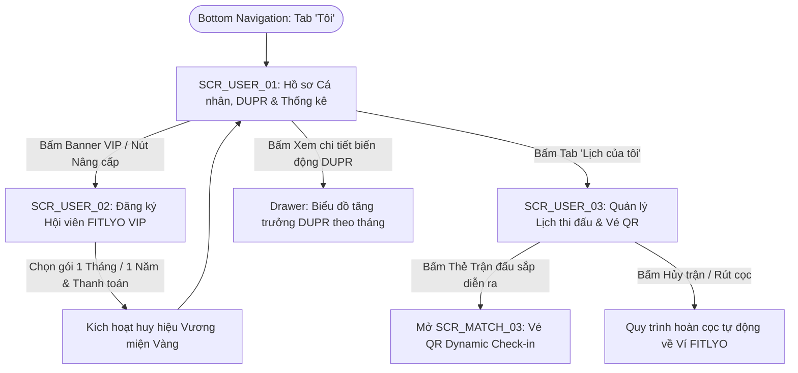

# TÀI LIỆU ĐẶC TẢ CHI TIẾT MÀN HÌNH - PHÂN HỆ HỒ SƠ NGƯỜI CHƠI, DUPR & HỘI VIÊN VIP (SCR_USER_xx)
**Dự án:** Nền Tảng Thể Thao FITLYO Pickleball (EXE101 - FPT University)  
**Phiên bản:** 2.0  
**Tác giả:** Đội ngũ Phân tích & Thiết kế Giao diện FITLYO  
**Phân hệ:** User Profile, DUPR Rating, Schedule & FITLYO VIP (`SCR_USER_xx`)  
**Ngày cập nhật:** 14/10/2026  
**Môi trường áp dụng:** Mobile Web Responsive (375px - 430px) & Web App Desktop (1280px+)

---

## MỤC LỤC TÀI LIỆU
1. [TỔNG QUAN KIẾN TRÚC & SƠ ĐỒ ĐIỀU HƯỚNG PHÂN HỆ USER](#1-tổng-quan-kiến-trúc--sơ-đồ-điều-hướng-phân-hệ-user)
   - 1.1. Vai trò & Mục tiêu kinh doanh của Phân hệ Hồ sơ Người chơi
   - 1.2. Sơ đồ luồng điều hướng tổng thể (User Navigation Flow)
   - 1.3. Bảng danh mục màn hình nhóm SCR_USER_xx
2. [ĐẶC TẢ CHI TIẾT TỪNG MÀN HÌNH](#2-đặc-tả-chi-tiết-từng-màn-hình)
   - 2.1. `SCR_USER_01`: Hồ sơ Cá nhân, DUPR Rating & Thống kê Phong độ (Player Profile, DUPR History & Stats)
   - 2.2. `SCR_USER_02`: Nâng cấp Gói Hội viên FITLYO VIP / Premium (VIP Membership Subscription & Perks)
   - 2.3. `SCR_USER_03`: Lịch Hoạt động & Quản lý Vé Tham gia (My Schedule & Activity Management)
3. [MA TRẬN PHÂN QUYỀN TRÊN GIAO DIỆN PHÂN HỆ USER (RBAC ON UI MATRIX)](#3-ma-trận-phân-quyền-trên-giao-diện)
4. [QUY CHUẨN DESIGN TOKENS & TRẠNG THÁI MÀU SẮC DÀNH CHO USER PROFILE](#4-quy-chuẩn-design-tokens--trạng-thái-màu-sắc)

---

## 1. TỔNG QUAN KIẾN TRÚC & SƠ ĐỒ ĐIỀU HƯỚNG PHÂN HỆ USER

### 1.1. Vai trò & Mục tiêu kinh doanh của Phân hệ Hồ sơ Người chơi
Phân hệ Hồ sơ Người chơi (`SCR_USER_xx`) đóng vai trò trung tâm giữ chân người dùng (Retention & Engagement), xây dựng danh tính số và tạo động lực thi đấu thể thao lâu dài:
1. **Minh bạch Điểm số & Lộ trình DUPR:** Cung cấp hồ sơ thể thao cá nhân chuyên nghiệp, hiển thị trực quan mức DUPR hiện tại (từ 1.0 đến 6.0), tỉ lệ thắng/thua, lịch sử biến động điểm sau từng trận đấu và chỉ số uy tín tinh thần thể thao (Fair-play score).
2. **Khai thác Mô hình Doanh thu Đăng ký (FITLYO VIP Subscription):** Cung cấp gói hội viên đặc quyền (99.000đ/tháng) giúp người chơi mở khóa các ưu đãi: Đặt sân trước 14 ngày (so với 3 ngày của tài khoản thường), miễn 100% phí trung gian nạp cọc Escrow, ưu tiên ghép kèo DUPR giờ cao điểm và giảm giá 5-10% tại hệ thống sân đối tác.
3. **Trung tâm Điều phối Lịch trình (Personal Schedule Hub):** Hợp nhất toàn bộ hoạt động thể thao của người chơi (Kèo ghép Social DUPR, Lịch bao sân riêng cả nhóm, Lịch học PT với Huấn luyện viên) vào một dòng thời gian duy nhất với vé điện tử Dynamic QR Code sẵn sàng check-in 1 chạm.

---

### 1.2. Sơ đồ luồng điều hướng tổng thể (User Navigation Flow)



---

### 1.3. Bảng danh mục màn hình nhóm SCR_USER_xx

| Mã màn hình | Tên màn hình chức năng | Loại giao diện | Điểm vào chính (Entry Point) | Điểm thoát chính (Exit Point) |
| :--- | :--- | :--- | :--- | :--- |
| **`SCR_USER_01`** | Hồ sơ Cá nhân, DUPR & Thống kê Phong độ | Full Page Mobile First | Bottom Nav: Tab "Tôi", Avatar Header | `SCR_USER_02`, `SCR_USER_03`, Chỉnh sửa hồ sơ |
| **`SCR_USER_02`** | Nâng cấp Gói Hội viên FITLYO VIP | Sales Subscription Page | Banner nâng cấp trên Profile, Drawer VIP | Modal Thanh toán, Trở về `SCR_USER_01` |
| **`SCR_USER_03`** | Lịch Hoạt động & Quản lý Vé Tham gia | Full Page Tabs | Menu "Lịch của tôi", Tab trên Profile | `SCR_MATCH_03` (Vé QR), Đánh giá sau trận `SCR_MATCH_04` |

---

## 2. ĐẶC TẢ CHI TIẾT TỪNG MÀN HÌNH

---

### 2.1. `SCR_USER_01`: Hồ sơ Cá nhân, DUPR Rating & Thống kê Phong độ (Player Profile, DUPR History & Stats)

#### 1. Thông tin chung (Overview)
- **Mã màn hình:** `SCR_USER_01`
- **Tên màn hình:** Hồ sơ Cá nhân, DUPR Rating & Thống kê Phong độ
- **Phân hệ:** Hồ sơ Người chơi (`SCR_USER`)
- **Đối tượng sử dụng:** Tất cả thành viên đã đăng ký tài khoản FITLYO (hoặc người khác xem hồ sơ công khai).
- **Mục tiêu cốt lõi:** Trưng bày danh tính thể thao của người chơi, gồm điểm DUPR chính thức, biểu đồ phân tích 5 kỹ năng chuyên môn, lịch sử thi đấu gần nhất, và các huy hiệu thành tích thể thao.

#### 2. Wireframe Bố cục Giao diện (Layout Wireframe)
```text
+-------------------------------------------------------------+
| [Cài đặt]                 HỒ SƠ CÁ NHÂN              [Chia sẻ] |
+-------------------------------------------------------------+
| (AVATAR 96x96)   NGUYỄN VĂN AN                  [VƯƠNG MIỆN VIP]|
| @an_pickleball   TP. Thủ Đức | Thành viên từ T03/2026        |
|                                                             |
| +---------------------------------------------------------+ |
| | ĐIỂM XẾP HẠNG DUPR CHÍNH THỨC:                          | |
| |                    [  3.42  ]                           | |
| | Xếp hạng: Trung cấp (Intermediate) | Phong độ: (+0.17)    | |
| | Cấp bởi: Đánh giá khảo sát + 14 Trận đấu Social Đã xác nhận| |
| +---------------------------------------------------------+ |
|                                                             |
| CHỈ SỐ THỐNG KÊ THỂ THAO:                                    |
| [ 28 Trận Đã Đấu ]  [ Thắng: 68% (19T - 9B) ]  [ Uy tín: 98% ]|
|                                                             |
| BIỂU ĐỒ KỸ THUẬT CHUYÊN MÔN (RADAR 5 TRỤC):                |
| - Giao bóng (Serve)            : [||||||||||  ] 8.5 / 10     |
| - Đỡ bóng 3 (Third-shot drop)  : [|||||||     ] 7.0 / 10     |
| - Đấu lưới Dinking             : [||||||||    ] 8.0 / 10     |
| - Tấn công Volley              : [||||||      ] 6.5 / 10     |
| - Di chuyển & Vị trí sân       : [||||||||    ] 8.0 / 10     |
+-------------------------------------------------------------+
| [ Lịch sử đấu (14) ]    [ Khóa học đã tốt nghiệp (1) ]     |
|                                                             |
| TRẬN ĐẤU GẦN NHẤT:                                          |
| +---------------------------------------------------------+ |
| | [THẮNG 2-1] (+0.05 DUPR)              Hôm qua (13/10)   | |
| | Cụm Sân: D-Pickleball Thảo Điền - Slot 5 (18:30)        | |
| | Partner: Minh Trí vs Đối thủ: Quốc Bảo & Hoàng Nam       | |
| | Tinh thần thể thao: ★★★★★ (Được 3/3 bạn chơi khen ngợi) | |
| +---------------------------------------------------------+ |
|                                                             |
| KHÓA HỌC ĐÃ TỐT NGHIỆP:                                     |
| +---------------------------------------------------------+ |
| | [CHỨNG CHỈ] BOOT CAMP PICKLEBALL 3.0 -> 3.5              | |
| | HLV Xác nhận: Lê Hoàng Dũng (IPTPA Level 2)             | |
| | Đạt cam kết đầu ra DUPR: 3.42 / 3.50                    | |
| +---------------------------------------------------------+ |
+-------------------------------------------------------------+
| [Trang chủ]    [Kèo Đấu]    [Đặt Sân]    [HLV]    [* Tôi *] |
+-------------------------------------------------------------+
```

#### 3. Bảng Đặc tả Thành phần Giao diện (Component & Field Specs)

| Mã Thành phần | Tên Thành phần | Loại Control | Dữ liệu / Định dạng | Ràng buộc Nghiệp vụ & Tương tác |
| :--- | :--- | :--- | :--- | :--- |
| `U01_AVATAR` | Ảnh đại diện | Image Avatar | URL ảnh tròn 96x96 | Cho phép tải ảnh mới từ thư viện máy. |
| `U01_VIP_BADGE` | Huy hiệu Hội viên VIP| Tag Badge | Màu vàng hoàng kim | Chỉ hiển thị nếu tài khoản còn hạn gói VIP (`SCR_USER_02`). |
| `U01_DUPR_CARD` | Khung điểm DUPR lớn | Display Card | Float: 2 số thập phân | Nhấn để mở biểu đồ biến thiên DUPR qua từng tháng. |
| `U01_WINRATE_BAR`| Tỉ lệ thắng & Uy tín | Stats Grid | Số nguyên phần trăm | Uy tín dựa trên phản hồi Fair-play từ `SCR_MATCH_04`. |
| `U01_SKILL_RADAR`| Biểu đồ kỹ thuật | Radar Chart / Progress | Điểm từ 1.0 đến 10.0 | Tổng hợp từ đánh giá sau trận và điểm danh HLV. |

---

### 2.2. `SCR_USER_02`: Nâng cấp Gói Hội viên FITLYO VIP / Premium (VIP Membership Subscription & Perks)

#### 1. Thông tin chung (Overview)
- **Mã màn hình:** `SCR_USER_02`
- **Tên màn hình:** Nâng cấp Gói Hội viên FITLYO VIP / Premium
- **Phân hệ:** Hồ sơ Người chơi (`SCR_USER`)
- **Điểm vào:** Click banner VIP trên `SCR_USER_01` hoặc pop-up khi đặt sân vượt quá 3 ngày.
- **Mục tiêu cốt lõi:** Bán gói đăng ký định kỳ hội viên FITLYO VIP, nêu bật bảng so sánh quyền lợi vượt trội và hoàn tất thanh toán trong 3 bước.

#### 2. Wireframe Bố cục Giao diện (Layout Wireframe)
```text
+-------------------------------------------------------------+
| [< Quay lại]             HỘI VIÊN FITLYO VIP        [Điều khoản]|
+-------------------------------------------------------------+
| [ BANNER VÀNG SANG TRỌNG: MỞ KHÓA TOÀN BỘ ĐẶC QUYỀN SÂN ĐẤU ]|
|                                                             |
| BẢNG SO SÁNH QUYỀN LỢI ĐẶC QUYỀN:                           |
| Quyền lợi                        | Tài khoản Thường | VIP    |
| ---------------------------------+------------------+--------|
| Đặt giữ sân trước                | Tối đa 3 ngày    | 14 NGÀY|
| Phí giao dịch nạp / rút Escrow   | 2.5%             | MIỄN PHÍ|
| Ghép Kèo Giờ Vàng (Slot 5)       | Xếp hàng thường  | ƯU TIÊN|
| Giảm giá sân bãi liên kết        | 0%               | GIẢM 5%|
| Huy hiệu Vương Miện Vàng Profile | Không có         | CÓ     |
| Bảo hiểm chấn thương thể thao    | Không có         | CÓ (PTI|
+-------------------------------------------------------------+
| CHỌN GÓI HỘI VIÊN PHÙ HỢP:                                  |
|                                                             |
| ( ) GÓI 1 THÁNG: 99.000 VNĐ / tháng                         |
|                                                             |
| (*) GÓI 1 NĂM (TIẾT KIỆM 25%): 899.000 VNĐ / năm             |
|     (Tương đương chỉ 74.000đ/tháng - Tặng kèm 1 áo FITLYO Pro) |
+-------------------------------------------------------------+
| PHƯƠNG THỨC THANH TOÁN:                                     |
| (•) Ví FITLYO Pay (Số dư: 1.200.000đ)                       |
| ( ) Quét mã VietQR Ngân hàng                                |
|                                                             |
| [  NÂNG CẤP NGAY - CHỈ 899.000 VNĐ / NĂM  ]                 |
+-------------------------------------------------------------+
```

---

### 2.3. `SCR_USER_03`: Lịch Hoạt động & Quản lý Vé Tham gia (My Schedule & Activity Management)

#### 1. Thông tin chung (Overview)
- **Mã màn hình:** `SCR_USER_03`
- **Tên màn hình:** Lịch Hoạt động & Quản lý Vé Tham gia
- **Phân hệ:** Hồ sơ Người chơi (`SCR_USER`)
- **Điểm vào:** Menu "Lịch của tôi" hoặc tab trên Profile.
- **Mục tiêu cốt lõi:** Quản lý toàn bộ các trận đấu sắp diễn ra (Upcoming), mở mã Dynamic QR check-in vào sân (`SCR_MATCH_03`), và lịch sử các trận đã kết thúc để tra cứu kết quả.

#### 2. Wireframe Bố cục Giao diện (Layout Wireframe)
```text
+-------------------------------------------------------------+
| [=] FITLYO                   LỊCH CỦA TÔI          (Q) Tìm   |
+-------------------------------------------------------------+
| [(*) Sắp Diễn Ra (2)]      [ ( ) Lịch Sử Đã Đấu (26) ]      |
|                                                             |
| HÔM NAY (THỨ TƯ, 14/10/2026):                               |
| +---------------------------------------------------------+ |
| | [KÈO SOCIAL DUPR] [GIỜ VÀNG]            Vé #FTL-M26-8891| |
| | Cụm Sân: D-Pickleball Thảo Điền - Sân 02                 | |
| | Khung Giờ: Slot 5 (18:30 - 20:00) | Còn 2 tiếng nữa đấu | |
| | Đồng đội : Nguyễn Văn An (Host), Lê Bảo, Minh Trí       | |
| | Trạng thái: ĐÃ CỌC 45.000đ - SẴN SÀNG CHECK-IN          | |
| |                                                         | |
| | [ MỞ VÉ QR VÀO SÂN ]              [ Chỉ đường Google > ]| |
| +---------------------------------------------------------+ |
|                                                             |
| NGÀY MAI (THỨ NĂM, 15/10/2026):                             |
| +---------------------------------------------------------+ |
| | [LỚP HỌC HLV] KHÓA BOOT CAMP DUPR 3.5   Buổi 4/8        | |
| | Cụm Sân: Saigon Rackets Hiệp Phú - Sân 01                | |
| | Khung Giờ: Slot 4 (15:30 - 17:00)                       | |
| | HLV Hướng dẫn: Lê Hoàng Dũng                            | |
| | [ MỞ VÉ QR BUỔI HỌC ]             [ Hủy buổi học ]      | |
| +---------------------------------------------------------+ |
+-------------------------------------------------------------+
| [Trang chủ]    [Kèo Đấu]    [Đặt Sân]    [HLV]    [* Tôi *] |
+-------------------------------------------------------------+
```

---

## 3. MA TRẬN PHÂN QUYỀN TRÊN GIAO DIỆN (RBAC ON UI MATRIX)

| Hành động trên Giao diện | Người chơi thường | Hội viên VIP | Huấn luyện viên | Chủ sân (FM) | Quản trị viên (Admin) |
| :--- | :---: | :---: | :---: | :---: | :---: |
| Xem Hồ sơ cá nhân (`SCR_USER_01`) | Hồ sơ của mình | Hồ sơ của mình (Vương miện) | Hồ sơ HLV | Hồ sơ FM | Toàn bộ User |
| Nâng cấp gói VIP (`SCR_USER_02`) | Mua gói VIP | Gia hạn / Xem hạn dùng | Ưu đãi HLV | Không áp dụng | Quản lý gói |
| Quản lý Lịch của tôi (`SCR_USER_03`)| Toàn quyền vé mình | Toàn quyền vé mình | Lịch dạy & đấu | Lịch cụm sân | Tra cứu đối soát |
| Giữ chỗ sân trước 14 ngày | Không (Tối đa 3 ngày)| Được phép | Được phép | Toàn quyền mở slot | Cấu hình tham số |

---

## 4. QUY CHUẨN DESIGN TOKENS & TRẠNG THÁI MÀU SẮC DÀNH CHO USER PROFILE

- **VIP Crown Gold:** `#F59E0B` (Amber-500) & `#78350F` - Tượng trưng cho đặc quyền thượng lưu của Hội viên VIP.
- **Official DUPR Blue:** `#1D4ED8` (Blue-700) - Điểm xếp hạng chính thức được chứng nhận.
- **Fair-play Score Green:** `#10B981` (Emerald-500) - Chỉ số uy tín đạo đức thể thao cao (> 95%).
- **Warning Yellow:** `#FBBF24` (Yellow-400) - Tài khoản bị cảnh cáo hoặc có báo cáo tranh chấp.
