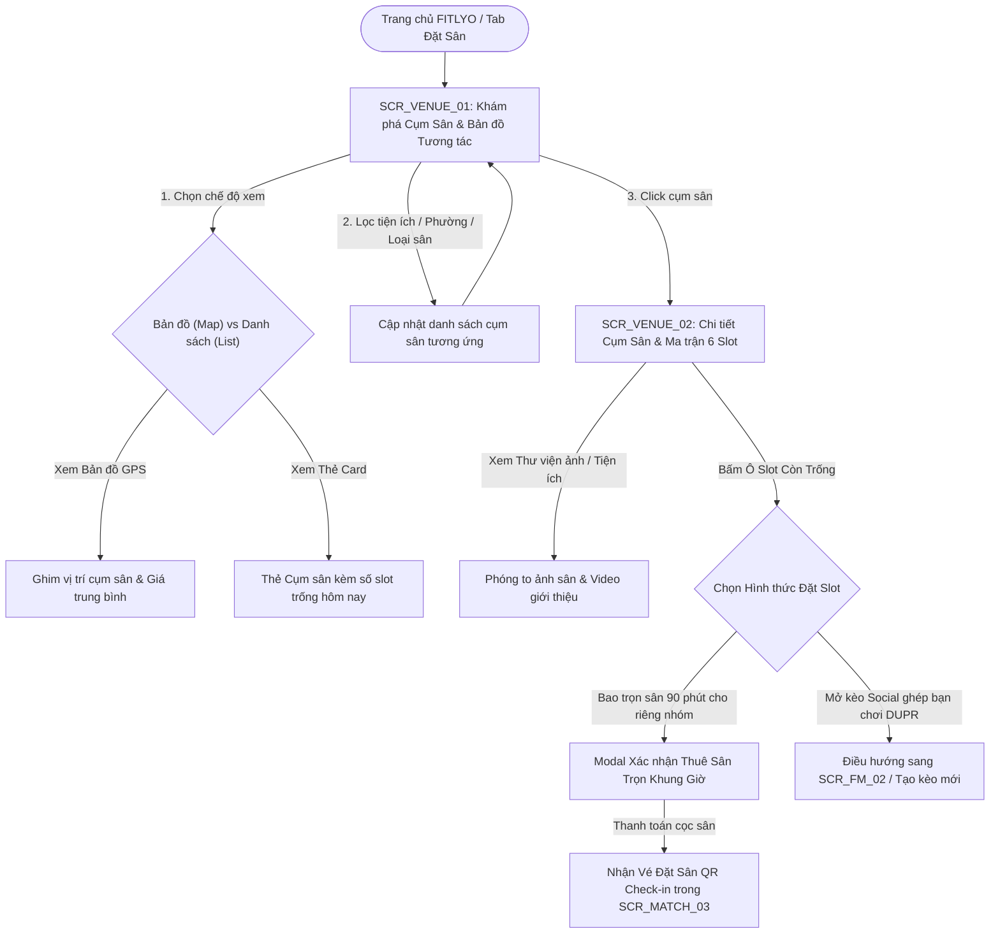

# TÀI LIỆU ĐẶC TẢ CHI TIẾT MÀN HÌNH - PHÂN HỆ CỤM SÂN & KHÁM PHÁ SÂN BÃI (SCR_VENUE_xx)
**Dự án:** Nền Tảng Thể Thao FITLYO Pickleball (EXE101 - FPT University)  
**Phiên bản:** 2.0  
**Tác giả:** Đội ngũ Phân tích & Thiết kế Giao diện FITLYO  
**Phân hệ:** Venues & Court Matrix Exploration (`SCR_VENUE_xx`)  
**Ngày cập nhật:** 14/10/2026  
**Môi trường áp dụng:** Mobile Web Responsive (375px - 430px) & Web App Desktop (1280px+)

---

## MỤC LỤC TÀI LIỆU
1. [TỔNG QUAN KIẾN TRÚC & SƠ ĐỒ ĐIỀU HƯỚNG PHÂN HỆ CỤM SÂN](#1-tổng-quan-kiến-trúc--sơ-đồ-điều-hướng-phân-hệ-cụm-sân)
   - 1.1. Vai trò & Mục tiêu kinh doanh của Phân hệ Cụm Sân
   - 1.2. Sơ đồ luồng điều hướng tổng thể (Venue Navigation Flow)
   - 1.3. Bảng danh mục màn hình nhóm SCR_VENUE_xx
2. [ĐẶC TẢ CHI TIẾT TỪNG MÀN HÌNH](#2-đặc-tả-chi-tiết-từng-màn-hình)
   - 2.1. `SCR_VENUE_01`: Khám phá Cụm sân Pickleball & Bản đồ Vị trí (Venue Discovery & Interactive Map)
   - 2.2. `SCR_VENUE_02`: Chi tiết Cụm sân, Tiện ích, Đánh giá & Ma trận 6 Slot (Venue Detail, Amenities & 6-Slot Grid Booking)
3. [MA TRẬN PHÂN QUYỀN TRÊN GIAO DIỆN PHÂN HỆ CỤM SÂN (RBAC ON UI MATRIX)](#3-ma-trận-phân-quyền-trên-giao-diện)
4. [QUY CHUẨN DESIGN TOKENS & TRẠNG THÁI MÀU SẮC DÀNH CHO CỤM SÂN](#4-quy-chuẩn-design-tokens--trạng-thái-màu-sắc)

---

## 1. TỔNG QUAN KIẾN TRÚC & SƠ ĐỒ ĐIỀU HƯỚNG PHÂN HỆ CỤM SÂN

### 1.1. Vai trò & Mục tiêu kinh doanh của Phân hệ Cụm Sân
Phân hệ Cụm Sân (`SCR_VENUE_xx`) là cổng thông tin khám phá địa điểm chơi thể thao trực quan và chuẩn xác nhất cho cộng đồng Pickleball tại TP. Thủ Đức:
1. **Bản đồ Vị trí & Định vị Thông minh (Smart Geolocation):** Giúp người chơi dễ dàng tìm kiếm các cụm sân gần nhất trong bán kính 1km - 10km quanh các phường trung tâm (Thảo Điền, An Phú, Bình Trưng, Hiệp Phú, Linh Trung, v.v.).
2. **Minh bạch Cơ sở vật chất & Tiện ích:** Phân loại rõ ràng chất lượng mặt sân (Sân nhựa đệm giảm chấn cao cấp, Sân mái che ngoài trời, Sân máy lạnh), tiện ích đi kèm (Bãi xe ô tô rộng rãi, Phòng tắm nóng lạnh miễn phí, Quầy nước/căng-tin, Đèn chiếu sáng LED chống lóa đạt chuẩn USAPA).
3. **Ma trận Đặt Sân 6 Slot 90 Phút Chuẩn:** Toàn bộ lịch đặt sân được số hóa minh bạch theo 6 khung giờ cố định (06:00 - 21:30), nhận diện tự động **Khung Giờ Vàng (Slot 5: 18:30 - 20:00)** để áp dụng bảng giá động và kết nối trực tiếp với tính năng Mở Kèo Social Ghép Trận.

---

### 1.2. Sơ đồ luồng điều hướng tổng thể (Venue Navigation Flow)



---

### 1.3. Bảng danh mục màn hình nhóm SCR_VENUE_xx

| Mã màn hình | Tên màn hình chức năng | Loại giao diện | Điểm vào chính (Entry Point) | Điểm thoát chính (Exit Point) |
| :--- | :--- | :--- | :--- | :--- |
| **`SCR_VENUE_01`** | Khám phá Cụm sân Pickleball & Bản đồ Vị trí | Full Page (Split Map/List) | Bottom Nav: Tab "Đặt Sân", Search Bar | `SCR_VENUE_02`, Bộ lọc tiện ích |
| **`SCR_VENUE_02`** | Chi tiết Cụm sân, Tiện ích & Ma trận 6 Slot | Full Page / Sticky Booking | Click thẻ cụm sân từ `SCR_VENUE_01` | Modal Thanh toán cọc sân, Kèo Social `SCR_MATCH_02` |

---

## 2. ĐẶC TẢ CHI TIẾT TỪNG MÀN HÌNH

---

### 2.1. `SCR_VENUE_01`: Khám phá Cụm sân Pickleball & Bản đồ Vị trí (Venue Discovery & Interactive Map)

#### 1. Thông tin chung (Overview)
- **Mã màn hình:** `SCR_VENUE_01`
- **Tên màn hình:** Khám phá Cụm sân Pickleball & Bản đồ Vị trí
- **Phân hệ:** Cụm Sân (`SCR_VENUE`)
- **Đối tượng sử dụng:** Tất cả người dùng tìm kiếm sân bãi tại TP. Thủ Đức.
- **Mục tiêu cốt lõi:** Cho phép người dùng chuyển đổi linh hoạt giữa giao diện Bản đồ vệ tinh tương tác (Interactive Map View) và Danh sách thẻ sân (List View), định vị vị trí người dùng để tính khoảng cách di chuyển chính xác và hiển thị số lượng slot còn trống trong ngày.

#### 2. Wireframe Bố cục Giao diện (Layout Wireframe)
```text
+-------------------------------------------------------------+
| [=] FITLYO SÂN BÃI                 (Q) Tìm tên sân, đường   |
+-------------------------------------------------------------+
| [(*) Xem Bản đồ GPS]               [ ( ) Xem Danh sách Thẻ ] |
|                                                             |
| BỘ LỌC NHANH:                                               |
| [ Gần tôi nhất < 5km ]  [ Còn slot hôm nay ]  [ Có điều hòa ]|
| Khu vực: [ Phường Thảo Điền ▼ ]    Loại sân: [ Trong nhà ▼ ]|
+-------------------------------------------------------------+
| +---------------------------------------------------------+ |
| |                KHU VỰC BẢN ĐỒ TƯƠNG TÁC                 | |
| |                                                         | |
| |           (Ghim: D-Pickleball [Còn 4 slot] - 180k)      | |
| |               * Vị trí của bạn (Thảo Điền)              | |
| |                                                         | |
| |     (Ghim: Rackets Hiệp Phú)    (Ghim: An Khánh Court)  | |
| |                                                         | |
| +---------------------------------------------------------+ |
|                                                             |
| THẺ CỤM SÂN NỔI BẬT ĐƯỢC CHỌN (BOTTOM CARD HOVER):         |
| +---------------------------------------------------------+ |
| | [ẢNH BÌA HD]  D-PICKLEBALL THẢO ĐIỀN           ★ 4.9 (128)| |
| | Địa chỉ : 12 Võ Trường Toản, P. Thảo Điền (Cách bạn 1.2km)| |
| | Quy mô  : 4 Sân trong nhà máy lạnh + Đèn LED chuẩn USAPA  | |
| | Tiện ích: [Bãi đỗ ô tô] [Phòng tắm nóng] [Quầy nước Pro]  | |
| | Hôm nay : CÒN 3 SLOT TRỐNG (Có 1 Slot 5 Giờ Vàng)         | |
| | Giá thuê: 120.000đ - 220.000đ / Slot 90 phút             | |
| | [ Xem vị trí bản đồ ]              [ XEM LỊCH & ĐẶT SÂN ] | |
| +---------------------------------------------------------+ |
+-------------------------------------------------------------+
| [Trang chủ]    [Kèo Đấu]    [* Đặt Sân *]    [HLV]    [Tôi] |
+-------------------------------------------------------------+
```

#### 3. Bảng Đặc tả Thành phần Giao diện (Component & Field Specs)

| Mã Thành phần | Tên Thành phần | Loại Control | Dữ liệu / Định dạng | Ràng buộc Nghiệp vụ & Tương tác |
| :--- | :--- | :--- | :--- | :--- |
| `V01_VIEW_TOGGLE`| Công tắc chế độ xem | Segmented Control | `MAP_VIEW`, `LIST_VIEW` | Mặc định Map View trên mobile có định vị; List view cho desktop. |
| `V01_NEARBY_CHIP`| Chip lọc sân gần tôi | Filter Chip | Khoảng cách GPS (< 5km) | Yêu cầu cấp quyền Geolocation của trình duyệt. |
| `V01_MAP_CANVAS` | Bản đồ tương tác | Leaflet / Google Maps | Tọa độ cụm sân | Nhóm các ghim (clustering); click ghim đẩy thẻ sân tương ứng lên đầu. |
| `V01_CARD_SLOTS` | Nhãn số slot trống | Status Badge | Chuỗi: "Còn x slot" | Tự động quét trạng thái 6 slot hôm nay của tất cả sân con trong cụm. |
| `V01_DETAIL_BTN` | Nút Xem lịch & Đặt | Primary Button | Action Trigger | Chuyển hướng trực tiếp vào Ma trận đặt sân `SCR_VENUE_02`. |

---

### 2.2. `SCR_VENUE_02`: Chi tiết Cụm sân, Tiện ích, Đánh giá & Ma trận 6 Slot (Venue Detail, Amenities & 6-Slot Grid Booking)

#### 1. Thông tin chung (Overview)
- **Mã màn hình:** `SCR_VENUE_02`
- **Tên màn hình:** Chi tiết Cụm sân, Tiện ích, Đánh giá & Ma trận 6 Slot
- **Phân hệ:** Cụm Sân (`SCR_VENUE`)
- **Điểm vào:** Click "Xem lịch & Đặt sân" từ `SCR_VENUE_01` hoặc kết quả tìm kiếm.
- **Mục tiêu cốt lõi:** Cung cấp thông tin chi tiết toàn diện của cụm sân và **Ma trận Lịch Đặt Sân 6 Slot 90 Phút** theo thời gian thực; cho phép người chơi chọn thuê nguyên sân (Private Court) hoặc tham gia Mở Kèo Social DUPR ngay trên ô slot còn trống.

#### 2. Wireframe Bố cục Giao diện (Layout Wireframe)
```text
+-------------------------------------------------------------+
| [< Khám phá]            CHI TIẾT CỤM SÂN            [Yêu thích] |
+-------------------------------------------------------------+
| [CAROUSEL ẢNH CỤM SÂN: 5 Ảnh HD Mặt sân, Đèn LED, Phòng tắm]|
|                                                             |
| D-PICKLEBALL THẢO ĐIỀN                  [ĐẠT CHUẨN THI ĐẤU] |
| Đánh giá : ★★★★★ 4.9 (128 lượt nhận xét)                    |
| Địa chỉ  : 12 Võ Trường Toản, Phường Thảo Điền, TP. Thủ Đức |
| Giờ mở   : 06:00 - 22:00 Hàng ngày | Hotline: 0909.888.777   |
| Tiện ích : [P Xe hơi] [Tắm nóng lạnh] [Máy lạnh] [Wifi]    |
+-------------------------------------------------------------+
| MA TRẬN 6 KHUNG GIỜ 90 PHÚT CHUẨN:                          |
| Chọn ngày: [ < Hôm nay: 14/10/2026 > ]                      |
|                                                             |
| Khung giờ chuẩn     | Sân 01 (Trong nhà)   | Sân 02 (Trong nhà)     |
| --------------------+----------------------+------------------------|
| Slot 1: 06:00-07:30 | [TRỐNG - 140k]       | [KÈO SOCIAL 3/4]       |
|                     | (Bấm để bao sân)     | DUPR 2.0-2.5 (35k/ng)  |
| --------------------+----------------------+------------------------|
| Slot 2: 07:30-09:00 | [ĐÃ BAO SÂN]         | [TRỐNG - 140k]         |
|                     | (Khách cố định)      | (Bấm để đặt)           |
| --------------------+----------------------+------------------------|
| Slot 3: 09:00-10:30 | [GIẢM GIÁ - 100k]    | [LỚP HỌC HLV DŨNG]     |
|                     | Slot sáng vắng khách | Khóa Boot Camp 3.5     |
| --------------------+----------------------+------------------------|
| Slot 4: 15:30-17:00 | [GIẢM GIÁ - 100k]    | [TRỐNG - 100k]         |
| --------------------+----------------------+------------------------|
| Slot 5: 18:30-20:00 | [GIỜ VÀNG - 220k]    | [GIỜ VÀNG - KÈO SOCIAL]|
| [KHUNG GIỜ VÀNG]    | CÒN DUY NHẤT 1 SÂN   | ĐÃ ĐỦ 4/4 VĐV (45k/ng) |
| --------------------+----------------------+------------------------|
| Slot 6: 20:00-21:30 | [TRỐNG - 160k]       | [TRỐNG - 160k]         |
+-------------------------------------------------------------+
| BẤM VÀO Ô SLOT TRỐNG ĐỂ CHỌN:                               |
| [  BAO TRỌN SÂN 90 PHÚT  ]   HOẶC   [  MỞ KÈO GHÉP SOCIAL  ] |
+-------------------------------------------------------------+
```

#### 3. Bảng Đặc tả Thành phần Giao diện (Component & Field Specs)

| Mã Thành phần | Tên Thành phần | Loại Control | Dữ liệu / Định dạng | Ràng buộc Nghiệp vụ & Tương tác |
| :--- | :--- | :--- | :--- | :--- |
| `V02_HERO_SLIDER`| Slider hình ảnh | Swiper Carousel | Mảng URL WebP | Vuốt mượt mà, hỗ trợ zoom xem chi tiết mặt thảm đệm. |
| `V02_DATE_NAV` | Thanh đổi ngày xem | Date Selector | Ngày `YYYY-MM-DD` | Xem trước lịch 14 ngày tới. |
| `V02_SLOT_MATRIX`| Lưới ma trận 6 Slot | Matrix Table Grid | Trạng thái từng ô slot | Tự động đồng bộ thời gian thực với hệ thống quản lý của chủ sân (`SCR_FM_01`). |
| `V02_GOLD_ROW` | Dòng Slot 5 Giờ Vàng | Highlight Table Row | Amber background | Khung giờ nhu cầu cao nhất (18:30 - 20:00), giá thuê niêm yết cao hơn. |
| `V02_BOOK_MODAL` | Hộp thoại chọn hình thức | Action Sheet | 2 Lựa chọn đặt | 1. Thuê riêng cả sân (thanh toán cọc sân); 2. Mở kèo ghép chia 4 tiền sân. |

---

## 3. MA TRẬN PHÂN QUYỀN TRÊN GIAO DIỆN PHÂN HỆ CỤM SÂN (RBAC ON UI MATRIX)

| Hành động trên Giao diện | Khách vãng lai (Guest) | Người chơi (Player) | Hội viên VIP | Chủ sân (FM) | Quản trị viên (Admin) |
| :--- | :---: | :---: | :---: | :---: | :---: |
| Khám phá & Tìm kiếm sân (`SCR_VENUE_01`) | Xem bản đồ & list | Xem & Định vị GPS | Ưu tiên sân đối tác VIP | Xem sân mình & đối thủ | Xem toàn bộ hệ thống |
| Xem Ma trận Lịch Slot (`SCR_VENUE_02`) | Xem trạng thái slot | Xem & Đặt sân | Đặt trước 14 ngày | Chỉnh sửa ma trận | Toàn quyền tra soát |
| Đặt bao trọn sân 90 phút | Yêu cầu Đăng nhập | Đặt cọc bình thường | Giảm 5% giá sân | Khóa slot khách vãng lai | Can thiệp hoàn cọc |
| Mở kèo ghép Social từ slot trống | Yêu cầu Đăng nhập | Mở kèo (yêu cầu DUPR) | Mở kèo ưu tiên | Tự động mở lấp slot | Quản lý kiểm duyệt |

---

## 4. QUY CHUẨN DESIGN TOKENS & TRẠNG THÁI MÀU SẮC DÀNH CHO CỤM SÂN

- **Available Court Green:** `#16A34A` (Green-600) - Slot còn trống, sẵn sàng nhận khách hoặc mở kèo.
- **Social Match Gold/Amber:** `#D97706` (Amber-600) - Đang ghép trận Social DUPR hoặc Slot 5 Giờ Vàng.
- **Coach Class Blue:** `#2563EB` (Blue-600) - Khung giờ lớp học có HLV giảng dạy.
- **Occupied / Locked Slate:** `#64748B` (Slate-500) - Sân đã được khách đặt bao riêng hoặc tạm khóa bảo trì.
