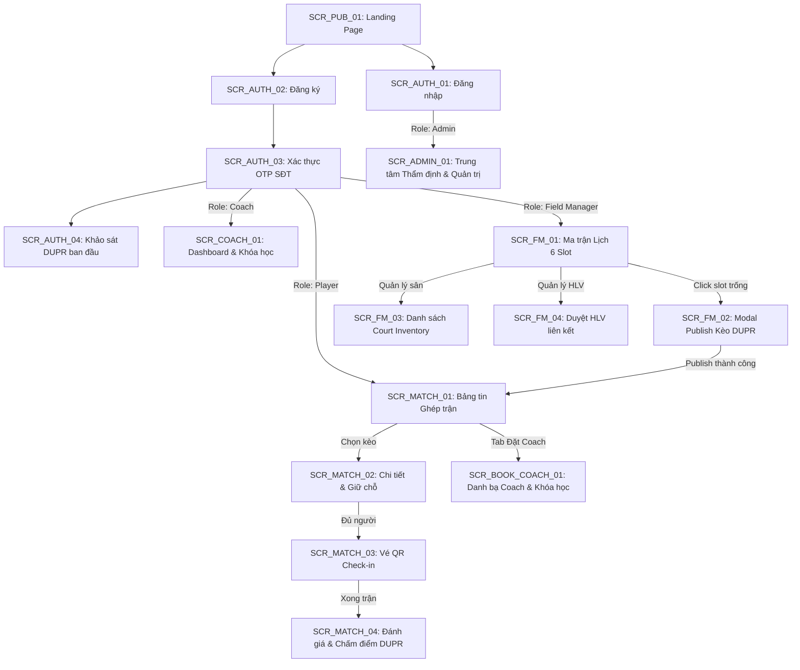
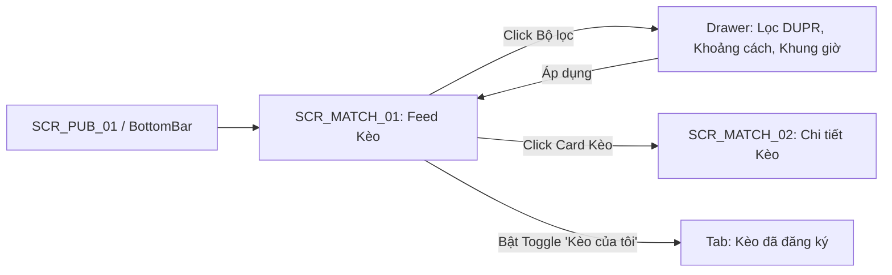
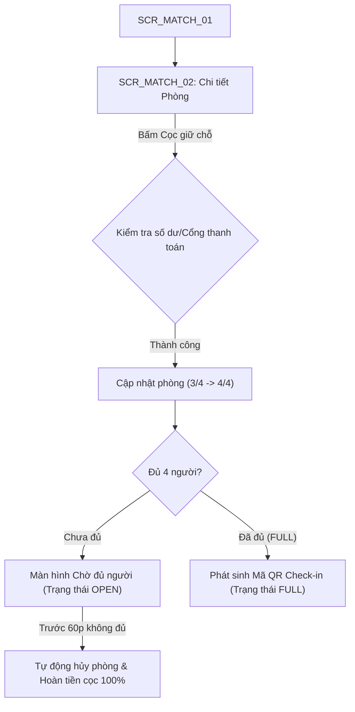
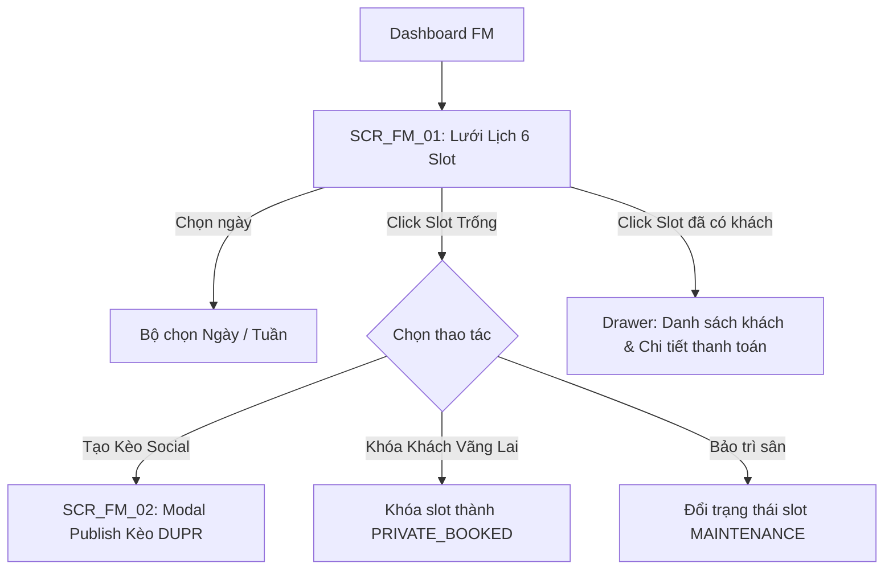

# TÀI LIỆU ĐẶC TẢ CHI TIẾT MÀN HÌNH & GIAO DIỆN (UI/UX SPECIFICATION)
# DỰ ÁN KHỞI NGHIỆP: FITLYO (PICKLEBALL PLATFORM)
### *Môn học: EXE101 - Khởi nghiệp Đổi mới Sáng tạo (FPT University)*
### *Chuẩn hóa theo Screen Analysis & UI Design Specification Framework*

---

| Thông Tin Tài Liệu | Chi Tiết |
| :--- | :--- |
| **Dự án** | **FITLYO - Social Matchmaking & Court / Coach Booking Platform** |
| **Phiên bản** | 1.0.0 (Bản đặc tả kỹ thuật chi tiết) |
| **Căn cứ tài liệu** | [PRD FITLYO v1.0.0](file:///D:/FPTU/Term%207/EXE101/FITLYO/Documents/FITLYO_PRD_Yeu_Cau_Phan_Mem.md) |
| **Đối tượng áp dụng** | Business Analyst (BA), UI/UX Designer, Frontend Engineer, QA/QC |

---

## MỤC LỤC
1. [KIẾN TRÚC TỔNG THỂ & SƠ ĐỒ ĐIỀU HƯỚNG (SITE MAP & GLOBAL SCREEN FLOW)](#1-kiến-trúc-tổng-thể--sơ-đồ-điều-hướng)
2. [HỆ THỐNG MÃ ĐỊNH DANH MÀN HÌNH (SCREEN ID CATALOG)](#2-hệ-thống-mã-định-danh-màn-hình)
3. [ĐẶC TẢ CHI TIẾT CÁC MÀN HÌNH CỐT LÕI (CORE SCREENS DEEP-DIVE)](#3-đặc-tả-chi-tiết-các-màn-hình-cốt-lõi)
   - 3.1. `SCR_MATCH_01`: Khám phá & Bảng tin Ghép trận (Social Matchmaking Feed)
   - 3.2. `SCR_MATCH_02`: Chi tiết Kèo đấu, Giữ chỗ & Vé QR Check-in
   - 3.3. `SCR_FM_01`: Ma trận Lịch sân & 6 Slot chuẩn (Court Slot Calendar Grid)
   - 3.4. `SCR_FM_02`: Mở bán & Công bố Trận ghép (Publish Social Match Modal)
   - 3.5. `SCR_COACH_01`: Quản lý Khóa học & Lịch dạy (Coach Courses & Schedule)
   - 3.6. `SCR_BOOK_COACH_01`: Đặt lịch Huấn luyện viên & Khóa học (PT Booking)
   - 3.7. `SCR_ADMIN_01`: Thẩm định Giấy phép Cụm sân & Bằng cấp Coach
4. [BẢNG ĐẶC TẢ TỔNG QUAN DANH SÁCH TOÀN BỘ MÀN HÌNH HỆ THỐNG](#4-bảng-đặc-tả-tổng-quan-toàn-bộ-màn-hình)
5. [MA TRẬN PHÂN QUYỀN TRÊN GIAO DIỆN (RBAC ON UI MATRIX)](#5-ma-trận-phân-quyền-trên-giao-diện)
6. [HƯỚNG DẪN DESIGN SYSTEM & DESIGN TOKENS DÀNH CHO FITLYO](#6-hướng-dẫn-design-system)

---

## 1. KIẾN TRÚC TỔNG THỂ & SƠ ĐỒ ĐIỀU HƯỚNG



---

## 2. HỆ THỐNG MÃ ĐỊNH DANH MÀN HÌNH (SCREEN ID CATALOG)

Hệ thống được quy chuẩn theo tiền tố module:
- `SCR_PUB_xx`: Nhóm màn hình công khai cho khách (Public / Guest).
- `SCR_AUTH_xx`: Nhóm màn hình Xác thực, Định danh & Khảo sát ban đầu.
- `SCR_MATCH_xx`: Phân hệ Ghép trận Social Matchmaking (Cốt lõi Player).
- `SCR_VENUE_xx`: Phân hệ Tìm kiếm & Xem chi tiết Cụm sân.
- `SCR_BOOK_xx`: Phân hệ Đặt lịch Huấn luyện viên & Khóa học.
- `SCR_USER_xx`: Phân hệ Hồ sơ cá nhân, Trình độ DUPR & Gói Premium.
- `SCR_FM_xx`: Phân hệ Chủ sân / Quản lý cụm sân (Field Manager).
- `SCR_COACH_xx`: Phân hệ Huấn luyện viên (Coach).
- `SCR_ADMIN_xx`: Phân hệ Quản trị viên hệ thống (Admin).

---

## 3. ĐẶC TẢ CHI TIẾT CÁC MÀN HÌNH CỐT LÕI (CORE SCREENS DEEP-DIVE)

---

### 3.1. `SCR_MATCH_01`: Khám phá & Bảng tin Ghép trận (Social Matchmaking Feed)

#### 1. Thông tin chung
- **Mã màn hình:** `SCR_MATCH_01`
- **Tên màn hình:** Khám phá & Bảng tin Kèo ghép trận DUPR
- **Phân hệ:** Social Matchmaking
- **Đối tượng sử dụng (Actors):** Player (Free & Premium), Coach (Xem tham khảo)
- **Điều kiện tiên quyết:** Đã đăng nhập và hoàn thành bài test DUPR ban đầu.
- **Mục tiêu cốt lõi:** Người chơi tìm thấy phòng đấu đang mở phù hợp với vị trí TP. Thủ Đức, khung giờ mong muốn và trình độ DUPR trong vòng dưới 3 thao tác chạm.

#### 2. Sơ đồ luồng màn hình (Screen Flow)


#### 3. Phác thảo bố cục (Wireframe Mockup)
```text
+-------------------------------------------------------------------------+
| [LOGO FITLYO]              📍 TP. Thủ Đức ▾        [🔔 (2)]  [Avatar VIP]|
+-------------------------------------------------------------------------+
| [🔍 Tìm sân, tên bạn chơi...]                       [ ⚙️ Bộ lọc nâng cao ]|
+-------------------------------------------------------------------------+
| LỌC NHANH:  (• Tất cả)  (⭐ Hợp trình độ 2.5-3.0)  (⏰ Khung tối 18:30) (📍 Gần tôi)|
+-------------------------------------------------------------------------+
| TAB: [ KÈO ĐANG MỞ (14) ]          |          [ KÈO CỦA TÔI (2) ]       |
+-------------------------------------------------------------------------+
| +---------------------------------------------------------------------+ |
| | 🔥 ĐÔI NAM NỮ (Cần 1 người)              ⭐️ Trình độ yêu cầu: 2.5 - 3.0| |
| | 🏢 Cụm sân D-Sports Pickleball (Hiệp Phú, TP. Thủ Đức)              | |
| | ⏰ Slot 5: 18:30 - 20:00 (Hôm nay, 13/10)     | Mặt sân: Trong nhà   | |
| | Người tham gia (3/4): [Avatar A] [Avatar B] [Avatar C] [➕ Còn 1 chỗ] | |
| | Phí cọc slot: 45.000đ/người                                         | |
| |                                                  [ GIỮ CHỖ NGAY -> ]| |
| +---------------------------------------------------------------------+ |
| +---------------------------------------------------------------------+ |
| | ⚡ ĐÔI NAM PHONG TRÀO                     ⭐️ Trình độ yêu cầu: 3.5 - 4.0| |
| | 🏢 Cụm sân Thủ Thiêm Sports Hub (An Phú, TP. Thủ Đức)               | |
| | ⏰ Slot 4: 17:00 - 18:30 (Ngày mai, 14/10)    | Mặt sân: Ngoài trời  | |
| | Người tham gia (2/4): [Avatar D] [Avatar E] [➕ Còn 2 chỗ]           | |
| | ⚠️ Cảnh báo: Trình độ bạn (2.8) thấp hơn yêu cầu phòng (3.5+)        | |
| | Phí cọc slot: 55.000đ/người                    [ XEM CHI TIẾT ]     | |
| +---------------------------------------------------------------------+ |
+-------------------------------------------------------------------------+
| [Bottom Bar]: [🏸 Ghép trận (Active)]  [🏟️ Sân]  [👨‍🏫 Coach]  [👤 Hồ sơ]  |
+-------------------------------------------------------------------------+
```

#### 4. Bảng đặc tả chi tiết trường & thành phần (Field Spec)
| Mã UI | Tên thành phần | Loại Control | Bắt buộc | Ràng buộc & Validation | Logic nghiệp vụ & Hành vi |
| :--- | :--- | :--- | :---: | :--- | :--- |
| `INP_SEARCH` | Ô tìm kiếm nhanh | Input Search | Không | Max 80 ký tự. Xóa khoảng trắng thừa. | Debounce 350ms gọi API. Lọc theo tên sân, đường, hoặc tên người chơi. |
| `CHIP_LEVEL_AUTO` | Nút lọc "Hợp trình độ" | Chip Filter | Không | Lấy điểm DUPR của User $\pm 0.5$ | Mặc định tự bật nếu người dùng đã có điểm DUPR. Giúp loại bỏ phòng lệch kèo. |
| `SLOT_FILTER` | Lọc 6 Slot chuẩn | Dropdown / Multi-select | Không | Các giá trị từ Slot 1 đến Slot 6 theo PRD | Cho phép chọn nhiều slot (VD: chọn cả Slot 4 và Slot 5). |
| `WARN_DIFF_DUPR` | Huy hiệu cảnh báo lệch trình | Badge Alert | - | Hiện khi $\|DUPR_{user} - DUPR_{phong}\| > 0.5$ | Tô nền vàng cam. Khi bấm "Giữ chỗ" sẽ hiển thị popup xác nhận chấp nhận thách đấu. |
| `BTN_JOIN_CARD` | Nút Giữ chỗ nhanh | Button Primary | Có | Phòng còn chỗ trống (`current < max`) | Nhấn chuyển hướng sang `SCR_MATCH_02` giữ chỗ tạm thời trong 5 phút. |

#### 5. Ma trận 5 trạng thái giao diện (Screen State Matrix)
| Trạng thái | Điều kiện kích hoạt | Giao diện hiển thị | Hành vi tương tác |
| :--- | :--- | :--- | :--- |
| **Ideal State** | Có $\ge 1$ phòng đấu phù hợp | Render danh sách Card kèm huy hiệu DUPR, phân trang cuộn mượt (Infinite Scroll) | Chạm vào card chuyển chi tiết. Kéo vuốt xuống (Pull-to-refresh) tải lại. |
| **Loading State** | Đang tải danh sách phòng | 3 Skeleton Card mô phỏng cấu trúc card với hiệu ứng Shimmer mờ nhạt | Vô hiệu hóa bộ lọc trong lúc tải. |
| **Empty State** | Không có phòng nào thỏa mãn bộ lọc | Minh họa hình vợt Pickleball + Câu thông báo: *"Không có kèo nào quanh bạn trong khung giờ này"* | Nút bấm **[Đặt lại bộ lọc]** hoặc **[Nhận thông báo khi có kèo mới]**. |
| **Error State** | Lỗi mạng / Server 500 | Card cảnh báo lỗi đỏ: *"Không thể kết nối máy chủ. Vui lòng thử lại"* | Nút **[Thử lại]** gọi lại API lấy dữ liệu. |
| **Edge / Concurrency** | Phòng vừa đầy người ngay khi bấm | Toast đỏ: *"Phòng vừa đủ người cách đây vài giây!"* | Card tự động đổi sang trạng thái mờ (Disabled) `ĐÃ ĐỦ NGƯỜI`. |

#### 6. Phân quyền trên UI (RBAC on UI)
- **Free Player:** Xem danh sách, tham gia các phòng bình thường.
- **Premium Player:** Các phòng hot giờ cao điểm hiển thị trước 15 phút kèm huy hiệu **VIP Early Access**.

---

### 3.2. `SCR_MATCH_02`: Chi tiết Kèo đấu, Giữ chỗ & Vé QR Check-in

#### 1. Thông tin chung
- **Mã màn hình:** `SCR_MATCH_02`
- **Tên màn hình:** Chi tiết Phòng đấu & Vé điện tử Check-in
- **Phân hệ:** Social Matchmaking
- **Đối tượng sử dụng (Actors):** Player, Field Manager (Xem đối soát check-in)
- **Mục tiêu cốt lõi:** Xác nhận thông tin phòng, cọc tiền slot 90 phút và hiển thị vé QR để check-in tại sân khi đủ người.

#### 2. Sơ đồ luồng màn hình (Screen Flow)


#### 3. Phác thảo bố cục (Wireframe Mockup)
```text
+-------------------------------------------------------------------------+
| [<- Quay lại]             CHI TIẾT PHÒNG ĐẤU #MM-9023        [Chia sẻ]  |
+-------------------------------------------------------------------------+
| [ THẺ THÔNG TIN SÂN & THỜI GIAN ]                                       |
| 🏢 Cụm sân Pickleball D-Sports Thủ Đức - Sân số 3 (Trong nhà)           |
| 📍 123 Võ Văn Ngân, P. Linh Chiểu, TP. Thủ Đức (Mở Google Maps)         |
| ⏰ Slot 5: 18:30 - 20:00 | Hôm nay, 13/10/2026                          |
| 🎯 Trình độ yêu cầu: DUPR 2.5 - 3.0 | Thể thức: Đôi nam nữ              |
+-------------------------------------------------------------------------+
| DANH SÁCH NGƯỜI CHƠI (3/4):                                             |
| 1. [Avatar] Trần Văn Hùng (Host/FM)  - DUPR: 2.85  ⭐️ Uy tín: 98% (Đã cọc)|
| 2. [Avatar] Lê Thị Mai               - DUPR: 2.60  ⭐️ Uy tín: 95% (Đã cọc)|
| 3. [Avatar] Bạn (Nguyễn An)          - DUPR: 2.75  ⭐️ Uy tín: 100%       |
| 4. [➕ Đang chờ 1 người chơi nữa...]                                    |
+-------------------------------------------------------------------------+
| [ NẾU ĐÃ ĐỦ 4 NGƯỜI - VÉ CHECK-IN XUẤT HIỆN TẠI ĐÂY ]                   |
| +---------------------------------------------------------------------+ |
| |                      [ MÃ QR CHECK-IN SÂN ]                         | |
| |                           █████████████                             | |
| |                           ██  ██ ██  ██                             | |
| |                           █████████████                             | |
| | Mã vé: PKB-1310-8849 | Xuất trình mã này cho nhân viên quầy tại sân | |
| +---------------------------------------------------------------------+ |
+-------------------------------------------------------------------------+
| CHI PHÍ: 45.000đ / người (Đã bao gồm tiền sân + 2 quả bóng tiêu chuẩn)   |
| Chính sách hủy: Free hủy trước 12h (hoàn 100%). Premium hủy trước 4h.    |
+-------------------------------------------------------------------------+
| [ HỦY GIỮ CHỖ ]                                  [ XÁC NHẬN CỌC SLOT ]  |
+-------------------------------------------------------------------------+
```

#### 4. Bảng đặc tả chi tiết trường & thành phần (Field Spec)
| Mã UI | Tên thành phần | Loại Control | Bắt buộc | Ràng buộc & Validation | Logic nghiệp vụ & Hành vi |
| :--- | :--- | :--- | :---: | :--- | :--- |
| `TXT_ROOM_STATUS` | Nhãn trạng thái phòng | Badge / Tag | Có | `OPEN`, `FULL`, `IN_PROGRESS`, `FINISHED`, `CANCELLED` | Màu sắc tương ứng: Xanh lá (OPEN), Xanh dương (FULL), Cam (IN_PROGRESS), Xám (FINISHED), Đỏ (CANCELLED). |
| `LIST_PARTICIPANTS` | Danh sách người tham gia | List Component | Có | Tối đa 4 người (đôi) hoặc 2 người (đơn) | Hiển thị tên, avatar, chỉ số DUPR, tỷ lệ uy tín (Reputation Score). |
| `QR_CHECKIN` | Mã QR Code Check-in | QR Renderer | Điều kiện | Chỉ hiển thị khi trạng thái là `FULL` | Mã hóa chuỗi token ngắn hạn: `booking_id + user_id + timestamp`. Quét tại quầy sân để xác nhận vào sân. |
| `BTN_CANCEL_HOLD` | Nút Hủy giữ chỗ | Button Danger | - | Cho phép bấm nếu trước giờ thi đấu quy định | - Player Free: Báo trước $\ge 12h \rightarrow$ hoàn 100%.<br>- Player Premium: Báo trước $\ge 4h \rightarrow$ hoàn 100%. Quá hạn không hoàn cọc. |

---

### 3.3. `SCR_FM_01`: Ma trận Lịch sân & 6 Slot chuẩn (Court Slot Calendar Grid)

#### 1. Thông tin chung
- **Mã màn hình:** `SCR_FM_01`
- **Tên màn hình:** Ma trận Lịch Sân & Điều hành Slot Thời Gian Thực
- **Phân hệ:** Field Manager (Chủ sân / Quản lý cụm sân)
- **Đối tượng sử dụng (Actors):** Field Manager, Admin (Giám sát)
- **Mục tiêu cốt lõi:** Quản lý tập trung công suất các sân con theo 6 slot chuẩn 90 phút/ngày; thao tác 1 chạm để mở bán Social Matchmaking hoặc khóa sân cho khách vãng lai.

#### 2. Sơ đồ luồng màn hình (Screen Flow)


#### 3. Phác thảo bố cục (Wireframe Mockup)
```text
+-----------------------------------------------------------------------------------+
| [Cụm sân D-Sports Thủ Đức]    Lịch ngày: [< Hôm nay: 13/10/2026 >]   [ + Thêm sân ]|
+-----------------------------------------------------------------------------------+
| CHÚ GIẢI: [🟢 Trống (Available)] [🔵 Kèo Social] [🟣 Giờ dạy Coach] [🟠 Khách bao sân] [⚪ Bảo trì]|
+-----------------------------------------------------------------------------------+
| KHUNG GIỜ (SLOT) | SÂN 1 (Trong nhà)   | SÂN 2 (Trong nhà)   | SÂN 3 (Ngoài trời)  |
+------------------+---------------------+---------------------+---------------------+
| Slot 1           | 🟢 TRỐNG            | 🟢 TRỐNG            | ⚪ BẢO TRÌ LƯỚI     |
| 06:00 - 07:30    | [ + Mở Social ]     | [ + Mở Social ]     | (Khóa slot)         |
+------------------+---------------------+---------------------+---------------------+
| Slot 2           | 🟣 LỚP HỌC COACH    | 🟢 TRỐNG            | 🟢 TRỐNG            |
| 07:30 - 09:00    | HLV Tuấn Kiệt (4 HV)| [ + Mở Social ]     | [ + Mở Social ]     |
+------------------+---------------------+---------------------+---------------------+
| Slot 3           | 🔵 KÈO SOCIAL (3/4) | 🟢 TRỐNG            | 🟢 TRỐNG            |
| 15:30 - 17:00    | DUPR 2.0-2.5 [Xem]  | [ + Mở Social ]     | [ + Mở Social ]     |
+------------------+---------------------+---------------------+---------------------+
| Slot 4           | 🟠 KHÁCH BAO RIÊNG  | 🔵 KÈO SOCIAL (FULL)| 🟢 TRỐNG            |
| 17:00 - 18:30    | Đặt tại quầy        | DUPR 3.0-3.5 [QR]   | [ + Mở Social ]     |
+------------------+---------------------+---------------------+---------------------+
| Slot 5 (GIỜ VÀNG)| 🔵 KÈO SOCIAL (FULL)| 🔵 KÈO SOCIAL (FULL)| 🟠 KHÁCH BAO RIÊNG  |
| 18:30 - 20:00    | DUPR 3.5-4.0 [QR]   | DUPR 2.5-3.0 [QR]   | Đặt cọc App         |
+------------------+---------------------+---------------------+---------------------+
| Slot 6           | 🟢 TRỐNG            | 🟢 TRỐNG            | 🟢 TRỐNG            |
| 20:00 - 21:30    | [ + Mở Social ]     | [ + Mở Social ]     | [ + Mở Social ]     |
+-----------------------------------------------------------------------------------+
| TỔNG KẾT HÔM NAY: Công suất lấp đầy: 72% | Doanh thu ước tính: 4.850.000đ         |
+-----------------------------------------------------------------------------------+
```

#### 4. Bảng đặc tả chi tiết trường & thành phần (Field Spec)
| Mã UI | Tên thành phần | Loại Control | Bắt buộc | Ràng buộc & Validation | Logic nghiệp vụ & Hành vi |
| :--- | :--- | :--- | :---: | :--- | :--- |
| `DATE_SELECT` | Bộ chọn ngày | Date Strip Picker | Có | Mặc định: Hôm nay. Giới hạn chọn trước tối đa 30 ngày. | Khi đổi ngày, tự động tải lại ma trận trạng thái toàn bộ các sân. |
| `SLOT_CELL` | Ô ma trận slot sân | Interactive Grid Cell | Có | Ràng buộc theo 5 trạng thái quy định trong PRD | - Click ô xanh (`AVAILABLE`): Mở menu hành động nhanh.<br>- Click ô xanh dương (`MATCH_PUBLISHED`): Xem danh sách người đã đăng ký.<br>- Click ô cam (`PRIVATE_BOOKED`): Xem tên và SĐT người đặt. |
| `OCCUPANCY_BAR` | Thanh tỷ lệ lấp đầy | Progress Bar | - | Tỷ lệ = $\frac{\text{Số slot đã đặt}}{\text{Tổng slot active}} \times 100\%$ | Màu sắc: < 50% (Đỏ cam), 50-75% (Vàng), > 75% (Xanh lá). Hỗ trợ FM tối ưu khung giờ ế khách. |

---

### 3.4. `SCR_FM_02`: Mở bán & Công bố Trận ghép (Publish Social Match Modal)

#### 1. Thông tin chung
- **Mã màn hình:** `SCR_FM_02`
- **Tên màn hình:** Modal Khởi tạo & Công bố Kèo ghép trận
- **Phân hệ:** Field Manager
- **Đối tượng sử dụng (Actors):** Field Manager
- **Mục tiêu cốt lõi:** Cấu hình nhanh các tiêu chí trận đấu (DUPR, số lượng người, phí chia đều) và đẩy lên bảng tin toàn hệ thống trong dưới 30 giây.

#### 2. Phác thảo bố cục (Wireframe Mockup)
```text
+-------------------------------------------------------------------------+
| [X]                CÔNG BỐ PHÒNG GHÉP TRẬN SOCIAL MATCH                 |
+-------------------------------------------------------------------------+
| Địa điểm: Cụm sân D-Sports Thủ Đức - Sân 2                              |
| Thời gian: Slot 5 (18:30 - 20:00) | Thứ Ba, 13/10/2026                  |
+-------------------------------------------------------------------------+
| 1. Trình độ yêu cầu (Thang DUPR):                                       |
|    Từ: [ 2.5 ▾ ]   đến: [ 3.0 ▾ ]    (Khuyến nghị: Sơ cấp - Trung cấp thấp)|
|                                                                         |
| 2. Thể thức & Số lượng người chơi:                                      |
|    (•) Đánh Đôi (4 người)            ( ) Đánh Đơn (2 người)             |
|                                                                         |
| 3. Mức phí tham gia mỗi người chơi:                                     |
|    [ 50.000 ] VNĐ / người                                               |
|    (Gợi ý: Giá sân 180k/slot 90p chia 4 người = 45k + 5k phí bóng)      |
|                                                                         |
| 4. Tiện ích cung cấp kèm theo:                                          |
|    [x] 2 quả bóng thi đấu tiêu chuẩn      [x] Nước uống miễn phí        |
|    [ ] Có người nhặt bóng                 [ ] Mượn vợt miễn phí         |
|                                                                         |
| 5. Ghi chú thêm cho người chơi (Tùy chọn):                              |
|    [ Giao lưu vui vẻ, đề nghị đến đúng giờ trước 10 phút...           ] |
+-------------------------------------------------------------------------+
| [ HỦY BỎ ]                                        [ XÁC NHẬN CÔNG BỐ -> ]|
+-------------------------------------------------------------------------+
```

#### 3. Bảng đặc tả chi tiết trường & thành phần (Field Spec)
| Mã UI | Tên thành phần | Loại Control | Bắt buộc | Ràng buộc & Validation | Logic nghiệp vụ & Hành vi |
| :--- | :--- | :--- | :---: | :--- | :--- |
| `SEL_DUPR_MIN` | DUPR Tối thiểu | Select Dropdown | Có | Từ 1.0 đến 5.0 (Bước 0.5). Phải $\le$ DUPR Max. | Mức sàn để hệ thống lọc người tham gia. |
| `SEL_DUPR_MAX` | DUPR Tối đa | Select Dropdown | Có | Từ 1.5 đến 5.5 (Bước 0.5). | Chênh lệch Min-Max khuyến nghị $\le 0.5$ để tránh lệch kèo. |
| `RAD_FORMAT` | Thể thức thi đấu | Radio Group | Có | 2 tùy chọn: Đánh Đôi (Max 4) / Đánh Đơn (Max 2) | Mặc định: Đánh Đôi (4 người). |
| `INP_ENTRY_FEE` | Phí tham gia / người | Input Number | Có | Tối thiểu: 20.000đ, Tối đa: 300.000đ | Tự động tính tổng thu = Phí $\times$ Số người so với tiền thuê sân gốc. |
| `BTN_PUBLISH` | Nút Xác nhận Công bố | Button Primary | Có | Tất cả trường hợp lệ | Đổi trạng thái slot thành `MATCH_PUBLISHED`, đẩy thông báo cho người chơi gần đó. |

---

### 3.5. `SCR_COACH_01`: Quản lý Khóa học & Lịch dạy (Coach Courses & Schedule)

#### 1. Thông tin chung
- **Mã màn hình:** `SCR_COACH_01`
- **Tên màn hình:** Quản lý Khóa học & Lịch giảng dạy của Coach
- **Phân hệ:** Huấn luyện viên (Coach)
- **Đối tượng sử dụng (Actors):** Coach (Đặc biệt là Certified Coach)
- **Mục tiêu cốt lõi:** Thiết lập danh mục khóa học (1 tuần - 3 tháng), quản lý lịch dạy cố định (2 buổi/tuần) và điểm danh, cập nhật DUPR cho học viên.

#### 2. Phác thảo bố cục (Wireframe Mockup)
```text
+-------------------------------------------------------------------------+
| [Avatar] HLV ĐẶNG TUẤN KIỆT (Verified Certified) ⭐️ 4.95 | [ + Tạo khóa ]|
+-------------------------------------------------------------------------+
| TAB: [ 📚 Khóa học đang mở (3) ]   [ 🗓️ Lịch dạy tuần ]   [ 👥 Học viên ]|
+-------------------------------------------------------------------------+
| DANH SÁCH KHÓA HỌC:                                                     |
| +---------------------------------------------------------------------+ |
| | KHÓA: "Pickleball Căn bản & Làm quen DUPR 2.0"       [ ĐANG DIỄN RA ]| |
| | ⏱️ Thời lượng: 1 tháng (8 buổi) | Tần suất: 2 buổi/tuần (T3 - T5 Slot 2)| |
| | 📍 Sân: D-Sports Thủ Đức       | Học phí: 1.600.000đ/học viên        | |
| | Sĩ số: 4/4 học viên (Đầy lớp)  | Tiến độ: Buổi 5 / 8 buổi            | |
| |                                     [ ĐIỂM DANH ]  [ CHI TIẾT LỚP ] | |
| +---------------------------------------------------------------------+ |
| +---------------------------------------------------------------------+ |
| | KHÓA: "Chiến thuật Đánh đôi Nâng cao DUPR 3.5+"      [ ĐANG TUYỂN ]  | |
| | ⏱️ Thời lượng: 1 tháng (8 buổi) | Tần suất: 2 buổi/tuần (T4 - T6 Slot 5)| |
| | 📍 Sân: Thủ Thiêm Sports Hub   | Học phí: 2.200.000đ/học viên        | |
| | Sĩ số: 2/4 học viên (Còn 2 chỗ)| Khai giảng: 20/10/2026              | |
| |                                     [ SAO CHÉP LINK ]  [ CHỈNH SỬA ] | |
| +---------------------------------------------------------------------+ |
+-------------------------------------------------------------------------+
```

#### 3. Bảng đặc tả chi tiết trường & thành phần (Field Spec)
| Mã UI | Tên thành phần | Loại Control | Bắt buộc | Ràng buộc & Validation | Logic nghiệp vụ & Hành vi |
| :--- | :--- | :--- | :---: | :--- | :--- |
| `BTN_CREATE_COURSE` | Nút Tạo khóa học mới | Button Primary | - | Chỉ kích hoạt nếu là `Certified Coach` | Mở màn hình tạo khóa học `SCR_COACH_02`. Uncertified Coach sẽ bị mờ nút kèm tooltip. |
| `BADGE_PROGRESS` | Tiến độ khóa học | Badge / Label | - | `Đã hoàn thành X / Y buổi` | Hiển thị rõ số buổi đã diễn ra so với tổng 8 buổi chuẩn. |
| `BTN_ATTENDANCE` | Nút Điểm danh | Button Secondary | - | Chỉ bấm được trong ngày có buổi học | Mở modal danh sách học viên để đánh dấu `Có mặt / Vắng mặt / Báo bù`. |

---

### 3.6. `SCR_BOOK_COACH_01`: Đặt lịch Huấn luyện viên & Khóa học (PT Booking)

#### 1. Thông tin chung
- **Mã màn hình:** `SCR_BOOK_COACH_01`
- **Tên màn hình:** Danh bạ Huấn luyện viên & Đặt lịch Học Pickleball
- **Phân hệ:** PT Booking & Courses
- **Đối tượng sử dụng (Actors):** Player (Free & Premium)
- **Mục tiêu cốt lõi:** Cho phép người chơi tìm Coach, xem chứng chỉ được kiểm duyệt, lựa chọn học buổi lẻ hoặc khóa học dài hạn và tiến hành đăng ký.

#### 2. Phác thảo bố cục (Wireframe Mockup)
```text
+-------------------------------------------------------------------------+
| [<- Quay lại]            DANH BẠ HUẤN LUYỆN VIÊN             [Bộ lọc]    |
+-------------------------------------------------------------------------+
| [🔍 Tìm tên HLV, kỹ năng cần học (dink, volley, serve)...              ] |
+-------------------------------------------------------------------------+
| BỘ LỌC NHANH:  [x] Certified Coach (Tích xanh)  [ ] Học 1:1  [ ] Khóa nhóm|
+-------------------------------------------------------------------------+
| +---------------------------------------------------------------------+ |
| | [Avatar] HLV NGUYỄN HOÀNG LONG  [ ✔️ Certified Coach (PPR Level 2) ]  | |
| | ⭐ 4.9 (48 đánh giá) | 6 năm kinh nghiệm | Cựu VĐV Quốc gia           | |
| | 📍 Khu vực hoạt động: Cụm sân Thảo Điền, An Phú, Hiệp Phú (Thủ Đức) | |
| | 💰 Học phí: 350.000đ/buổi lẻ (90p) | 2.400.000đ/khóa 1 tháng (8 buổi)| |
| |                                                                     | |
| | [ KHÓA NỔI BẬT ]: Khóa Chỉnh kỹ thuật Dink & Drop shot (Còn 1 slot)  | |
| | 👑 Quyền lợi VIP: Hội viên FITLYO Premium được quyền book slot riêng| |
| |                                     [ XEM HỒ SƠ ]  [ ĐẶT LỊCH NGAY ]| |
| +---------------------------------------------------------------------+ |
+-------------------------------------------------------------------------+
```

#### 3. Bảng đặc tả chi tiết trường & thành phần (Field Spec)
| Mã UI | Tên thành phần | Loại Control | Bắt buộc | Ràng buộc & Validation | Logic nghiệp vụ & Hành vi |
| :--- | :--- | :--- | :---: | :--- | :--- |
| `BADGE_CERT` | Huy hiệu Certified Coach | Icon + Tag Verified | - | Chỉ hiển thị khi Admin đã duyệt chứng chỉ chuyên môn | Tạo niềm tin chất lượng cho người học. |
| `BTN_BOOK_PRIVATE` | Đặt slot riêng theo yêu cầu | Button | - | Chỉ khả dụng với `Player Premium` | Nếu là Free Player: Khi click hiện modal mời nâng cấp FITLYO Premium. |
| `RAD_BOOKING_TYPE` | Chọn hình thức học | Radio Group | Có | Buổi lẻ (90p) / Khóa học định kỳ (1 tháng) | Tự động cập nhật tổng chi phí và lịch hiển thị tương ứng. |

---

### 3.7. `SCR_ADMIN_01`: Thẩm định Giấy phép Cụm sân & Bằng cấp Coach

#### 1. Thông tin chung
- **Mã màn hình:** `SCR_ADMIN_01`
- **Tên màn hình:** Trung tâm Thẩm định Đối tác (Field Manager & Coach)
- **Phân hệ:** Quản trị viên hệ thống (Admin)
- **Đối tượng sử dụng (Actors):** Admin
- **Mục tiêu cốt lõi:** Đối soát hồ sơ pháp lý sân bóng và chứng chỉ chuyên môn HLV trước khi cấp phép hoạt động trên nền tảng.

#### 2. Phác thảo bố cục (Wireframe Mockup)
```text
+-----------------------------------------------------------------------------------+
| FITLYO ADMIN PORTAL | [Trung tâm Thẩm định Hồ sơ]               Admin: SuperAdmin |
+-----------------------------------------------------------------------------------+
| TABS: [ 🏢 CỤM SÂN CHỜ DUYỆT (3) ]         |       [ 👨‍🏫 CHỨNG CHỈ COACH CHỜ DUYỆT (5) ]|
+-----------------------------------------------------------------------------------+
| HỒ SƠ ĐANG CHỌN: #FM-APP-0128 - Cụm sân Pickleball Vinhomes Grand Park            |
| Chủ sở hữu: Công ty TNHH Thể Thao Ngôi Sao Mới | Hotline: 0903.xxx.xxx             |
| Địa chỉ: Phân khu The Rainbow, Vinhomes Grand Park, P. Long Thạnh Mỹ, TP. Thủ Đức |
| Khai báo quy mô: 6 sân tiêu chuẩn (4 sân ngoài trời, 2 sân mái che)                |
+-----------------------------------------------------------------------------------+
| TÀI LIỆU MINH CHỨNG PHÁP LÝ (Bấm để phóng to):                                    |
| [ 📄 GPKD_SaoY.pdf ]     [ 📄 HopDongThueMatBang.pdf ]     [ 🖼️ AnhThucTeSan.jpg ] |
+-----------------------------------------------------------------------------------+
| GHI CHÚ KIỂM TRA ĐỐI SOÁT:                                                        |
| [ Đã gọi điện xác minh mặt bằng, địa chỉ chính xác, đủ điều kiện an toàn thể thao]|
+-----------------------------------------------------------------------------------+
| [ ❌ TỪ CHỐI (KÈM LÝ DO) ]                           [ ✔️ PHÊ DUYỆT & KÍCH HOẠT SÂN ]|
+-----------------------------------------------------------------------------------+
```

#### 3. Bảng đặc tả chi tiết trường & thành phần (Field Spec)
| Mã UI | Tên thành phần | Loại Control | Bắt buộc | Ràng buộc & Validation | Logic nghiệp vụ & Hành vi |
| :--- | :--- | :--- | :---: | :--- | :--- |
| `DOC_PREVIEW` | Trình xem tài liệu pháp lý | Modal Document Viewer | Có | File PDF/PNG/JPG lưu trong Private Secure Storage | Chỉ Admin có quyền xem để bảo mật thông tin kinh doanh. |
| `INP_REJECT_REASON` | Lý do từ chối | Textarea | Bắt buộc khi từ chối | Tối thiểu 20 ký tự | Gửi email/thông báo thông tin cụ thể để đối tác bổ sung lại hồ sơ. |
| `BTN_APPROVE_VENUE` | Nút Phê duyệt & Kích hoạt | Button Success | Có | Kiểm tra 2FA của Admin | Kích hoạt trạng thái `ActiveFM`, tự động sinh 6 slot/ngày cho các sân con. |

---

## 4. BẢNG ĐẶC TẢ TỔNG QUAN DANH SÁCH TOÀN BỘ MÀN HÌNH HỆ THỐNG

| Mã Màn hình | Tên màn hình chức năng | Phân hệ | Actor chính | Điểm vào (Entry) | Điểm thoát chính (Exit) |
| :--- | :--- | :--- | :--- | :--- | :--- |
| `SCR_PUB_01` | Trang chủ Landing Page | Public | Khách / All | Trực tiếp URL `/` | `SCR_AUTH_01`, `SCR_AUTH_02`, `SCR_MATCH_01` |
| `SCR_AUTH_01` | Đăng nhập Đa kênh | Auth | Chưa login | Header / Modal | `SCR_MATCH_01` hoặc Dashboard theo vai trò |
| `SCR_AUTH_02` | Đăng ký Chọn Vai trò | Auth | Chưa login | Header `[Đăng ký]` | `SCR_AUTH_03` (OTP Phone) |
| `SCR_AUTH_03` | Xác thực OTP Số điện thoại | Auth | User mới | Sau đăng ký | `SCR_AUTH_04` hoặc Dashboard |
| `SCR_AUTH_04` | Khảo sát Trình độ DUPR ban đầu | Auth | Player mới | Sau verify OTP | `SCR_MATCH_01` (Bảng tin ghép trận) |
| `SCR_AUTH_05` | Nộp Hồ sơ Thẩm định Coach | Auth | Coach mới | Sau verify OTP | Trang chờ duyệt chứng chỉ |
| `SCR_AUTH_06` | Nộp Hồ sơ Pháp lý Chủ sân | Auth | FM mới | Sau verify OTP | Trang chờ thẩm định cụm sân |
| `SCR_MATCH_01` | Bảng tin Ghép trận DUPR | Matchmaking | Player | Menu chính `/matches` | `SCR_MATCH_02` (Chi tiết kèo) |
| `SCR_MATCH_02` | Chi tiết Kèo & Cọc Giữ chỗ | Matchmaking | Player | Click card từ Feed | `SCR_MATCH_03` (Vé QR) |
| `SCR_MATCH_03` | Vé Điện tử & QR Check-in | Matchmaking | Player | Khi phòng `FULL` | Check-in xong chuyển sang `IN_PROGRESS` |
| `SCR_MATCH_04` | Đánh giá sau trận & Chấm DUPR | Matchmaking | Player | Trận đấu `FINISHED` | Cập nhật điểm uy tín & về lại Feed |
| `SCR_VENUE_01` | Tìm kiếm Cụm sân & Slot trống | Venues | Player / Coach | Menu `/venues` | `SCR_VENUE_02` |
| `SCR_VENUE_02` | Chi tiết Cụm sân & Ma trận giá | Venues | Player / Coach | Click 1 cụm sân | Xem 6 slot trống hoặc đặt sân |
| `SCR_BOOK_01` | Danh bạ Huấn luyện viên | PT Booking | Player | Menu `/coaches` | `SCR_BOOK_02` |
| `SCR_BOOK_02` | Hồ sơ HLV & Chi tiết Khóa học | PT Booking | Player | Click chọn HLV | `SCR_BOOK_03` |
| `SCR_BOOK_03` | Thanh toán Đặt lịch HLV / Khóa | PT Booking | Player | Bấm Đặt lịch | Trang xác nhận & Lịch cá nhân |
| `SCR_USER_01` | Hồ sơ Cá nhân & Chỉ số DUPR | Profile | All | Avatar Menu | Cập nhật thông tin / Lịch sử trận |
| `SCR_USER_02` | Đăng ký Gói FITLYO Premium | Subscription | Player | Banner / Nút VIP | Thanh toán thành công $\rightarrow$ Cấp badge VIP |
| `SCR_USER_03` | Lịch Hoạt động của tôi | Schedule | Player | Menu `/my-schedule` | Xem vé QR / Xin dời lịch học |
| `SCR_FM_01` | Ma trận Lịch sân & 6 Slot chuẩn | Field Manager | Field Manager | Menu `/fm/calendar` | `SCR_FM_02`, Chi tiết slot |
| `SCR_FM_02` | Modal Publish Phòng Ghép trận | Field Manager | Field Manager | Click slot trống | Đẩy kèo lên `SCR_MATCH_01` |
| `SCR_FM_03` | Quản lý Sân con (Court Inventory)| Field Manager | Field Manager | Menu `/fm/courts` | Đổi trạng thái Active/Maintenance |
| `SCR_FM_04` | Cấu hình Tiện ích & Thông tin Sân| Field Manager | Field Manager | Menu `/fm/settings` | Lưu thông tin cơ sở kinh doanh |
| `SCR_FM_05` | Quản lý HLV Liên kết tại Sân | Field Manager | Field Manager | Menu `/fm/coaches` | Duyệt / Tạm dừng quyền HLV |
| `SCR_FM_06` | Báo cáo Doanh thu & Tỷ lệ lấp đầy| Field Manager | Field Manager | Menu `/fm/reports` | Xuất file đối soát |
| `SCR_COACH_01` | Dashboard & Khóa học của Coach | Coach | Coach | Menu `/coach/dashboard`| `SCR_COACH_02` |
| `SCR_COACH_02` | Tạo / Chỉnh sửa Khóa học mới | Coach | Certified Coach | Bấm Tạo khóa | Lưu vào danh mục khóa học |
| `SCR_COACH_03` | Điểm danh & Nhận xét Học viên | Coach | Coach | Bấm Điểm danh lớp | Cập nhật điểm DUPR cho học viên |
| `SCR_COACH_04` | Đăng ký Liên kết Cụm sân mới | Coach | Coach | Menu `/coach/venues` | Gửi yêu cầu tới Field Manager |
| `SCR_ADMIN_01` | Trung tâm Thẩm định Đối tác | Admin | Admin | Menu `/admin/approvals`| Phê duyệt / Từ chối hồ sơ |
| `SCR_ADMIN_02` | Quản lý Tài khoản & Phân quyền | Admin | Admin | Menu `/admin/users` | Khóa / Mở khóa tài khoản |
| `SCR_ADMIN_03` | Xử lý Tranh chấp & Báo cáo Gian lận| Admin | Admin | Menu `/admin/disputes`| Hoàn tiền / Trừ điểm uy tín |
| `SCR_ADMIN_04` | Cấu hình Tham số Hệ thống & DUPR| Admin | Admin | Menu `/admin/config` | Cài đặt hoa hồng sàn & 6 slot |
| `SCR_ADMIN_05` | Dashboard Báo cáo Doanh thu Toàn sàn| Admin | Admin | Menu `/admin/dashboard`| Biểu đồ CCU & Doanh thu tổng |

---

## 5. MA TRẬN PHÂN QUYỀN TRÊN GIAO DIỆN (RBAC ON UI MATRIX)

Quy tắc hiển thị:
- **Ẩn (Hidden):** Không thuộc phạm vi nghiệp vụ của vai trò.
- **Vô hiệu hóa (Disabled kèm Tooltip):** Thuộc vai trò nhưng chưa đủ điều kiện (ví dụ chưa lên Premium hoặc chưa Certified).
- **Hiển thị đầy đủ (Enabled):** Toàn quyền thao tác.

| Chức năng trên UI | Free Player | Premium Player | Coach | Field Manager | Admin |
| :--- | :---: | :---: | :---: | :---: | :---: |
| Xem & Lọc bảng tin ghép trận | Enabled | Enabled | Enabled (View) | Enabled (View) | Enabled (View) |
| Nút "Giữ chỗ" phòng Social Match | Enabled | Enabled (Ưu tiên) | Hidden | Hidden | Hidden |
| Nút "Đặt Certified Coach" độc quyền | Disabled *(Tooltip: Lên VIP)* | Enabled | Hidden | Hidden | Hidden |
| Yêu cầu khung giờ học riêng (Custom Slot)| Disabled *(Tooltip: Lên VIP)* | Enabled | Hidden | Hidden | Hidden |
| Nút "Publish Kèo Ghép Trận" trên Slot sân| Hidden | Hidden | Hidden | Enabled | Enabled |
| Nút đổi trạng thái sân (Active / Bảo trì) | Hidden | Hidden | Hidden | Enabled | Enabled |
| Nút "Tạo Khóa học (Courses)" | Hidden | Hidden | Enabled *(Nếu Certified)* | Hidden | Hidden |
| Nút "Đánh giá & Cấp chứng nhận DUPR" | Hidden | Hidden | Enabled *(Nếu Certified)* | Hidden | Hidden |
| Nút "Phê duyệt Giấy phép KD & Chứng chỉ" | Hidden | Hidden | Hidden | Hidden | Enabled |
| Nút "Cấu hình hoa hồng & Tham số slot" | Hidden | Hidden | Hidden | Hidden | Enabled |

---

## 6. HƯỚNG DẪN DESIGN SYSTEM & DESIGN TOKENS DÀNH CHO FITLYO

Nhằm đảm bảo trải nghiệm người dùng nhất quán giữa các nền tảng:

1. **Màu sắc chủ đạo (SportTech Pickleball Theme):**
   - **Primary Brand Color:** `Pickleball Lime Green` (`#84CC16` - Năng động, thể thao, sân bãi).
   - **Secondary Accent:** `Electric Ocean Blue` (`#0284C7` - Trẻ trung, tin cậy, công nghệ).
   - **Surface & Backgrounds:** Nền tối thể thao (`#0F172A`) hoặc Nền sáng tương phản cao (`#F8FAFC`).
   - **Trạng thái Trận đấu & Slot:**
     - `Available / Open`: Xanh lá `#22C55E`
     - `Match Published`: Xanh dương `#3B82F6`
     - `Coaching / Booked`: Tím `#A855F7`
     - `Private Booked`: Cam `#F97316`
     - `Maintenance / Closed`: Xám `#64748B`

2. **Quy chuẩn Tương tác trên Thiết bị Di động (Mobile-First):**
   - Vùng cảm ứng (Touch Target): Mọi nút bấm, chip lọc và thẻ slot tối thiểu **$44 \times 44 \text{ px}$**.
   - Bộ điều hướng dưới đáy màn hình (Bottom Navigation Bar) cố định trên Mobile Web để dễ dàng thao tác bằng ngón tay cái.
   - Sử dụng **Skeleton Loader** cho toàn bộ danh sách phòng và lưới lịch sân để chống giật layout (Cumulative Layout Shift - CLS = 0).
