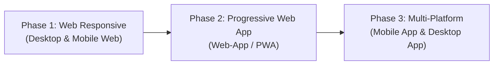
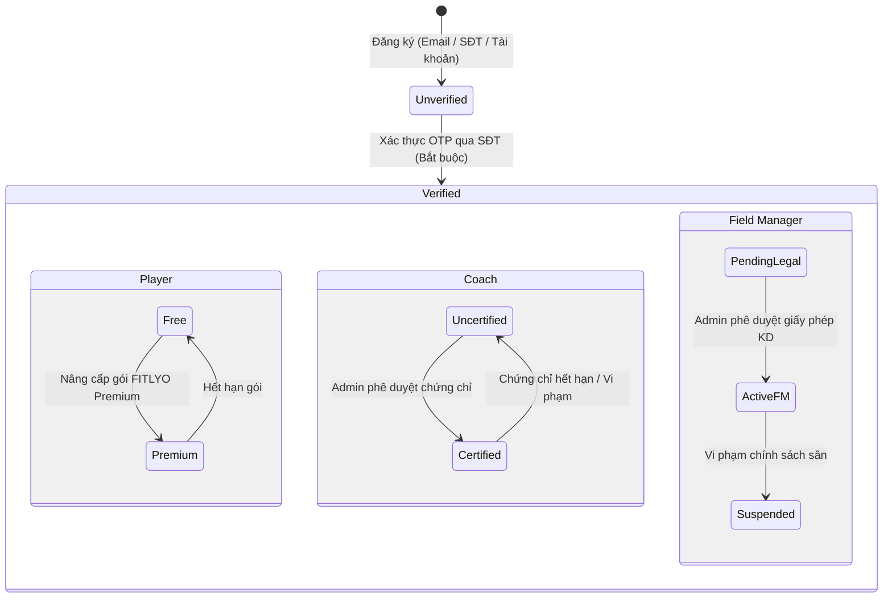

# TÀI LIỆU ĐẶC TẢ YÊU CẦU SẢN PHẨM & HỆ THỐNG (PRD / SRS)
# DỰ ÁN KHỞI NGHIỆP: FITLYO
### *Nền tảng Quản lý Sân Pickleball, Social Matchmaking & Huấn luyện viên Cá nhân hóa (PT Booking)*

---

| Thông Tin Dự Án | Chi Tiết |
| :--- | :--- |
| **Tên sản phẩm** | **FITLYO** |
| **Môn học / Đơn vị** | EXE101 - Khởi nghiệp đổi mới sáng tạo (FPT University) |
| **Lĩnh vực** | SportTech / Booking Platform / Social Sports Community |
| **Phạm vi thử nghiệm (Pilot)** | Khu vực TP. Thủ Đức, TP. Hồ Chí Minh |
| **Phiên bản tài liệu** | 1.0.0 (Bản hoàn thiện) |
| **Trạng thái** | Đã duyệt yêu cầu phát triển |

> [!IMPORTANT]
> **HỆ THỐNG TÀI LIỆU THIẾT KẾ & ĐẶC TẢ CHI TIẾT ĐỒNG BỘ:**
> PRD này là căn cứ nghiệp vụ cao nhất, đã được chuẩn hóa đồng bộ với:
> 1. [Tài liệu Thiết kế Luồng Nghiệp vụ (WF-01 đến WF-13)](file:///D:/FPTU/Term%207/EXE101/FITLYO/Documents/FITLYO_Tai_Lieu_Luong_Nghiep_Vu.md)
> 2. [Tài liệu Đặc tả Tổng quan Màn hình & Site Map](file:///D:/FPTU/Term%207/EXE101/FITLYO/Documents/FITLYO_Dac_Ta_Man_Hinh_Screen_Spec.md)
> 3. Hệ thống 7 tập tài liệu đặc tả chi tiết 36 màn hình:
>    - [Phân hệ Chủ sân SCR_FM (8 màn hình)](file:///D:/FPTU/Term%207/EXE101/FITLYO/Documents/FITLYO_Dac_Ta_Man_Hinh_SCR_FM.md)
>    - [Phân hệ Kèo đấu DUPR SCR_MATCH (4 màn hình)](file:///D:/FPTU/Term%207/EXE101/FITLYO/Documents/FITLYO_Dac_Ta_Man_Hinh_SCR_MATCH.md)
>    - [Phân hệ Huấn luyện viên SCR_COACH & BOOK (7 màn hình)](file:///D:/FPTU/Term%207/EXE101/FITLYO/Documents/FITLYO_Dac_Ta_Man_Hinh_SCR_COACH.md)
>    - [Phân hệ Cụm sân SCR_VENUE (2 màn hình)](file:///D:/FPTU/Term%207/EXE101/FITLYO/Documents/FITLYO_Dac_Ta_Man_Hinh_SCR_VENUE.md)
>    - [Phân hệ Hồ sơ Người chơi & VIP SCR_USER (3 màn hình)](file:///D:/FPTU/Term%207/EXE101/FITLYO/Documents/FITLYO_Dac_Ta_Man_Hinh_SCR_USER.md)
>    - [Phân hệ Quản trị Sàn SCR_ADMIN (5 màn hình)](file:///D:/FPTU/Term%207/EXE101/FITLYO/Documents/FITLYO_Dac_Ta_Man_Hinh_SCR_ADMIN.md)
>    - [Phân hệ Landing & Xác thực SCR_AUTH (7 màn hình)](file:///D:/FPTU/Term%207/EXE101/FITLYO/Documents/FITLYO_Dac_Ta_Man_Hinh_SCR_AUTH.md)

---

## MỤC LỤC

1. [TỔNG QUAN DỰ ÁN (PROJECT OVERVIEW)](#1-tổng-quan-dự-án-project-overview)
   - 1.1. Bối cảnh & Tầm nhìn
   - 1.2. Vấn đề thị trường (Problem Statement)
   - 1.3. Giải pháp sản phẩm (Solution & Value Proposition)
   - 1.4. Quy mô & Phạm vi triển khai
   - 1.5. Lộ trình nền tảng (Platform Roadmap)
2. [ĐỐI TƯỢNG NGƯỜI DÙNG & PHÂN QUYỀN (ACTORS & ROLES)](#2-đối-tượng-người-dùng--phân-quyền-actors--roles)
   - 2.1. Ma trận phân quyền (RBAC)
   - 2.2. Chi tiết 4 vai trò chính
   - 2.3. Vòng đời & Trạng thái tài khoản (Account Lifecycle)
3. [HỆ THỐNG XÁC THỰC & BẢO MẬT (AUTHENTICATION & SECURITY)](#3-hệ-thống-xác-thực--bảo-mật-authentication--security)
   - 3.1. Phương thức đăng nhập đa kênh
   - 3.2. Xác thực 2 yếu tố (2FA)
   - 3.3. Quy trình xác thực danh tính & kiểm duyệt hồ sơ
4. [ĐẶC TẢ TÍNH NĂNG CỐT LÕI (CORE FEATURES SPECIFICATION)](#4-đặc-tả-tính-năng-cốt-lõi-core-features-specification)
   - 4.1. Phân hệ Social Matchmaking (Ghép trận theo trình độ)
   - 4.2. Hệ thống chuẩn hóa trình độ người chơi (Skill Rating System)
   - 4.3. Phân hệ Đặt lịch & Quản lý Coach (PT Booking & Courses)
   - 4.4. Hệ thống Quản lý Thời gian & Slot Sân (Court Slot Management)
   - 4.5. Gói hội viên FITLYO Premium
5. [PHÂN HỆ FIELD MANAGER (CHỦ SÂN / QUẢN LÝ CỤM SÂN)](#5-phân-hệ-field-manager-chủ-sân--quản-lý-cụm-sân)
   - 5.1. Khởi tạo & Cấu hình địa điểm kinh doanh
   - 5.2. Quản lý trạng thái từng sân (Court Inventory)
   - 5.3. Quản lý ma trận lịch sân & Slot trống
   - 5.4. Quản lý và liên kết Coach tại sân
6. [PHÂN HỆ HUẤN LUYỆN VIÊN (COACH)](#6-phân-hệ-huấn-luyện-viên-coach)
   - 6.1. Đăng ký & Thẩm định chứng chỉ chuyên môn
   - 6.2. Đăng ký hoạt động tại cụm sân
   - 6.3. Quản lý khóa học, lịch dạy và học viên
7. [PHÂN HỆ QUẢN TRỊ VIÊN HỆ THỐNG (ADMIN)](#7-phân-hệ-quản-trị-viên-hệ-thống-admin)
   - 7.1. Phê duyệt hồ sơ Field Manager & Chứng chỉ Coach
   - 7.2. Quản lý người dùng, xử lý tranh chấp & khiếu nại
   - 7.3. Cấu hình hệ thống & Dashboard báo cáo
8. [YÊU CẦU PHI CHỨC NĂNG (NON-FUNCTIONAL REQUIREMENTS)](#8-yêu-cầu-phi-chức-năng-non-functional-requirements)
   - 8.1. Hiệu năng & Khả năng chịu tải (Performance & Scalability)
   - 8.2. Trải nghiệm người dùng & Giao diện Responsive (UI/UX)
   - 8.3. An toàn thông tin & Bảo mật (Security & Compliance)

---

## 1. TỔNG QUAN DỰ ÁN (PROJECT OVERVIEW)

### 1.1. Bối cảnh & Tầm nhìn
Pickleball đang là bộ môn thể thao có tốc độ phát triển bùng nổ nhất tại Việt Nam, đặc biệt tại các đô thị năng động như TP. Hồ Chí Minh. Tuy nhiên, hạ tầng công nghệ phục vụ bộ môn này vẫn còn phân mảnh:
- Việc đặt sân chủ yếu qua tin nhắn Zalo/gọi điện thủ công.
- Người chơi mới gặp khó khăn lớn trong việc tìm kiếm bạn chơi có cùng trình độ (tránh tình trạng "lệch kèo" làm mất trải nghiệm).
- Nhu cầu thuê huấn luyện viên (PT/Coach) nâng cao kỹ năng tăng nhanh nhưng thiếu nền tảng minh bạch hóa chứng chỉ, đánh giá năng lực và lịch học.

**FITLYO** ra đời với sứ mệnh trở thành hệ sinh thái công nghệ toàn diện cho cộng đồng Pickleball, kết nối thông minh giữa: **Chủ sân (Field Manager)** – **Huấn luyện viên (Coach)** – **Người chơi (Player)**.

### 1.2. Vấn đề thị trường (Problem Statement)
| Đối tượng | Vấn đề / Nỗi đau (Pain Points) |
| :--- | :--- |
| **Người chơi (Player)** | - Đi lẻ khó tìm người chơi cùng trình độ để ráp kèo.<br>- Khó tìm Coach uy tín, có chứng chỉ rõ ràng.<br>- Khó tìm khung giờ sân trống linh hoạt và minh bạch về giá. |
| **Chủ sân (Field Manager)** | - Slot giờ vắng khách (buổi sáng/trưa/đầu giờ chiều) bị lãng phí công suất.<br>- Quản lý lịch thủ công dễ trùng lịch (overbooking).<br>- Khó quản lý hoạt động giảng dạy của các Coach tự do tại sân. |
| **Huấn luyện viên (Coach)** | - Khó tiếp cận học viên mới ngoài mối quan hệ cá nhân.<br>- Lịch dạy phân tán, khó quản lý sân tập và khóa học dài hạn.<br>- Thiếu nơi khẳng định năng lực chuyên môn qua bằng cấp/chứng chỉ đã xác thực. |

### 1.3. Giải pháp sản phẩm (Solution & Value Proposition)
1. **Social Matchmaking thông minh:** Ghép người chơi theo trình độ chuẩn hóa (DUPR), vị trí địa lý và khung giờ mong muốn, giúp lấp đầy sân và mở rộng mối quan hệ thể thao lành mạnh.
2. **Hệ thống Coach Booking cá nhân hóa:** Đặt lịch học theo buổi lẻ hoặc khóa học dài hạn với các huấn luyện viên được thẩm định chứng chỉ chuyên môn.
3. **Quản lý sân tập tối ưu theo chuẩn Slot 90 phút:** Giúp chủ sân quản lý trạng thái sân theo thời gian thực, tự động hóa quy trình mở bán slot và tối đa hóa doanh thu.

### 1.4. Quy mô & Phạm vi triển khai
- **Thị trường mục tiêu ban đầu (Pilot Phase):** Khu vực **TP. Thủ Đức** (tập trung mật độ cao các cụm sân Pickleball mới, sinh viên các trường đại học, khu công nghệ cao và cư dân trẻ tại các khu đô thị Thảo Điền, An Phú, Vinhomes Grand Park).
- **Mở rộng tiếp theo:** Toàn bộ khu vực TP. Hồ Chí Minh, Bình Dương, Đồng Nai và các đô thị lớn trên toàn quốc.

### 1.5. Lộ trình nền tảng (Platform Roadmap)

- **Phase 1 (Hiện tại - MVP):** Web ứng dụng chuẩn Responsive mượt mà trên cả máy tính (Desktop) và trình duyệt di động (Mobile Web). Tối ưu hóa SEO, tốc độ tải trang và trải nghiệm người dùng không cần cài đặt ứng dụng.
- **Phase 2:** Nâng cấp lên Web-App (PWA - Progressive Web App) hỗ trợ cài đặt nhanh màn hình chính, Push Notification thời gian thực về thông báo ghép trận và nhắc lịch tập.
- **Phase 3 (Dự kiến mở rộng):** Phát triển Mobile App chuyên biệt (iOS & Android) với tính năng định vị GPS thời gian thực, tính điểm trận đấu trực tiếp và Desktop App cho Field Manager quản lý POS/thu ngân tại quầy.

---

## 2. ĐỐI TƯỢNG NGƯỜI DÙNG & PHÂN QUYỀN (ACTORS & ROLES)

### 2.1. Ma trận phân quyền (RBAC Matrix)

| Chức năng / Quyền hạn | Player (Free) | Player (Premium) | Coach | Field Manager | Admin |
| :--- | :---: | :---: | :---: | :---: | :---: |
| Tìm kiếm sân & xem thông tin slot | ✓ | ✓ | ✓ | ✓ | ✓ |
| Tham gia ghép trận Social Matchmaking | ✓ | ✓ | ✓ | - | Giám sát |
| Đặt lịch Coach thông thường | ✓ | ✓ | - | - | Giám sát |
| Đặt lịch Coach Certified (Có chứng chỉ) | Giới hạn | ✓ (Ưu tiên) | - | - | Giám sát |
| Cá nhân hóa lịch học / Yêu cầu slot riêng | ✗ | ✓ | - | - | Giám sát |
| Tạo và công bố trận ghép (Publish Social) | ✗ | ✗ | ✗ | ✓ | ✓ |
| Quản lý sân, đổi trạng thái In/Active | ✗ | ✗ | ✗ | ✓ | ✓ |
| Đăng ký cụm sân hoạt động | ✗ | ✗ | ✓ | - | Giám sát |
| Tạo khóa học (Courses) & nhận lịch dạy | ✗ | ✗ | ✓ | - | Giám sát |
| Duyệt hồ sơ Field Manager & Chứng chỉ Coach| ✗ | ✗ | ✗ | ✗ | ✓ |
| Cấu hình tham số hệ thống & Báo cáo tổng thể| ✗ | ✗ | ✗ | ✗ | ✓ |

### 2.2. Chi tiết 4 vai trò chính

#### 1. Player (Người chơi)
- **Free Player:**
  - Tìm kiếm sân, xem danh sách sân trống và lịch thi đấu.
  - Tham gia các phòng Social Matchmaking phù hợp với trình độ cá nhân.
  - Đặt lịch học với các huấn luyện viên cơ bản.
- **Premium Player (FITLYO Premium):**
  - Mở khóa quyền đặt lịch các **Certified Coach** (được kiểm định gắt gao).
  - Tự do tùy biến, cá nhân hóa khung giờ học theo nhu cầu riêng.
  - Được ưu tiên xếp slot ghép trận, giữ chỗ trước các trận đấu giờ cao điểm.
  - Huy hiệu thành viên VIP trên bảng xếp hạng cộng đồng.

#### 2. Coach (Huấn luyện viên)
- **Uncertified Coach (Chưa xác thực):**
  - Đã đăng ký tài khoản loại Coach nhưng chưa nộp bằng cấp/chứng chỉ hoặc đang trong quá trình chờ phê duyệt.
  - Chỉ được nhận dạy các buổi giao lưu cơ bản, hạn chế học phí tối đa.
- **Certified Coach (Đã xác minh chứng chỉ):**
  - Đã được Admin kiểm duyệt chứng chỉ chuyên môn (PPR, IPTPA, VTF hoặc giấy chứng nhận VĐV quốc gia/thành phố).
  - Được gắn tích xanh xác thực, xuất hiện trong danh mục giảng dạy chuẩn của FITLYO.
  - Quyền nhận học viên gói Premium, tạo các khóa học (Courses) dài hạn (1 - 3 tháng).

#### 3. Field Manager (Chủ sân / Quản lý cụm sân)
- Bắt buộc phải cung cấp đầy đủ giấy phép kinh doanh, hợp đồng thuê địa điểm hoặc chứng từ liên quan khi đăng ký.
- Quản lý toàn bộ danh sách sân con trong cụm sân thuộc quyền sở hữu/vận hành.
- Quản lý trạng thái từng sân: Kích hoạt (Active), Tạm đóng (Inactive), Bảo trì (Maintenance).
- Đăng tải (Publish) các phòng Social Matchmaking để người chơi đăng ký tham gia.
- Quản lý danh sách các Coach được phép hoạt động giảng dạy tại cụm sân của mình.

#### 4. Admin (Quản trị viên nền tảng)
- Kiểm duyệt và kích hoạt tài khoản của Field Manager (dựa trên hồ sơ pháp lý).
- Kiểm duyệt chứng chỉ huấn luyện viên của Coach.
- Quản lý cấu hình toàn hệ sinh thái (quy định slot, thang điểm trình độ, chính sách chiết khấu/hoa hồng).
- Xử lý vi phạm, giải quyết tranh chấp hoàn tiền/báo cáo gian lận trình độ.

### 2.3. Vòng đời & Trạng thái tài khoản (Account Lifecycle)



- **Quy tắc chuyển trạng thái chung:** Mọi tài khoản khởi tạo ban đầu đều ở trạng thái `Unverified`. Bắt buộc phải hoàn thành bước **Xác thực số điện thoại qua mã OTP** để kích hoạt trạng thái `Verified`.
- Chỉ tài khoản `Verified` mới được tham gia giao dịch thanh toán, ghép trận hoặc đặt lịch học.

---

## 3. HỆ THỐNG XÁC THỰC & BẢO MẬT (AUTHENTICATION & SECURITY)

### 3.1. Phương thức đăng nhập đa kênh
Hệ thống hỗ trợ 3 hình thức đăng nhập linh hoạt nhằm tối ưu tỷ lệ chuyển đổi người dùng:
1. **Tài khoản thường (Account/Password):** Tên đăng nhập/Email kết hợp mật khẩu mã hóa (Bcrypt salt rounds >= 10).
2. **Đăng nhập nhanh qua Google (Gmail OAuth 2.0):** Tích hợp Google Identity Services, tự động lấy họ tên và ảnh đại diện.
3. **Đăng nhập bằng Số điện thoại (Phone OTP):** Đăng nhập không cần mật khẩu (Passwordless) thông qua mã OTP gửi về tin nhắn SMS / Zalo ZNS.

### 3.2. Cơ chế xác thực hai lớp (2FA - Two-Factor Authentication)
- **Áp dụng:**
  - Bắt buộc đối với vai trò **Admin** và **Field Manager** (để bảo vệ dữ liệu tài chính & vận hành sân).
  - Tùy chọn (khuyến khích bật) đối với **Coach** và **Player**.
- **Kênh phân phối OTP:**
  - Gửi mã xác thực 6 số ngẫu nhiên qua **Số điện thoại** (SMS OTP) hoặc **Email đăng ký**.
  - Thời hạn mã OTP: 120 giây. Giới hạn tối đa 5 lần nhập sai trước khi khóa tạm thời 15 phút.

### 3.3. Quy trình xác thực danh tính & kiểm duyệt hồ sơ
- **Đối với Player:** Xác thực SĐT + Tự chọn trình độ khởi điểm (kèm khảo sát 5 câu hỏi trắc nghiệm kỹ năng).
- **Đối với Coach:** Tải lên ảnh chụp CMND/CCCD + Bản chụp bằng cấp/chứng chỉ (PPR, IPTPA, chứng nhận thi đấu). Admin kiểm duyệt trong vòng 24h làm việc.
- **Đối với Field Manager:** Bắt buộc gửi kèm:
  - Bản chụp Giấy chứng nhận đăng ký kinh doanh (Hộ kinh doanh hoặc Doanh nghiệp).
  - Hợp đồng thuê mặt bằng / Giấy chứng nhận quyền sử dụng đất.
  - Hình ảnh thực tế cụm sân và bảng hiệu.

---

## 4. ĐẶC TẢ TÍNH NĂNG CỐT LÕI (CORE FEATURES SPECIFICATION)

### 4.1. Phân hệ Social Matchmaking (Ghép trận cộng đồng)

#### Mục tiêu
Giải quyết tình trạng người chơi đi lẻ không có bạn chơi cùng, đồng thời giúp Field Manager lấp đầy các khung giờ thấp điểm.

#### Quy trình tạo phòng của Field Manager
1. Field Manager chọn cụm sân, chọn ngày và slot khả dụng (chưa có khách đặt riêng lẻ).
2. Thiết lập thông số phòng đấu:
   - **Trình độ yêu cầu (Skill Level):** Do FM quy định dựa trên thang DUPR (VD: 2.0 - 2.5 cho người mới, 3.0 - 3.5 cho phong trào khá).
   - **Số lượng người tham gia tối đa:** Mặc định 4 người (đấu đôi), hoặc 2 người (đấu đơn).
   - **Địa điểm thi đấu:** Hệ thống tự động điền địa chỉ chính xác của cụm sân.
   - **Mức phí tham gia:** Tính theo đầu người (Chia đều tiền thuê sân + phí cầu/nước nếu có).
3. Nhấn **Publish** để công khai phòng đấu lên bảng tin ghép trận toàn hệ thống.

#### Trải nghiệm của Player
- **Tìm kiếm & Lọc:**
  - Lọc theo khoảng cách/địa điểm (ưu tiên bán kính gần tại khu vực Thủ Đức).
  - Lọc theo khung giờ / slot mong muốn.
  - Lọc theo trình độ tương thích với bản thân (hệ thống cảnh báo nếu trình độ chênh lệch quá 0.5 điểm DUPR).
- **Đăng ký tham gia (Join Match):**
  - Xem danh sách những người đã tham gia trong phòng (Tên, Avatar, Trình độ DUPR, Tỷ lệ uy tín).
  - Xác nhận tham gia và thanh toán giữ chỗ (cọc tiền slot).
- **Trạng thái phòng đấu:**
  - `OPEN`: Đang chờ người chơi tham gia (chưa đủ người).
  - `FULL`: Đã đủ số lượng người chơi, tự động chốt danh sách và gửi thông báo nhắc giờ.
  - `IN_PROGRESS`: Đang trong khung giờ thi đấu.
  - `FINISHED`: Trận đấu đã kết thúc, hệ thống kích hoạt form chấm điểm uy tín và đánh giá lẫn nhau.
  - `CANCELLED`: Bị hủy bởi FM hoặc do không đủ số lượng tối thiểu trước giờ bắt đầu 60 phút.

---

### 4.2. Hệ thống chuẩn hóa trình độ người chơi (Skill Rating System)

Hệ thống áp dụng chuẩn quốc tế DUPR (Dynamic Universal Pickleball Rating) được bản địa hóa cho thị trường Việt Nam:

```
[Thang điểm DUPR FITLYO]
├── 1.0 - 2.0: Mới bắt đầu (Chưa nắm luật, mới làm quen vợt và bóng)
├── 2.0 - 2.5: Sơ cấp (Đã biết luật, giao bóng qua lưới, giữ bóng ngắn)
├── 2.5 - 3.0: Trung cấp thấp (Biết dink bóng, di chuyển cơ bản, kiểm soát lực)
├── 3.0 - 3.5: Trung cấp vững (Đánh dink đều, drop shot từ baseline, phán đoán tốt)
├── 3.5 - 4.0: Khá - Nâng cao (Tốc độ phản xạ nhanh, reset bóng tốt, chiến thuật đôi tốt)
└── 4.0 - 5.0+: Bán chuyên & Chuyên nghiệp (Thi đấu giải thưởng, kỹ chiến thuật toàn diện)
```

- **Quy định hiển thị:** Hồ sơ người chơi hiển thị rõ ràng chỉ số trình độ hiện tại và lịch sử trận đấu.
- **Cơ chế cập nhật trình độ:**
  - Khởi tạo ban đầu: Người chơi tự khai báo qua bộ bài test trắc nghiệm kiến thức & kinh nghiệm thực chiến.
  - Đánh giá từ Coach: Sau mỗi buổi học hoặc khóa học, Certified Coach có quyền cấp đánh giá xác nhận trình độ thực tế cho học viên.
  - Hệ thống điểm uy tín (Reputation Score): Thưởng điểm cho việc đến đúng giờ, thi đấu fair-play; trừ điểm nếu hủy trận sát giờ hoặc khai khống trình độ ("smurfing").

---

### 4.3. Phân hệ Đặt lịch & Quản lý Coach (PT Booking & Courses)

#### 1. Hồ sơ Huấn luyện viên (Coach Profile)
- Thông tin công khai: Họ tên, hình ảnh/video giới thiệu, số năm kinh nghiệm, bằng cấp/chứng chỉ (kèm huy hiệu Verified nếu là Certified Coach).
- Đánh giá & Phản hồi (Rating & Reviews) từ học viên cũ.
- Bảng giá công khai theo buổi lẻ và theo khóa học.
- Lịch rảnh (Available Slots) tại các cụm sân đã liên kết.

#### 2. Hình thức Huấn luyện (Coaching Formats)
- **Coach từng buổi riêng lẻ (Single Session):**
  - Học viên book 1 slot cụ thể (1h30) theo nhu cầu chỉnh sửa kỹ thuật cấp tốc hoặc làm quen bộ môn.
  - Học viên tự chọn sân (trong các sân Coach hỗ trợ) hoặc học tại sân do Coach chỉ định.
- **Coach theo lịch tạo sẵn (Fixed Schedule Sessions):**
  - Coach mở các lớp học định kỳ hàng tuần. Học viên xem lịch và đăng ký giữ chỗ.

#### 3. Hệ thống quản lý Khóa học (Courses Management)
Coach có quyền thiết lập các gói khóa học có giáo trình bài bản với các tiêu chuẩn ràng buộc:
- **Thời lượng khóa học:**
  - Mặc định chuẩn: **1 tháng**.
  - Giới hạn hệ thống: Tối thiểu **1 tuần** (khóa cấp tốc), tối đa **3 tháng** (khóa nâng cao chuyên sâu).
- **Tần suất học hàng tuần:**
  - Mặc định chuẩn: **2 buổi / tuần**.
  - Tùy chỉnh: 1 buổi/tuần (dành cho người bận rộn) hoặc 3 buổi/tuần (dành cho vận động viên phong trào).
- **Chính sách bù lịch & bảo lưu:**
  - Học viên được xin dời lịch tối đa 2 lần trong 1 khóa nếu báo trước 24 giờ.

---

### 4.4. Hệ thống Quản lý Thời gian & Slot Sân (Court Slot Management)

Hệ thống chuẩn hóa đơn vị đặt sân thành các **Slot 90 phút (1h30/slot)** để đảm bảo đủ thời gian khởi động, tập luyện và thi đấu trọn vẹn 1 trận Pickleball tiêu chuẩn:

#### Bảng cấu hình 6 Slot chuẩn trong ngày:
| Slot | Khung giờ | Đặc điểm vận hành |
| :---: | :---: | :--- |
| **Slot 1** | 06:00 - 07:30 | Buổi sáng sớm (Tập thể lực, đánh sáng mát mẻ) |
| **Slot 2** | 07:30 - 09:00 | Khung giờ sáng (Thích hợp cho lớp học cơ bản & tự do) |
| **Slot 3** | 15:30 - 17:00 | Khung giờ đầu chiều (Giờ vắng khách, ưu tiên khóa học & ghép trận giá tốt) |
| **Slot 4** | 17:00 - 18:30 | Khung giờ cao điểm 1 (Tan sở, nhu cầu chơi phong trào cao) |
| **Slot 5** | 18:30 - 20:00 | Khung giờ vàng (Nhu cầu Social Matchmaking & thi đấu cao nhất) |
| **Slot 6** | 20:00 - 21:30 | Khung giờ tối muộn (Giao lưu thể thao đêm) |

*(Ghi chú: Giữa các slot có thể cấu hình thời gian đệm 15 phút nếu sân cần dọn dẹp, hoặc liên tục theo chính sách từng cụm sân).*

#### Trạng thái Slot sân:
- `AVAILABLE` (Sân trống): Sẵn sàng cho Player đặt sân riêng, ghép trận hoặc Coach book dạy.
- `MATCH_PUBLISHED`: Đang mở cho người chơi ghi danh Social Matchmaking.
- `COACHING_BOOKED`: Đã được đặt làm giờ học với Huấn luyện viên.
- `PRIVATE_BOOKED`: Khách đã bao sân thi đấu riêng.
- `MAINTENANCE`: Khóa slot để bảo trì mặt sân/lưới/đèn chiếu sáng.

---

### 4.5. Gói hội viên FITLYO Premium

Gói dịch vụ đăng ký định kỳ (Subscription) dành riêng cho các Player muốn trải nghiệm dịch vụ chuyên nghiệp:

1. **Premium Coach Booking:**
   - Được quyền đặt lịch với nhóm **Certified Coach** độc quyền của nền tảng (những HLV đạt chứng chỉ quốc tế và thành tích cao).
   - Được hệ thống gợi ý Coach tối ưu dựa trên mục tiêu cải thiện kỹ năng (ví dụ: cần luyện cú đánh trái tay, dink chiến thuật đôi).
2. **Cá nhân hóa lịch học (Personalized Schedule):**
   - Linh hoạt chọn khung giờ đặc thù ngoài các slot cố định (nếu sân và HLV đồng ý).
   - Được thiết kế giáo trình riêng 1 kèm 1 và nhận video phân tích động tác sau mỗi buổi học.
3. **Đặc quyền Social Matchmaking:**
   - Ưu tiên hiển thị trên danh sách chờ của các phòng ghép trận hot.
   - Nhận thông báo sớm 15 phút trước khi một phòng Social chất lượng cao được mở bán.
   - Miễn phí hủy trận trước 4 tiếng (Player thông thường chỉ được hủy trước 12 tiếng).

---

## 5. PHÂN HỆ FIELD MANAGER (CHỦ SÂN / QUẢN LÝ CỤM SÂN)

### 5.1. Khởi tạo & Cấu hình địa điểm kinh doanh
- Khai báo thông tin cụm sân: Tên sân, Số điện thoại hotline, Địa chỉ chính xác (phường/đường tại TP. Thủ Đức), Định vị Google Maps.
- Khai báo tiện ích đi kèm: Bãi đỗ xe ô tô, phòng thay đồ, điều hòa, căn tin, cho thuê vợt/bóng.
- Tải lên chứng từ pháp lý và giấy phép đăng ký kinh doanh (bắt buộc duyệt qua Admin).
- Khai báo **Số lượng sân tối đa (Total Courts)** tại cơ sở (VD: Cụm sân có 6 sân từ Sân 1 đến Sân 6).

### 5.2. Quản lý trạng thái từng sân (Court Inventory)
- Danh sách trực quan các sân con trong cơ sở.
- Cấu hình trạng thái từng sân độc lập:
  - **Active:** Sân đang hoạt động bình thường, hệ thống tự động sinh 6 slot/ngày.
  - **Inactive:** Tạm ngưng hoạt động sân (ví dụ: cải tạo mặt sân, thi đấu giải nội bộ).

### 5.3. Quản lý ma trận lịch sân & Slot trống
- Giao diện trực quan dạng Calendar Grid (Lưới thời gian) hiển thị theo Ngày/Tuần:
  - Trục ngang: Các sân (Sân 1, Sân 2, Sân 3...).
  - Trục dọc: 6 Slot chuẩn trong ngày.
- Thao tác nhanh cho Field Manager:
  - Bấm vào slot trống -> Chọn **Tạo trận Social Matchmaking** (điền trình độ DUPR, số người, mở bán).
  - Bấm vào slot trống -> Khóa slot cho khách vãng lai đặt trực tiếp tại quầy.
  - Xem danh sách người chơi đã thanh toán tham gia trận đấu.

### 5.4. Quản lý và liên kết Coach tại sân
- Một Field Manager có thể liên kết và quản lý nhiều Huấn luyện viên hoạt động tại sân mình.
- Tiếp nhận yêu cầu đăng ký hoạt động từ các Coach.
- Quản lý chính sách chia sẻ mặt sân với Coach (phí sân cố định hoặc chiết khấu % theo giờ dạy).
- Quyền tạm dừng hoặc ngắt quyền hoạt động của Coach tại sân nếu vi phạm quy định nội bộ của sân.

---

## 6. PHÂN HỆ HUẤN LUYỆN VIÊN (COACH)

### 6.1. Đăng ký & Thẩm định chứng chỉ chuyên môn
- Tạo hồ sơ năng lực HLV chuyên nghiệp:
  - Số năm kinh nghiệm chơi & huấn luyện Pickleball.
  - Tải lên các chứng chỉ quốc tế/trong nước: PPR (Professional Pickleball Registry), IPTPA, chứng chỉ HLV Tổng cục TDTT.
  - Thành tích thi đấu tại các giải phong trào/chuyên nghiệp.
- Theo dõi trạng thái thẩm định: `Chờ duyệt` -> `Đã cấp chứng nhận (Certified Coach)` hoặc `Từ chối (kèm lý do)`.

### 6.2. Đăng ký hoạt động tại cụm sân
- Tìm kiếm các cụm sân trong khu vực TP. Thủ Đức đã có mặt trên FITLYO.
- Gửi yêu cầu liên kết đến Field Manager của cụm sân tương ứng.
- Khi được FM chấp thuận, Coach được quyền mở lớp và dẫn học viên vào sân tập luyện theo khung giờ đã thỏa thuận.

### 6.3. Quản lý khóa học, lịch dạy và học viên
- **Thiết lập biểu phí:**
  - Giá dạy 1 buổi lẻ (90 phút).
  - Giá trọn gói khóa học 1 tháng (8 buổi).
- **Lên lịch rảnh (Availability):** Đánh dấu các slot mình sẵn sàng nhận dạy trong tuần.
- **Tạo Khóa học (Courses Catalog):**
  - Đặt tên khóa học (VD: "Pickleball Cơ bản cho người mới bắt đầu", "Chiến thuật Đánh đôi Nâng cao DUPR 3.5+").
  - Thiết lập thời gian (1 tuần - 3 tháng, mặc định 1 tháng).
  - Thiết lập lịch cố định: Mặc định 2 buổi/tuần (VD: Tối Thứ 3 & Thứ 5 Slot 5).
- **Quản lý học viên:**
  - Theo dõi danh sách học viên đang theo học.
  - Điểm danh từng buổi học.
  - Gửi nhận xét và cập nhật chứng nhận trình độ cho học viên sau khi kết thúc khóa.

---

## 7. PHÂN HỆ QUẢN TRỊ VIÊN HỆ THỐNG (ADMIN)

### 7.1. Phê duyệt hồ sơ Field Manager & Chứng chỉ Coach
- **Duyệt Field Manager:**
  - Kiểm tra tính xác thực của Giấy phép kinh doanh và chứng từ địa điểm.
  - Xác thực số lượng sân đăng ký thực tế so với hồ sơ.
  - Duyệt kích hoạt tài khoản để FM bắt đầu vận hành trên nền tảng.
- **Duyệt Certified Coach:**
  - Đối soát bằng cấp, chứng chỉ chuyên môn của Coach với cơ sở dữ liệu của các tổ chức cấp phép.
  - Cấp huy hiệu "Certified Coach" cho tài khoản hợp lệ.

### 7.2. Quản lý người dùng, xử lý tranh chấp & khiếu nại
- Khóa/mở khóa tài khoản khi phát hiện dấu hiệu gian lận hoặc vi phạm tiêu chuẩn cộng đồng.
- Xử lý khiếu nại về hoàn tiền (hủy sân do thời tiết mưa to đối với sân ngoài trời, tranh chấp giữa Coach và Học viên).
- Tiếp nhận và xử lý báo cáo gian lận trình độ thi đấu trong các phòng Social Matchmaking.

### 7.3. Cấu hình hệ thống & Dashboard báo cáo
- Cấu hình các tham số vận hành:
  - Thời lượng slot chuẩn (mặc định: 90 phút).
  - Tỷ lệ phí hoa hồng nền tảng (Platform Commission Fee) trên mỗi lượt đặt sân và đặt lịch Coach.
  - Bảng định nghĩa chi tiết thang điểm DUPR.
- **Báo cáo kinh doanh theo thời gian thực:**
  - Tổng số lượt trận Matchmaking đã tổ chức thành công tại TP. Thủ Đức.
  - Tỷ lệ lấp đầy sân (Occupancy Rate) của từng cụm sân đối tác.
  - Doanh thu từ gói FITLYO Premium và hoa hồng giao dịch.

---

## 8. YÊU CẦU PHI CHỨC NĂNG (NON-FUNCTIONAL REQUIREMENTS)

### 8.1. Hiệu năng & Khả năng chịu tải (Performance & Scalability)
- **Tốc độ phản hồi (Latency):** Thời gian tải trang ban đầu (First Contentful Paint) < 1.5 giây trên mạng 4G/Wifi tiêu chuẩn. API tìm kiếm sân và slot phản hồi < 300ms.
- **Khả năng mở rộng:** Kiến trúc chịu tải tối thiểu 1.000 người dùng hoạt động đồng thời (CCU) trong giai đoạn thử nghiệm tại Thủ Đức, sẵn sàng mở rộng ngang (Horizontal Scaling) khi triển khai toàn TP.HCM.

### 8.2. Trải nghiệm người dùng & Giao diện Responsive (UI/UX)
- Giao diện thân thiện chuẩn thể thao: Màu sắc năng động, tương phản cao, phông chữ dễ đọc ngoài trời.
- Hoạt động mượt mà 100% trên cả **Desktop** (màn hình lớn cho Field Manager thao tác quản lý lịch) và **Mobile Web** (giao diện tối ưu cho người chơi đặt sân và quẹt tìm trận bằng ngón cái).

### 8.3. An toàn thông tin & Bảo mật (Security & Compliance)
- Toàn bộ lưu lượng truyền tải mã hóa qua giao thức HTTPS (TLS 1.3).
- Lưu trữ mật khẩu bằng thuật toán băm Bcrypt kèm Salt an toàn.
- Cơ chế bảo vệ chống các lỗ hổng phổ biến: SQL Injection, XSS, CSRF, Rate Limiting chống spam gửi mã OTP.
- Lưu trữ giấy phép kinh doanh của Field Manager và thông tin CCCD của Coach trong khu vực lưu trữ bảo mật (Private Storage Bucket), chỉ Admin có quyền truy cập kiểm tra.