# TÀI LIỆU THIẾT KẾ CÁC LUỒNG XỬ LÝ NGHIỆP VỤ (BUSINESS PROCESS SPECIFICATION)
# DỰ ÁN: FITLYO - NỀN TẢNG QUẢN LÝ SÂN PICKLEBALL, SOCIAL MATCHMAKING & PT BOOKING

---

| Thông Tin Tài Liệu | Chi Tiết |
| :--- | :--- |
| **Dự án** | FITLYO (Môn học: EXE101 - Khởi nghiệp đổi mới sáng tạo, FPT University) |
| **Tác giả / Vai trò** | Business Analyst (BA) Agent |
| **Tài liệu căn cứ** | `FITLYO_PRD_Yeu_Cau_Phan_Mem - Publish.md` |
| **Phạm vi áp dụng** | Giai đoạn 1 (Web Responsive tại khu vực TP. Thủ Đức) & Chuẩn bị nền tảng cho Giai đoạn 2 (PWA Web-App) |
| **Mục đích tài liệu** | Đặc tả chi tiết hành vi hệ thống, luồng nghiệp vụ tương tác giữa các bên (Chủ sân - HLV - Người chơi - Admin), sơ đồ luồng dữ liệu, quy tắc nghiệp vụ ràng buộc và kịch bản ngoại lệ làm cơ sở trực tiếp cho đội ngũ UI/UX, Backend, Frontend và QA/QC. |
| **Phiên bản** | 1.0 (Bản chính thức) |
| **Ngày lập** | 13/10/2026 |

---

## MỤC LỤC TỔNG THỂ

1. [TỔNG QUAN & MA TRẬN USE CASE TOÀN HỆ THỐNG](#1-tổng-quan--ma-trận-use-case-toàn-hệ-thống)
   - 1.1. Danh mục Tác tử (Actors) & Vai trò
   - 1.2. Sơ đồ Use Case tổng thể hệ thống (System Use Case Diagram)
   - 1.3. Bảng quy ước thuật ngữ & Mã định danh
2. [PHÂN TÍCH & THIẾT KẾ CÁC LUỒNG NGHIỆP VỤ CHI TIẾT](#2-phân-tích--thiết-kế-các-luồng-nghiệp-vụ-chi-tiết)
   - [NHÓM 1: XÁC THỰC, ONBOARDING & PHÂN QUYỀN](#nhóm-1-xác-thực-onboarding--phân-quyền)
     - [WF-01: Đăng ký, Đăng nhập & Xác thực 2 bước (2FA)](#wf-01-đăng-ký-đăng-nhập--xác-thực-2-bước-2fa)
     - [WF-02: Đăng ký & Thẩm định Hồ sơ Chủ sân (Field Manager Onboarding)](#wf-02-đăng-ký--thẩm-định-hồ-sơ-chủ-sân-field-manager-onboarding)
     - [WF-03: Đăng ký & Kiểm duyệt Chứng chỉ Huấn luyện viên (Coach Certification)](#wf-03-đăng-ký--kiểm-duyệt-chứng-chỉ-huấn-luyện-viên-coach-certification)
     - [WF-04: Đăng ký Hoạt động Liên kết giữa Coach và Cụm sân](#wf-04-đăng-ký-hoạt-động-liên-kết-giữa-coach-và-cụm-sân)
   - [NHÓM 2: VẬN HÀNH & ĐIỀU PHỐI SÂN TẬP](#nhóm-2-vận-hành--điều-phối-sân-tập)
     - [WF-05: Quản lý Trạng thái Sân & Điều phối Ma trận 6 Slot 90 phút](#wf-05-quản-lý-trạng-thái-sân--điều-phối-ma-trận-6-slot-90-phút)
   - [NHÓM 3: SOCIAL MATCHMAKING (GHÉP TRẬN THEO TRÌNH ĐỘ)](#nhóm-3-social-matchmaking-ghép-trận-theo-trình-độ)
     - [WF-06: Field Manager Tạo & Công bố Phòng Ghép trận (Match Publishing)](#wf-06-field-manager-tạo--công-bố-phòng-ghép-trận-match-publishing)
     - [WF-07: Người chơi Tìm kiếm, Đăng ký Ghép trận & Check-in QR](#wf-07-người-chơi-tìm-kiếm-đăng-ký-ghép-trận--check-in-qr)
     - [WF-08: Kết thúc Trận đấu, Chấm điểm Uy tín & Đánh giá DUPR](#wf-08-kết-thúc-trận-đấu-chấm-điểm-uy-tín--đánh-giá-dupr)
   - [NHÓM 4: ĐẶT LỊCH HUẤN LUYỆN VIÊN & KHÓA HỌC (COACH BOOKING & COURSES)](#nhóm-4-đặt-lịch-huấn-luyện-viên--khóa-học-coach-booking--courses)
     - [WF-09: Đặt lịch Huấn luyện viên Buổi lẻ (Single Session Booking)](#wf-09-đặt-lịch-huấn-luyện-viên-buổi-lẻ-single-session-booking)
     - [WF-10: Khởi tạo, Đăng ký & Vận hành Khóa học Dài hạn (Courses Lifecycle)](#wf-10-khởi-tạo-đăng-ký--vận-hành-khóa-học-dài-hạn-courses-lifecycle)
   - [NHÓM 5: NÂNG CẤP & QUẢN TRỊ GÓI HỘI VIÊN FITLYO PREMIUM](#nhóm-5-nâng-cấp--quản-trị-gói-hội-viên-fitlyo-premium)
     - [WF-11: Nâng cấp Gói Hội viên FITLYO Premium & Kích hoạt Đặc quyền](#wf-11-nâng-cấp-gói-hội-viên-fitlyo-premium--kích-hoạt-đặc-quyền)
   - [NHÓM 6: XỬ LÝ NGOẠI LỆ, TRANH CHẤP & BẤT KHẢ KHÁNG](#nhóm-6-xử-lý-ngoại-lệ-tranh-chấp--bất-khả-kháng)
     - [WF-12: Hủy Slot do Điều kiện Bất khả kháng (Thời tiết xấu / Sự cố sân)](#wf-12-hủy-slot-do-điều-kiện-bất-khả-kháng-thời-tiết-xấu--sự-cố-sân)
     - [WF-13: Xử lý Khiếu nại, Tố cáo Gian lận Trình độ & Phạt No-Show](#wf-13-xử-lý-khiếu-nại-tố-cáo-gian-lận-trình-độ--phạt-no-show)
3. [MA TRẬN TRẠNG THÁI CÁC THỰC THỂ CỐT LÕI (STATE MACHINE CONSOLIDATION)](#3-ma-trận-trạng-thái-các-thực-thể-cốt-lõi-state-machine-consolidation)
4. [BẢNG TỔNG HỢP QUY TẮC NGHIỆP VỤ HỆ THỐNG (BUSINESS RULES INVENTORY)](#4-bảng-tổng-hợp-quy-tắc-nghiệp-vụ-hệ-thống-business-rules-inventory)

---

## 1. TỔNG QUAN & MA TRẬN USE CASE TOÀN HỆ THỐNG

### 1.1. Danh mục Tác tử (Actors) & Vai trò

| Ký hiệu Tác tử | Tên Tác tử | Định nghĩa & Trách nhiệm trong hệ thống |
| :---: | :--- | :--- |
| **`GUEST`** | Khách vãng lai | Người dùng chưa đăng nhập, chỉ xem thông tin cơ bản về sân và danh sách HLV |
| **`PL-Free`** | Người chơi Miễn phí | Tài khoản người chơi cơ bản, tìm sân, tham gia ghép trận tiêu chuẩn, đặt Coach cơ bản |
| **`PL-Pre`** | Người chơi Premium | Thành viên FITLYO Premium, ưu tiên slot, book Certified Coach, dời lịch linh hoạt |
| **`CO-Uncert`**| HLV Chưa kiểm định | Huấn luyện viên tự do chưa có chứng chỉ được Admin duyệt, dạy buổi lẻ cơ bản |
| **`CO-Cert`** | HLV Đạt chuẩn | Huấn luyện viên có bằng cấp/chứng chỉ quốc tế đã kiểm duyệt, mở khóa học dài hạn |
| **`FM`** | Field Manager (Chủ sân) | Chủ cơ sở kinh doanh, quản lý số lượng sân, publish phòng ghép trận, duyệt Coach |
| **`ADM`** | Quản trị viên (Admin) | Thẩm định hồ sơ pháp lý sân, duyệt chứng chỉ HLV, xử lý tranh chấp, quản lý sàn |
| **`SYS`** | Hệ thống FITLYO | Các tác vụ nền tự động: Cron job sinh slot, thanh toán, hoàn cọc, thông báo đẩy |

---

### 1.2. Sơ đồ Use Case tổng thể hệ thống (System Use Case Diagram)

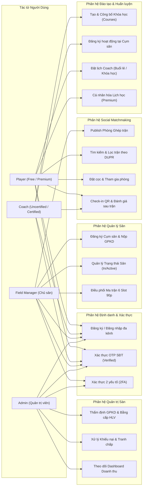

---

### 1.3. Bảng quy ước thuật ngữ & Mã định danh
- **DUPR (Dynamic Universal Pickleball Rating):** Thang đo trình độ chuẩn từ 1.0 đến 5.0+.
- **Standard Slot (Slot chuẩn):** Khung giờ cố định có thời lượng chính xác **90 phút (1h30)**. Hệ thống chia ngày thành 6 slot chuẩn.
- **Atomic Lock (Khóa nguyên tử):** Cơ chế bảo đảm tính toàn vẹn dữ liệu khi có nhiều người cùng bấm đặt 1 slot trong cùng 1 tích tắc.
- **Reputation Score (Điểm uy tín):** Điểm số đánh giá mức độ tin cậy của tài khoản (khởi điểm 100 điểm), giảm khi vi phạm, bỏ trận hoặc khai khống trình độ.

---

### 1.4. Bảng Ánh xạ Luồng Nghiệp vụ sang Hệ thống 36 Màn hình Giao diện

| Mã Luồng Nghiệp vụ | Tên Luồng Xử lý Nghiệp vụ | Mã Màn hình Phụ trách | File Đặc tả Giao diện Chi tiết |
| :--- | :--- | :--- | :--- |
| **`WF-01`** | Đăng ký, Đăng nhập & Xác thực 2 bước (2FA) | `SCR_PUB_01`, `SCR_AUTH_01`, `SCR_AUTH_02`, `SCR_AUTH_03` | [`FITLYO_Dac_Ta_Man_Hinh_SCR_AUTH.md`](file:///D:/FPTU/Term%207/EXE101/FITLYO/Documents/FITLYO_Dac_Ta_Man_Hinh_SCR_AUTH.md) |
| **`WF-02`** | Đăng ký & Thẩm định Hồ sơ Chủ sân | `SCR_AUTH_06`, `SCR_ADMIN_01` | [`FITLYO_Dac_Ta_Man_Hinh_SCR_AUTH.md`](file:///D:/FPTU/Term%207/EXE101/FITLYO/Documents/FITLYO_Dac_Ta_Man_Hinh_SCR_AUTH.md), [`SCR_ADMIN.md`](file:///D:/FPTU/Term%207/EXE101/FITLYO/Documents/FITLYO_Dac_Ta_Man_Hinh_SCR_ADMIN.md) |
| **`WF-03`** | Đăng ký & Kiểm duyệt Chứng chỉ Coach | `SCR_AUTH_05`, `SCR_ADMIN_01` | [`FITLYO_Dac_Ta_Man_Hinh_SCR_AUTH.md`](file:///D:/FPTU/Term%207/EXE101/FITLYO/Documents/FITLYO_Dac_Ta_Man_Hinh_SCR_AUTH.md), [`SCR_ADMIN.md`](file:///D:/FPTU/Term%207/EXE101/FITLYO/Documents/FITLYO_Dac_Ta_Man_Hinh_SCR_ADMIN.md) |
| **`WF-04`** | Đăng ký Liên kết Coach và Cụm sân | `SCR_COACH_04`, `SCR_FM_05` | [`FITLYO_Dac_Ta_Man_Hinh_SCR_COACH.md`](file:///D:/FPTU/Term%207/EXE101/FITLYO/Documents/FITLYO_Dac_Ta_Man_Hinh_SCR_COACH.md), [`SCR_FM.md`](file:///D:/FPTU/Term%207/EXE101/FITLYO/Documents/FITLYO_Dac_Ta_Man_Hinh_SCR_FM.md) |
| **`WF-05`** | Quản lý Sân & Điều phối Ma trận 6 Slot | `SCR_FM_01`, `SCR_FM_03`, `SCR_FM_08`, `SCR_VENUE_02` | [`FITLYO_Dac_Ta_Man_Hinh_SCR_FM.md`](file:///D:/FPTU/Term%207/EXE101/FITLYO/Documents/FITLYO_Dac_Ta_Man_Hinh_SCR_FM.md), [`SCR_VENUE.md`](file:///D:/FPTU/Term%207/EXE101/FITLYO/Documents/FITLYO_Dac_Ta_Man_Hinh_SCR_VENUE.md) |
| **`WF-06`** | Tạo & Công bố Phòng Ghép Social DUPR | `SCR_FM_01`, `SCR_FM_02`, `SCR_MATCH_01` | [`FITLYO_Dac_Ta_Man_Hinh_SCR_FM.md`](file:///D:/FPTU/Term%207/EXE101/FITLYO/Documents/FITLYO_Dac_Ta_Man_Hinh_SCR_FM.md), [`SCR_MATCH.md`](file:///D:/FPTU/Term%207/EXE101/FITLYO/Documents/FITLYO_Dac_Ta_Man_Hinh_SCR_MATCH.md) |
| **`WF-07`** | Tìm kiếm, Đăng ký Cọc Escrow & Check-in QR | `SCR_MATCH_01`, `SCR_MATCH_02`, `SCR_MATCH_03`, `SCR_FM_07` | [`FITLYO_Dac_Ta_Man_Hinh_SCR_MATCH.md`](file:///D:/FPTU/Term%207/EXE101/FITLYO/Documents/FITLYO_Dac_Ta_Man_Hinh_SCR_MATCH.md), [`SCR_FM.md`](file:///D:/FPTU/Term%207/EXE101/FITLYO/Documents/FITLYO_Dac_Ta_Man_Hinh_SCR_FM.md) |
| **`WF-08`** | Kết thúc Trận, Chấm Điểm Uy tín & DUPR | `SCR_MATCH_04`, `SCR_USER_01` | [`FITLYO_Dac_Ta_Man_Hinh_SCR_MATCH.md`](file:///D:/FPTU/Term%207/EXE101/FITLYO/Documents/FITLYO_Dac_Ta_Man_Hinh_SCR_MATCH.md), [`SCR_USER.md`](file:///D:/FPTU/Term%207/EXE101/FITLYO/Documents/FITLYO_Dac_Ta_Man_Hinh_SCR_USER.md) |
| **`WF-09`** | Đặt lịch Huấn luyện viên Buổi lẻ PT | `SCR_BOOK_01`, `SCR_BOOK_02`, `SCR_BOOK_03`, `SCR_COACH_01` | [`FITLYO_Dac_Ta_Man_Hinh_SCR_COACH.md`](file:///D:/FPTU/Term%207/EXE101/FITLYO/Documents/FITLYO_Dac_Ta_Man_Hinh_SCR_COACH.md) |
| **`WF-10`** | Vận hành Khóa học Dài hạn (Boot Camp) | `SCR_COACH_02`, `SCR_BOOK_02`, `SCR_BOOK_03`, `SCR_COACH_03` | [`FITLYO_Dac_Ta_Man_Hinh_SCR_COACH.md`](file:///D:/FPTU/Term%207/EXE101/FITLYO/Documents/FITLYO_Dac_Ta_Man_Hinh_SCR_COACH.md) |
| **`WF-11`** | Nâng cấp Gói VIP & Kích hoạt Đặc quyền | `SCR_USER_01`, `SCR_USER_02`, `SCR_USER_03` | [`FITLYO_Dac_Ta_Man_Hinh_SCR_USER.md`](file:///D:/FPTU/Term%207/EXE101/FITLYO/Documents/FITLYO_Dac_Ta_Man_Hinh_SCR_USER.md) |
| **`WF-12`** | Hủy Slot do Bất khả kháng (Mưa/Sự cố) | `SCR_ADMIN_03`, `SCR_FM_01`, `SCR_MATCH_03` | [`FITLYO_Dac_Ta_Man_Hinh_SCR_ADMIN.md`](file:///D:/FPTU/Term%207/EXE101/FITLYO/Documents/FITLYO_Dac_Ta_Man_Hinh_SCR_ADMIN.md) |
| **`WF-13`** | Xử lý Khiếu nại, Tố cáo Gian lận DUPR & Bùng cọc | `SCR_MATCH_04`, `SCR_ADMIN_03`, `SCR_ADMIN_02` | [`FITLYO_Dac_Ta_Man_Hinh_SCR_ADMIN.md`](file:///D:/FPTU/Term%207/EXE101/FITLYO/Documents/FITLYO_Dac_Ta_Man_Hinh_SCR_ADMIN.md) |

---

## 2. PHÂN TÍCH & THIẾT KẾ CÁC LUỒNG NGHIỆP VỤ CHI TIẾT

### NHÓM 1: XÁC THỰC, ONBOARDING & PHÂN QUYỀN

---### WF-01: Đăng ký, Đăng nhập & Xác thực 2 bước (2FA)

#### 1. Mô tả nghiệp vụ
Đảm bảo xác thực đa kênh tiện lợi (Tài khoản, Google OAuth, SĐT OTP), bắt buộc định danh số điện thoại để đạt trạng thái `Verified`, và áp dụng 2FA bắt buộc cho các vai trò quản trị tài sản (Field Manager, Admin).

#### 2. Điều kiện tiên quyết & Kết thúc
- **Pre-condition:** Người dùng truy cập FITLYO trên trình duyệt Web (Desktop hoặc Mobile Web).
- **Post-condition:** Tài khoản được xác thực, cấp JWT token (thời hạn 2 giờ, refresh token 7 ngày), chuyển hướng đến đúng giao diện theo Role.

#### 3. Sơ đồ tuần tự tương tác (Sequence Diagram)

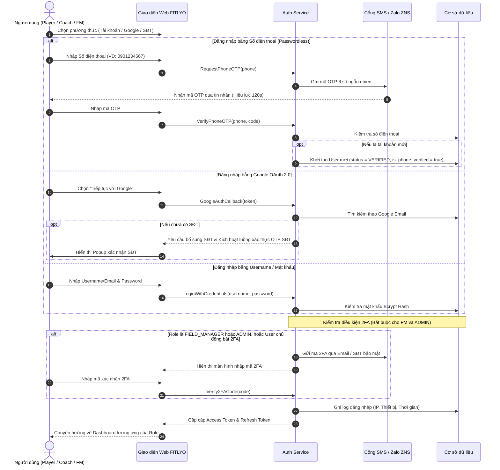

#### 4. Kịch bản phân bước (Main Flow & Exceptions)
| Bước | Bên thực hiện | Hành động | Phản hồi hệ thống |
| :---: | :---: | :--- | :--- |
| **1** | User | Chọn phương thức đăng nhập và nhập dữ liệu. | Validate định dạng email/SĐT/mật khẩu tại client. |
| **2** | Auth Service | So khớp thông tin đăng nhập trong cơ sở dữ liệu. | Trả lỗi nếu sai mật khẩu quá 5 lần (khóa 15 phút - BR-03). |
| **3** | Auth Service | Kiểm tra cờ `is_phone_verified`. | Nếu `false`, bắt buộc chuyển qua màn hình OTP SĐT. |
| **4** | User | Nhập mã OTP gồm 6 chữ số nhận qua điện thoại. | So sánh với mã OTP lưu tạm trong Redis cache (TTL 120s). |
| **5** | Auth Service | Kiểm tra quyền (Role) để kích hoạt 2FA. | Nếu là `FM` hoặc `ADMIN`, gửi mã 2FA đến kênh bảo mật (BR-02). |
| **6** | User | Nhập mã 2FA hoàn tất phiên đăng nhập. | Cấp JWT Token, phân luồng về Dashboard phù hợp. |

---

### WF-02: Đăng ký & Thẩm định Hồ sơ Chủ sân (Field Manager Onboarding)

#### 1. Mô tả nghiệp vụ
Chủ cụm sân tại TP. Thủ Đức đăng ký tài khoản kinh doanh, cung cấp chứng từ pháp lý và số lượng sân tối đa. Admin thẩm định thực tế trước khi cụm sân được kích hoạt kinh doanh trên nền tảng.

#### 2. Sơ đồ luồng quyết định (Activity Flowchart)

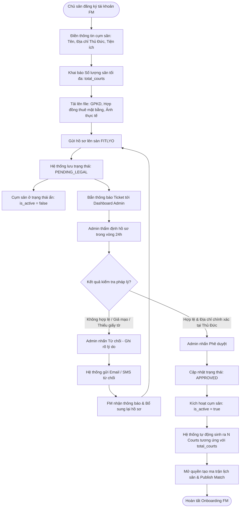

#### 3. Quy tắc nghiệp vụ (Business Rules)
- **BR-04:** Trường `total_courts` không được thay đổi tùy tiện sau khi đã duyệt. Nếu muốn mở rộng thêm sân, FM phải gửi yêu cầu nâng hạn mức kèm hình ảnh nghiệm thu thực tế.
- **BR-05:** Cụm sân chưa ở trạng thái `APPROVED` sẽ hoàn toàn ẩn khỏi kết quả tìm kiếm của Người chơi.

---### WF-03: Đăng ký & Kiểm duyệt Chứng chỉ Huấn luyện viên (Coach Certification)

#### 1. Mô tả nghiệp vụ
Xác thực năng lực chuyên môn của Huấn luyện viên Pickleball, bảo vệ quyền lợi người học và là điều kiện tiên quyết để phân phối học viên gói FITLYO Premium.

#### 2. Sơ đồ tuần tự thẩm định (Sequence Diagram)

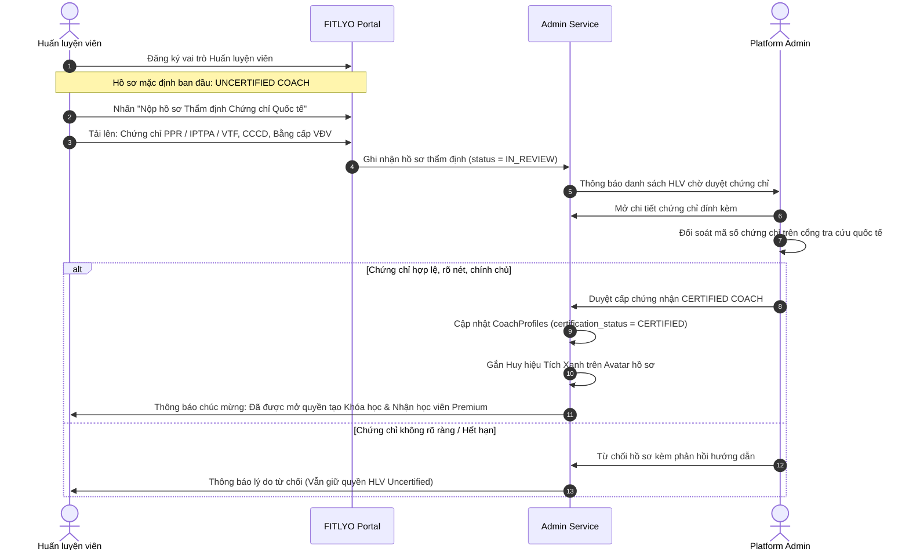

#### 3. Quy tắc nghiệp vụ (Business Rules)
- **BR-06:** **Uncertified Coach** chỉ được nhận học viên thông thường, không được quyền nhận lịch từ học viên đặt qua danh mục Certified Coach của gói Premium, và bị giới hạn trần học phí tối đa (không quá 200.000 VNĐ / slot 90p).
- **BR-07:** **Certified Coach** được gắn huy hiệu Tích xanh trên profile, được quyền tạo Khóa học dài hạn (Courses) và nhận học viên gói FITLYO Premium.

---

### WF-04: Đăng ký Hoạt động Liên kết giữa Coach và Cụm sân

#### 1. Mô tả nghiệp vụ
Thiết lập mối quan hệ hợp tác chính thức giữa Huấn luyện viên và Cụm sân (Field Manager) để sử dụng mặt sân dạy học mà không xung đột với khách vãng lai.

#### 2. Sơ đồ xử lý liên kết (Activity Diagram)

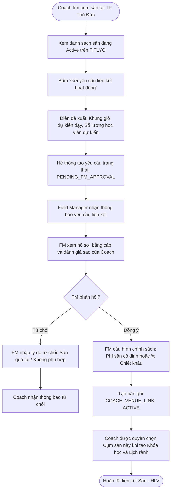

---

### NHÓM 2: VẬN HÀNH & ĐIỀU PHỐI SÂN TẬP

---

### WF-05: Quản lý Trạng thái Sân & Điều phối Ma trận 6 Slot 90 phút

#### 1. Mô tả nghiệp vụ
Chuẩn hóa toàn bộ thời gian vận hành trong ngày thành **6 Slot cố định (mỗi slot 90 phút)** từ 06:00 đến 21:30. Cho phép Field Manager theo dõi trực quan và điều phối linh hoạt các loại hình đặt sân.

#### 2. Bảng phân bổ 6 Slot chuẩn hệ thống
| Slot | Khung giờ | Loại giờ | Cơ chế vận hành tối ưu |
| :---: | :---: | :---: | :--- |
| **SL-01** | 06:00 - 07:30 | Bình thường | Thể lực sáng sớm / Giao lưu phong trào sáng mát mẻ |
| **SL-02** | 07:30 - 09:00 | Thấp điểm | Dành cho lớp học dài hạn / Học viên tự do |
| **SL-03** | 15:30 - 17:00 | Thấp điểm | Ưu tiên mở phòng Social Matchmaking giảm giá giờ vắng |
| **SL-04** | 17:00 - 18:30 | Cao điểm 1 | Giờ tan sở, nhu cầu ghép trận và chơi cố định cao |
| **SL-05** | 18:30 - 20:00 | Giờ Vàng | Ghép trận chất lượng cao DUPR 3.0+ / Học viên Premium |
| **SL-06** | 20:00 - 21:30 | Cao điểm muộn | Giao lưu buổi tối / Đặt sân tự do |

#### 3. Sơ đồ chuyển đổi trạng thái Slot (State Machine)

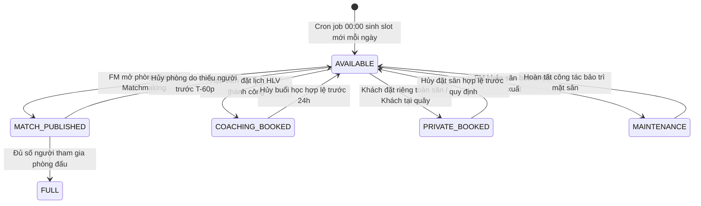

#### 4. Quy tắc nghiệp vụ (Business Rules)
- **BR-08 (Khóa slot chống trùng lịch):** Áp dụng cơ chế Khóa nguyên tử (Atomic Lock) khi có giao dịch cọc slot, tuyệt đối chống trùng lịch (Overbooking).
- **BR-09 (Xử lý sân Inactive):** Khi chuyển sân sang `Inactive`, tự động khóa các slot trống; slot đã có người đặt bắt buộc điều chuyển sang sân trống tương đương hoặc hoàn tiền.

---### NHÓM 3: SOCIAL MATCHMAKING (GHÉP TRẬN THEO TRÌNH ĐỘ)

---

### WF-06: Field Manager Tạo & Công bố Phòng Ghép trận (Match Publishing)

#### 1. Mô tả nghiệp vụ
Field Manager chọn một slot trống trong ngày, cấu hình trình độ DUPR yêu cầu, số lượng người tham gia và giá tham gia theo đầu người để công bố lên bảng tin ghép trận toàn khu vực Thủ Đức.

#### 2. Kịch bản phân bước (Sequence Diagram)

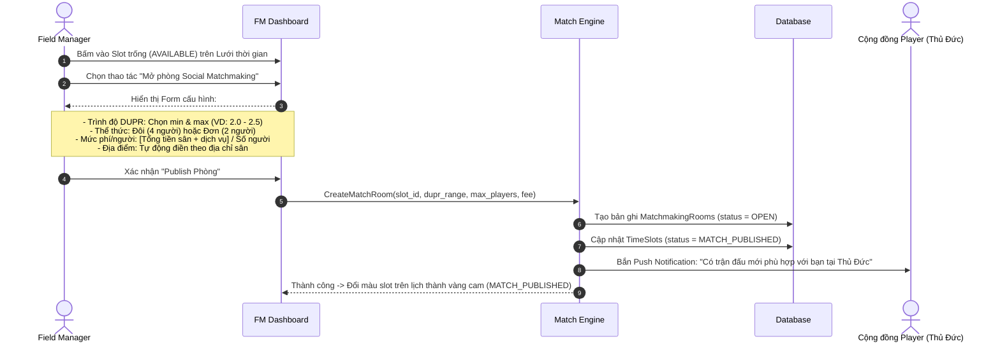

---

### WF-07: Người chơi Tìm kiếm, Đăng ký Ghép trận & Check-in QR

#### 1. Mô tả nghiệp vụ
Người chơi tìm phòng chơi quanh khu vực Thủ Đức, kiểm tra độ tương thích DUPR, thanh toán tiền cọc để giữ chỗ, nhận mã QR check-in tại quầy sân.

#### 2. Sơ đồ luồng nghiệp vụ chi tiết (Flowchart)

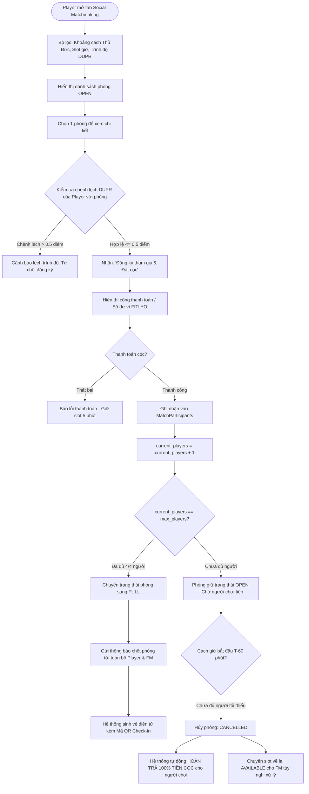

#### 3. Quy tắc nghiệp vụ (Business Rules)
- **BR-10 (Kiểm soát trình độ DUPR):** Người chơi không được tham gia phòng có độ lệch DUPR quá $\pm 0.5$ điểm.
- **BR-11 (Chính sách hủy trận từ Player):**
  - **Player Free:** Được hủy trận và nhận lại 100% cọc nếu hủy trước giờ bắt đầu ít nhất **12 tiếng**. Sau 12 tiếng, mất toàn bộ cọc.
  - **Player Premium:** Hưởng đặc quyền hủy trận miễn phí trước giờ bắt đầu **4 tiếng**.
- **BR-12 (Tự động giải tán phòng):** Nếu trước giờ thi đấu 60 phút mà phòng vẫn chưa đạt đủ số lượng người tối thiểu (tối thiểu 4 người cho đôi, 2 người cho đơn), phòng tự động hủy (`CANCELLED`) và hệ thống hoàn trả tiền cọc 100% ngay lập tức.

---

### WF-08: Kết thúc Trận đấu, Chấm điểm Uy tín & Đánh giá DUPR

#### 1. Mô tả nghiệp vụ
Sau khi kết thúc 90 phút thi đấu, hệ thống kích hoạt form đánh giá chéo giữa các đấu thủ nhằm bảo vệ môi trường thể thao trung thực, kiểm soát hiện tượng "smurfing" (gian lận hạ điểm DUPR).

#### 2. Bảng cơ chế cộng/trừ Điểm uy tín (Reputation Score)
| Tình huống thực tế | Hành vi ghi nhận | Biện pháp xử lý của Hệ thống |
| :--- | :--- | :--- |
| Đến đúng giờ, thi đấu văn minh | 100% bạn chơi đánh giá 5 sao | **+2 Điểm Uy tín** |
| Đi trễ 10 - 20 phút | Bạn chơi phản ánh đi muộn | **-5 Điểm Uy tín** |
| Bỏ trận không báo trước (No-show) | Vắng mặt, không check-in | **-20 Điểm Uy tín**, phạt 100% cọc |
| Gian lận hạ điểm DUPR ("Smurfing") | Trình cao cố tình đánh phòng người mới | Kích hoạt cờ cảnh báo, chuyển Admin thẩm tra |

---### NHÓM 4: ĐẶT LỊCH HUẤN LUYỆN VIÊN & KHÓA HỌC (COACH BOOKING & COURSES)

---

### WF-09: Đặt lịch Huấn luyện viên Buổi lẻ (Single Session Booking)

#### 1. Mô tả nghiệp vụ
Người chơi tìm kiếm HLV theo địa điểm, trình độ mong muốn và đặt 1 buổi tập lẻ 90 phút theo nhu cầu chỉnh sửa kỹ thuật cá nhân.

#### 2. Sơ đồ tuần tự (Sequence Diagram)

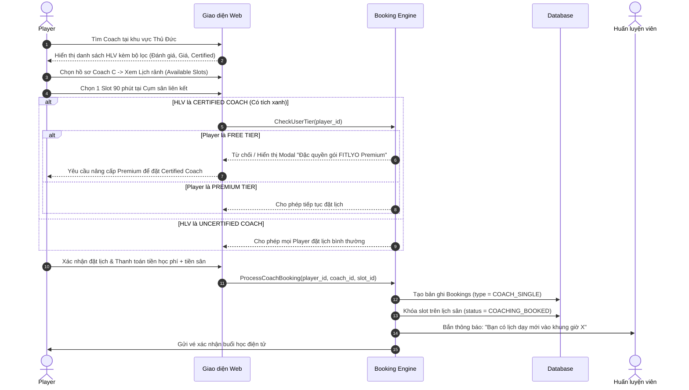

---

### WF-10: Khởi tạo, Đăng ký & Vận hành Khóa học Dài hạn (Courses Lifecycle)

#### 1. Mô tả nghiệp vụ
Quy chuẩn hóa hoạt động đào tạo bài bản với các khóa học dài hạn: Thời lượng chuẩn **1 tháng** (tối thiểu 1 tuần, tối đa 3 tháng), tần suất chuẩn **2 buổi/tuần**.

#### 2. Vòng đời Khóa học (Course Lifecycle State Diagram)

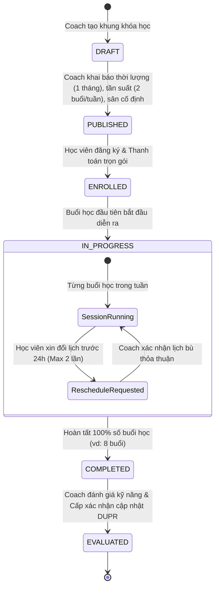

#### 3. Quy tắc nghiệp vụ (Business Rules)
- **BR-13 (Quyền hạn tạo Khóa học):** Chỉ **Certified Coach** mới được quyền tạo khóa học dài hạn (Courses).
- **BR-14 (Tiêu chuẩn Khóa học):**
  - Thời lượng khóa học: Mặc định **1 tháng (4 tuần)**. Giới hạn tối thiểu **1 tuần**, tối đa **3 tháng**.
  - Tần suất học: Mặc định **2 buổi / tuần**.
- **BR-15 (Dời lịch học):** Học viên được xin dời lịch tối đa **2 lần / khóa**, bắt buộc gửi yêu cầu trên hệ thống trước giờ học ít nhất **24 tiếng**.

---

### NHÓM 5: NÂNG CẤP & QUẢN TRỊ GÓI HỘI VIÊN FITLYO PREMIUM

---

### WF-11: Nâng cấp Gói Hội viên FITLYO Premium & Kích hoạt Đặc quyền

#### 1. Mô tả nghiệp vụ
Mô hình thuê bao (Subscription) mang lại nguồn doanh thu ổn định cho nền tảng và cung cấp trải nghiệm thể thao cao cấp cho người chơi nghiêm túc.

#### 2. Bảng ma trận so sánh quyền lợi gói Hội viên
| Quyền lợi người dùng | Player Free | FITLYO Premium |
| :--- | :---: | :---: |
| Tìm kiếm sân & xem slot trống | ✓ | ✓ |
| Tham gia ghép trận Social Matchmaking | Tiêu chuẩn | **Ưu tiên giữ chỗ & Huy hiệu VIP** |
| Thông báo slot mở sớm | Không | **Nhận thông báo sớm 15 phút** |
| Thời hạn hủy trận Social miễn phí | Trước 12 tiếng | **Trước 4 tiếng** |
| Đặt lịch Huấn luyện viên Uncertified | ✓ | ✓ |
| Đặt lịch Huấn luyện viên Certified (Có chứng chỉ) | Giới hạn / Không | **Toàn quyền đặt lịch** |
| Cá nhân hóa Lịch học & Giáo trình riêng | ✗ | **Được hỗ trợ xếp lịch linh hoạt** |

---### NHÓM 6: XỬ LÝ NGOẠI LỆ, TRANH CHẤP & BẤT KHẢ KHÁNG

---

### WF-12: Hủy Slot do Điều kiện Bất khả kháng (Thời tiết xấu / Sự cố sân)

#### 1. Mô tả nghiệp vụ
Khu vực TP. Thủ Đức có nhiều sân ngoài trời chịu ảnh hưởng bởi mưa lớn, hoặc sự cố hỏng đèn chiếu sáng buổi tối. Hệ thống cung cấp cơ chế hủy khẩn cấp và hoàn tiền tự động 100% để bảo vệ uy tín nền tảng.

#### 2. Sơ đồ tuần tự xử lý hoàn tiền (Sequence Diagram)

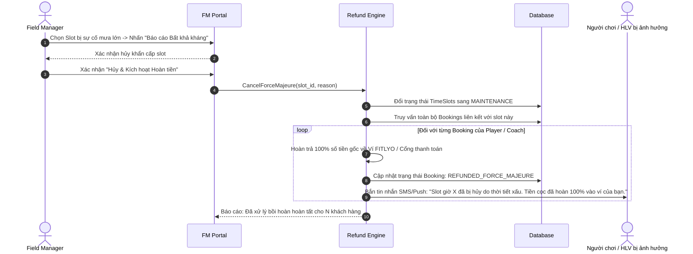

---

### WF-13: Xử lý Khiếu nại, Tố cáo Gian lận Trình độ & Phạt No-Show

#### 1. Mô tả nghiệp vụ
Tiếp nhận và xử lý khiếu nại về hành vi phi thể thao, gian lận điểm số DUPR, hoặc bỏ trận không lý do làm hỏng trải nghiệm của người chơi khác.

#### 2. Sơ đồ xử lý vi phạm (Flowchart)

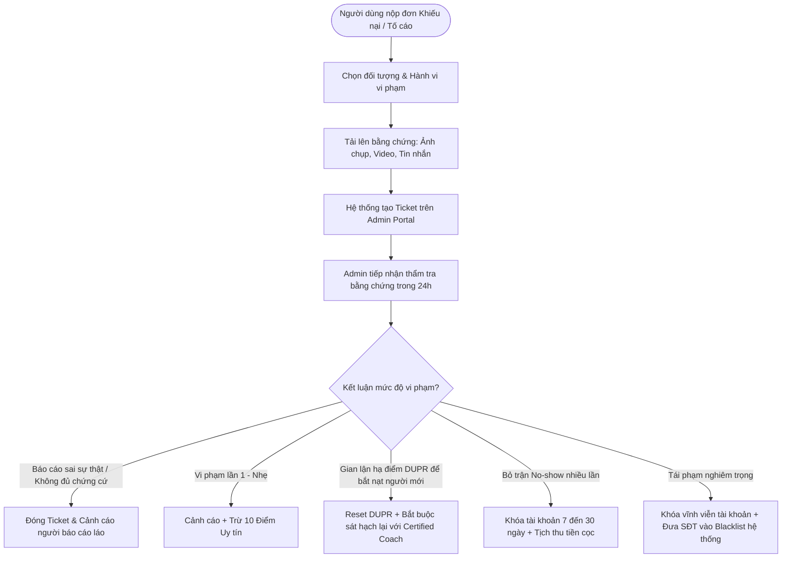

---

## 3. MA TRẬN TRẠNG THÁI CÁC THỰC THỂ CỐT LÕI (STATE MACHINE CONSOLIDATION)

| Thực thể dữ liệu | Các trạng thái khả dụng (States) | Điều kiện kích hoạt chuyển trạng thái (Transitions) |
| :--- | :--- | :--- |
| **`Users`** | `UNVERIFIED`, `VERIFIED`, `SUSPENDED`, `BANNED` | Mới tạo: `UNVERIFIED` $\rightarrow$ Nhập OTP SĐT đúng: `VERIFIED` $\rightarrow$ Vi phạm nặng: `SUSPENDED` / `BANNED`. |
| **`Venues`** | `PENDING_LEGAL`, `APPROVED`, `REJECTED`, `INACTIVE` | Nộp hồ sơ: `PENDING_LEGAL` $\rightarrow$ Admin duyệt GPKD: `APPROVED` (hiển thị trên sàn). |
| **`Courts`** | `ACTIVE`, `INACTIVE`, `MAINTENANCE` | FM có thể bật/tắt độc lập từng sân con trong cơ sở để phục vụ sửa chữa. |
| **`TimeSlots`** | `AVAILABLE`, `MATCH_PUBLISHED`, `COACHING_BOOKED`, `PRIVATE_BOOKED`, `MAINTENANCE` | Sinh tự động 6 slot/ngày lúc 00:00: `AVAILABLE` $\rightarrow$ Khóa nguyên tử khi có khách cọc hoặc ghép trận. |
| **`MatchmakingRooms`**| `OPEN`, `FULL`, `IN_PROGRESS`, `FINISHED`, `CANCELLED` | Tạo phòng: `OPEN` $\rightarrow$ Đủ 4 người: `FULL` $\rightarrow$ Hết giờ: `FINISHED`. Thiếu người trước T-60p: `CANCELLED`. |
| **`Courses`** | `DRAFT`, `PUBLISHED`, `ENROLLED`, `IN_PROGRESS`, `COMPLETED` | Coach tạo: `DRAFT` $\rightarrow$ Mở bán: `PUBLISHED` $\rightarrow$ Học viên ghi danh: `ENROLLED` $\rightarrow$ Kết thúc: `COMPLETED`. |

---

## 4. BẢNG TỔNG HỢP QUY TẮC NGHIỆP VỤ HỆ THỐNG (BUSINESS RULES INVENTORY)

| Mã BR | Tên quy tắc nghiệp vụ | Phân hệ áp dụng | Nội dung quy định chi tiết |
| :---: | :--- | :--- | :--- |
| **BR-01** | Bắt buộc Xác thực SĐT | Authentication | Mọi tài khoản mới tạo mặc định là `UNVERIFIED`. Bắt buộc nhập OTP số điện thoại để đạt `VERIFIED`. Chỉ tài khoản `VERIFIED` mới được thực hiện đặt cọc, thanh toán và thi đấu. |
| **BR-02** | 2FA Bắt buộc Quản trị | Security / Admin | Mọi tài khoản có quyền `FIELD_MANAGER` hoặc `ADMIN` bắt buộc kích hoạt xác thực 2 lớp qua Email hoặc SMS OTP khi đăng nhập. |
| **BR-03** | Khóa đăng nhập chống Brute-force | Security | Khóa tạm thời 15 phút nếu người dùng nhập sai mật khẩu hoặc mã OTP quá 5 lần liên tiếp. |
| **BR-04** | Hạn mức Sân tối đa | Quản lý sân | Số lượng sân hoạt động không được vượt quá số lượng sân (`total_courts`) đã đăng ký trong Giấy phép kinh doanh được Admin duyệt. |
| **BR-05** | Hiển thị Sân trên sàn | Quản lý sân | Cụm sân chỉ hiển thị trên sàn tìm kiếm khi trạng thái pháp lý là `APPROVED` và cờ `is_active = true`. |
| **BR-06** | Giới hạn Uncertified Coach | Huấn luyện viên | HLV chưa qua thẩm định chứng chỉ không được nhận học viên Certified của gói Premium và mức học phí không vượt quá 200.000 VNĐ / slot 90p. |
| **BR-07** | Quyền hạn Certified Coach | Huấn luyện viên | HLV có chứng chỉ quốc tế được gắn Tích Xanh, toàn quyền mở Khóa học dài hạn và nhận dạy học viên Premium. |
| **BR-08** | Khóa slot chống trùng lịch | Vận hành Slot | Áp dụng cơ chế Khóa nguyên tử (Atomic Lock) khi có giao dịch cọc slot, tuyệt đối chống trùng lịch (Overbooking). |
| **BR-09** | Xử lý Sân đóng cửa | Vận hành Sân | Khi chuyển sân sang `Inactive`, tự động khóa các slot trống; slot đã có người đặt bắt buộc điều chuyển sang sân trống tương đương hoặc hoàn tiền. |
| **BR-10** | Biên độ ghép trận DUPR | Social Matchmaking | Điểm DUPR của người chơi không được chênh lệch quá $\pm 0.5$ điểm so với yêu cầu phòng đấu. |
| **BR-11** | Chính sách hủy trận Social | Social Matchmaking | Người chơi Free được hủy hoàn cọc trước **12 tiếng**. Người chơi Premium được hủy hoàn cọc trước **4 tiếng**. |
| **BR-12** | Tự động hủy phòng thiếu người | Social Matchmaking | Trước giờ thi đấu **60 phút**, nếu phòng chưa đủ số lượng người chơi tối thiểu, hệ thống tự động giải tán phòng và hoàn 100% cọc ngay lập tức. |
| **BR-13** | Quyền hạn tạo Khóa học | Đào tạo Coach | Chỉ Huấn luyện viên đạt chuẩn `Certified Coach` mới được phép thiết lập và công bố Khóa học (Courses). |
| **BR-14** | Tiêu chuẩn Khóa học | Đào tạo Coach | Thời lượng khóa học: Mặc định **1 tháng (4 tuần)** (min 1 tuần, max 3 tháng). Tần suất: Mặc định **2 buổi / tuần**. |
| **BR-15** | Dời lịch học Khóa học | Đào tạo Coach | Học viên được xin dời lịch tối đa **2 lần / khóa**, bắt buộc gửi yêu cầu trên hệ thống trước giờ học ít nhất **24 tiếng**. |
| **BR-16** | Hoàn tiền Bất khả kháng | Bất khả kháng | Khi FM hủy slot do thời tiết mưa lớn hoặc sự cố sân, hệ thống hoàn tiền 100% gốc cho toàn bộ người chơi và HLV. |
| **BR-17** | Điểm Uy tín sàn FITLYO | Đánh giá & Kỷ luật | Điểm uy tín khởi điểm: 100. Dưới 80 điểm bị hạn chế ghép trận giờ vàng; dưới 50 điểm bị đình chỉ tài khoản tạm thời. |

---

> **Khuyến nghị triển khai kỹ thuật dành cho Team Dev:**  
> - Các luồng nghiệp vụ trên đã được thiết kế tương thích trực tiếp với sơ đồ dữ liệu và quy định tại `FITLYO_PRD_Yeu_Cau_Phan_Mem - Publish.md`.  
> - Khuyến nghị Backend sử dụng Redis Distributed Lock cho **BR-08** (đặt slot) và Message Queue (RabbitMQ / BullMQ) cho **BR-12** (tự động kiểm tra và hủy phòng lúc T-60 phút).